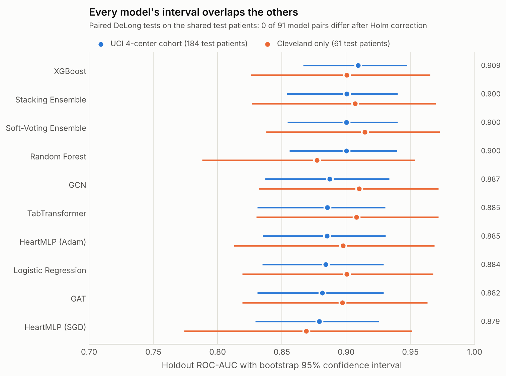
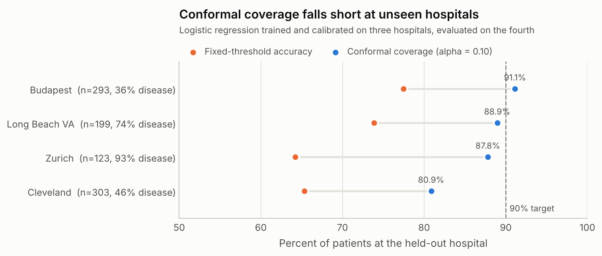
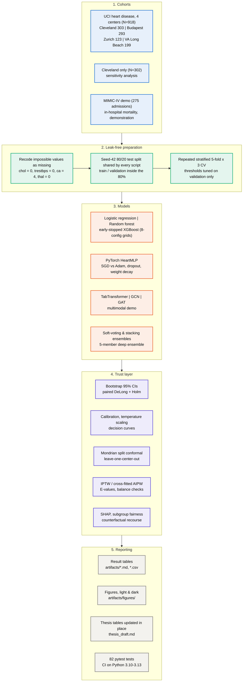

# Trustworthy Cardiovascular & ICU Clinical ML Pipeline

[](https://github.com/YahyaLendani/heart-disease-clinical-ml/actions/workflows/ci.yml)
[](https://www.python.org/downloads/)
[](https://pytorch.org/)
[](https://scikit-learn.org/)
[](https://xgboost.readthedocs.io/)
[](tests/)
[](https://github.com/astral-sh/ruff)
[](LICENSE)

An end-to-end, test-verified clinical machine-learning pipeline for **heart-disease diagnosis** on the four UCI centers (*Cleveland, Budapest, Zurich, VA Long Beach*; 918 patients) and a demonstration of **in-hospital mortality prediction** on the MIMIC-IV demo.

Beyond ranking classifiers, it asks whether a model can be trusted at the bedside: how precise its scores are (bootstrap confidence intervals, paired DeLong tests), whether it holds up at an unseen hospital (leave-one-center-out with conformal prediction), whether its probabilities are calibrated and clinically useful (temperature scaling, decision curves), who it fails (subgroup fairness audit), and what would change its prediction (causal effect estimates and counterfactual recourse). Every table and figure below is regenerated by one command, `heart-pipeline`.

---

## Key Findings

<p align="center">
  <picture>
    <source media="(prefers-color-scheme: dark)" srcset="artifacts/figures/model_auc_forest_dark.png">
    
  </picture>
</p>

1. **No model is significantly better than any other.** On the 184 test patients of the 4-center cohort, holdout ROC-AUC ranges from 0.879 (HeartMLP with SGD) to 0.909 (XGBoost). Each interval is about ±0.04 wide, and paired DeLong tests find **0 of 91 model pairs** different after Holm correction. Logistic regression is within 0.025 AUC of everything else. On the 61-patient Cleveland split the order reshuffles and the intervals roughly double.
2. **Conformal guarantees do not carry over to a new hospital.** Calibrated on three centers and tested on the fourth, 90% conformal prediction sets reach only 80.9–91.1% coverage (chart below). Within one cohort the same method reaches 88.6% coverage and sends 25.5% of patients to review.
3. **The model misses disease in women three times as often as in men.** The false-negative rate is 25.0% for 35 female test patients and 7.4% for 149 male ones. Equal-opportunity thresholds narrow the sensitivity gap only from 0.226 to 0.215.
4. **The causal estimates are inconclusive.** After propensity weighting, 7 of 12 covariates stay imbalanced. Both doubly robust (AIPW) effect intervals include zero, and both point estimates flip sign relative to the Cleveland-only cohort.

<p align="center">
  <picture>
    <source media="(prefers-color-scheme: dark)" srcset="artifacts/figures/loco_conformal_coverage_dark.png">
    
  </picture>
</p>

---

## Table of Contents

- [Key Findings](#key-findings)
- [Clinical Context](#clinical-context)
- [Pipeline Overview](#pipeline-overview)
- [Results](#results)
  - [1. Holdout and Repeated Cross-Validation](#1-holdout-and-repeated-cross-validation)
  - [2. Leave-One-Center-Out Generalization](#2-leave-one-center-out-generalization)
  - [3. Uncertainty, Causality, Fairness and Recourse](#3-uncertainty-causality-fairness-and-recourse)
- [Figure Gallery](#figure-gallery)
- [Quick Start](#quick-start)
- [Step-by-Step Replication](#step-by-step-replication)
- [Repository Structure](#repository-structure)
- [Methods and Reading List](#methods-and-reading-list)
- [Citation](#citation)
- [License](#license)

---

## Clinical Context

A single holdout ROC-AUC says little about whether a model is safe to use:

1. **Hospitals differ.** Disease prevalence ranges from **36.2%** in Budapest to **93.5%** in Zurich, so a probability threshold chosen at one site misfires at another.
2. **Small test sets give noisy rankings.** With 61 test patients (Cleveland alone) a ROC-AUC is only known to about ±0.08, wider than the gaps between models.
3. **Neural probabilities are often overconfident**, which distorts risk stratification and decision-curve net benefit.
4. **Correlation is not causation.** Exercise angina and hypertension are tangled up with age, sex and other findings.
5. **A risk score alone is not actionable.** Clinicians also need to know which modifiable factors drive a prediction.

Each point maps to a stage of the pipeline below, and each stage is covered by the test suite.

---

## Pipeline Overview



---

## Results

### 1. Holdout and Repeated Cross-Validation

**Primary benchmark:** the 918-patient 4-center cohort (`data/processed/cleaned_heart_disease_combined.csv`). All scripts share the same seed-42 split, so every model is scored on the same **184 test patients**. That is three times Cleveland's 61, which halves the confidence-interval width (about ±0.04 instead of ±0.08 ROC-AUC). Zero-coded cholesterol (172 patients) and blood pressure (1 patient) are recoded as missing. Left in, `chol = 0` flags almost every Zurich patient (93.5% prevalence) and becomes a site shortcut.

**How to read the tables:**
- Holdout metrics carry stratified bootstrap **95% confidence intervals** (1,000 resamples).
- CV columns are **repeated stratified 5-fold CV**, 5 folds × 3 repeats = 15 folds, shown as mean ± SD.
- Model, optimizer, hyperparameter, early-stopping and threshold choices use validation data or CV only, never the test set.
- `artifacts/model_comparison.md` holds the pairwise DeLong tests. None of the 91 pairs is significant; the smallest Holm-adjusted p is 1.0.

#### Classical baselines and HeartMLP

Random Forest and XGBoost are each tuned over an 8-configuration grid (`artifacts/hyperparameter_search_*.csv`). CV runs on each script's training portion: 60% train for the baselines, 80% train+validation for HeartMLP.

| Model | Category | Test Accuracy | Test ROC-AUC [95% CI] | Test PR-AUC | Test Brier ↓ | CV ROC-AUC (15 folds) | CV Brier ↓ |
| :--- | :--- | :---: | :---: | :---: | :---: | :---: | :---: |
| **XGBoost** | Gradient-boosted trees | 0.832 | 0.909 [0.867, 0.947] | 0.924 | 0.121 | 0.878 ± 0.022 | 0.139 ± 0.015 |
| **Random Forest** | Bagged decision trees | 0.815 | 0.900 [0.856, 0.939] | 0.916 | 0.130 | 0.877 ± 0.025 | 0.143 ± 0.011 |
| **Logistic Regression** | Linear baseline | 0.804 | 0.884 [0.835, 0.929] | 0.912 | 0.137 | 0.871 ± 0.022 | 0.143 ± 0.015 |
| **HeartMLP (Adam)** | Feedforward network | 0.810 | 0.885 [0.835, 0.931] | 0.898 | 0.139 | 0.859 ± 0.038 | 0.155 ± 0.030 |
| **HeartMLP (SGD)** | Feedforward network | 0.793 | 0.879 [0.829, 0.925] | 0.899 | 0.148 | 0.854 ± 0.035 | 0.162 ± 0.029 |

The soft-voting and stacking ensembles (`artifacts/ensemble_comparison.md`) both reach a holdout ROC-AUC of **0.900 [0.854, 0.940]**, no better than XGBoost alone.

#### Reading-list architectures

The holdout uses the same test patients. In CV, each of the 5 × 3 folds of the full cohort serves as the test set once, and the rest is split 75/25 into train and validation. Weights come from the epoch with the lowest validation loss.

| Model | Category | Test Accuracy | Test ROC-AUC [95% CI] | Test PR-AUC | Test Brier ↓ | CV ROC-AUC (15 folds) | CV Brier ↓ |
| :--- | :--- | :---: | :---: | :---: | :---: | :---: | :---: |
| **GCN (Kipf & Welling, 2017)** | Spectral graph convnet | 0.799 | 0.887 [0.837, 0.934] | 0.899 | 0.135 | 0.878 ± 0.026 | 0.138 ± 0.016 |
| **TabTransformer (Huang et al., 2020)** | Contextual self-attention | 0.799 | 0.885 [0.831, 0.931] | 0.904 | 0.138 | 0.866 ± 0.029 | 0.147 ± 0.016 |
| **GAT (Veličković et al., 2018)** | Graph attention network | 0.810 | 0.882 [0.831, 0.929] | 0.905 | 0.138 | 0.874 ± 0.033 | 0.142 ± 0.021 |
| **Multimodal Cross-Attention †** | Synthetic-signal demo | 0.663 | 0.698 [0.620, 0.778] | 0.769 | 0.218 | 0.704 ± 0.043 | 0.216 ± 0.012 |

† Demonstration only. Its "waveform" channel is synthesised from the same tabular features, so it adds no information and is left out of the rankings and the DeLong tests.

#### Operating thresholds (tuned on validation, applied to test)

| Model | Threshold (F1) | Test F1 at that threshold | Threshold (Youden's J) | Test Youden's J |
| :--- | :---: | :---: | :---: | :---: |
| **XGBoost** | 0.469 | 0.854 | 0.523 | 0.668 |
| **Random Forest** | 0.429 | 0.829 | 0.643 | 0.579 |
| **Logistic Regression** | 0.508 | 0.831 | 0.508 | 0.611 |

#### Sensitivity analysis: Cleveland-only cohort (302 patients, 61 test patients)

This is the same pipeline run with `--dataset cleaned_heart_disease.csv`; full outputs are in `artifacts/cleveland/`. Rankings shuffle relative to the primary cohort (GCN and TabTransformer move to the top), the intervals are about twice as wide, and again 0 of 91 pairs differ after Holm correction.

| Model | Category | Test Accuracy | Test ROC-AUC [95% CI] | Test PR-AUC | Test Brier ↓ | CV ROC-AUC (15 folds) | CV Brier ↓ |
| :--- | :--- | :---: | :---: | :---: | :---: | :---: | :---: |
| **XGBoost** | Gradient-boosted trees | 0.803 | 0.900 [0.826, 0.965] | 0.885 | 0.133 | 0.907 ± 0.048 | 0.122 ± 0.039 |
| **Random Forest** | Bagged decision trees | 0.803 | 0.877 [0.788, 0.953] | 0.871 | 0.144 | 0.913 ± 0.046 | 0.120 ± 0.031 |
| **Logistic Regression** | Linear baseline | 0.836 | 0.900 [0.819, 0.968] | 0.883 | 0.129 | 0.898 ± 0.051 | 0.127 ± 0.039 |
| **HeartMLP (Adam)** | Feedforward network | 0.803 | 0.898 [0.813, 0.969] | 0.852 | 0.145 | 0.882 ± 0.063 | 0.156 ± 0.063 |
| **HeartMLP (SGD)** | Feedforward network | 0.770 | 0.869 [0.774, 0.951] | 0.817 | 0.171 | 0.816 ± 0.130 | 0.198 ± 0.092 |
| **GCN (Kipf & Welling, 2017)** | Spectral graph convnet | 0.803 | 0.910 [0.832, 0.972] | 0.864 | 0.130 | 0.915 ± 0.025 | 0.119 ± 0.017 |
| **TabTransformer (Huang et al., 2020)** | Contextual self-attention | 0.820 | 0.908 [0.830, 0.972] | 0.871 | 0.125 | 0.894 ± 0.027 | 0.135 ± 0.022 |
| **GAT (Veličković et al., 2018)** | Graph attention network | 0.820 | 0.897 [0.819, 0.963] | 0.854 | 0.135 | 0.910 ± 0.030 | 0.124 ± 0.024 |
| **Multimodal Cross-Attention †** | Synthetic-signal demo | 0.672 | 0.690 [0.554, 0.821] | 0.646 | 0.223 | 0.682 ± 0.069 | 0.228 ± 0.026 |

> **MIMIC-IV (demonstration only):** the bundled demo extract has 275 admissions and 15 deaths, so its test split holds only 3 deaths and holdout ROC-AUC intervals span roughly 0.1–1.0. `artifacts/mimic_baseline_comparison.md` shows the pipeline running on ICU data with patient-grouped splits, repeated CV and bootstrap CIs. It is not a model ranking; a real mortality study needs credentialed access to the full MIMIC-IV database.

### 2. Leave-One-Center-Out Generalization

A logistic regression is trained on three centers and tested zero-shot on the fourth. **Split conformal prediction** (α = 0.10, 90% target) is calibrated on the three source centers. Coverage at the unseen hospital falls short of 90% at three of four centers. Deferral rises with the shift, as intended, but the exchangeability-based guarantee does not transfer across hospitals.

| Held-out center | N | Disease prevalence | Fixed-threshold accuracy | Conformal coverage (90% target) | Mean set size | Deferral rate |
| :--- | :---: | :---: | :---: | :---: | :---: | :---: |
| **Cleveland** | 303 | 45.9% | 65.3% | 80.9% | 1.22 | 22.4% |
| **Budapest (Hungarian)** | 293 | 36.2% | 77.5% | 91.1% | 1.32 | 32.1% |
| **Zurich (Switzerland)** | 123 | 93.5% | 64.2% | 87.8% | 1.38 | 38.2% |
| **VA Long Beach** | 199 | 74.4% | 73.9% | 88.9% | 1.32 | 31.7% |

No model family transfers best everywhere. Random Forest is best on Cleveland and Zurich, logistic regression on Budapest and Long Beach (`artifacts/cross_center_generalization.md`).

### 3. Uncertainty, Causality, Fairness and Recourse

All numbers come from the 184-patient holdout of the primary cohort (`artifacts/reading_list_advancements_summary.md`).

- **Conformal triage (Angelopoulos & Bates, 2021).** Calibration and test scores use the same uncalibrated HeartMLP probabilities, as the finite-sample guarantee requires.
  - At α = 0.10, coverage is **88.6%** (87.3% on disease cases, 90.2% on controls), mean set size is 1.255 and **25.5%** of patients are deferred.
  - At α = 0.15, deferral falls to **15.2%** with 86.4% coverage.
  - At α = 0.05, coverage is 95.1% with 52.7% deferral.
- **Calibration and deep ensembles (Guo et al., 2017; Lakshminarayanan et al., 2017).** Validation-tuned temperature scaling (T\* = 1.455) lowers holdout ECE from 0.073 to 0.067. A 5-member deep ensemble has a mean epistemic variance of 0.0049.
- **Causal inference (Pearl & Mackenzie, 2018; Chernozhukov et al., 2018; VanderWeele & Ding, 2017).**
  - **IPTW:** the naive risk difference for exercise angina (0.446) shrinks to 0.075 after weighting. The largest |SMD| drops from 0.961 to 0.264, but **7 of 12 covariates** stay at or above 0.10, so residual confounding cannot be ruled out.
  - **Cross-fitted AIPW:** the exercise-angina ATE is +0.060 (95% CI −0.047 to 0.167, E-value 1.457). The stage 2 hypertension ATE is −0.013 (95% CI −0.069 to 0.042, E-value 1.184). Both intervals include zero.
- **Equal-opportunity thresholds (Barocas et al., 2020).** Group thresholds maximise Youden's J under a sensitivity-parity constraint. On this cohort they narrow the test sensitivity gap only from 0.226 to 0.215, with no change in false-positive rate. On Cleveland, one group's threshold collapses to 0.05 and the report flags it.
- **Counterfactual recourse (Wachter et al., 2017; Ustun et al., 2019).**
  - **80.0%** of high-risk test patients reach the 0.30 risk target, with mean predicted risk falling by 0.519.
  - Immutable attributes (`age`, `sex`, `fbs`) never change.
  - About 7.8 features change per patient, so these explain the model rather than prescribe treatment.
  - **100%** of patients the conformal step rated high-risk leave the {1} set under the model.

---

## Figure Gallery

Every figure is regenerated by the pipeline into `artifacts/figures/` (Cleveland copies in `artifacts/cleveland/figures/`). They share one style (`evaluation/plot_style.py`): a palette checked for colour-vision deficiency, legends or direct labels on every multi-series chart, and the cohort and test-set size in each subtitle. The two summary charts above also come in dark versions.

### 1. Clinical utility: decision curves and precision–recall

<table>
  <tr>
    <td width="50%" align="center">
      
      <br/>
      <em><b>Figure 1A:</b> Decision curve analysis on the 184 test patients. All three baselines beat both "treat all" and "treat none" at every threshold from 0.10 to 0.75 (checked numerically, and also true on Cleveland). These are point estimates without confidence bands.</em>
    </td>
    <td width="50%" align="center">
      
      <br/>
      <em><b>Figure 1B:</b> Precision–recall curves against the no-skill line at the 0.55 prevalence. Holdout PR-AUC is 0.912–0.924 for the baselines.</em>
    </td>
  </tr>
</table>

### 2. Explainability (SHAP)

<table>
  <tr>
    <td width="33%" align="center">
      
      <br/>
      <em><b>Figure 2A:</b> SHAP summary for <code>HeartMLP</code> (Adam).</em>
    </td>
    <td width="33%" align="center">
      
      <br/>
      <em><b>Figure 2B:</b> TreeSHAP summary for Random Forest.</em>
    </td>
    <td width="33%" align="center">
      
      <br/>
      <em><b>Figure 2C:</b> TreeSHAP summary for XGBoost.</em>
    </td>
  </tr>
</table>

<table>
  <tr>
    <td width="50%" align="center">
      
      <br/>
      <em><b>Figure 2D:</b> One high-risk patient, decomposed by <code>HeartMLP</code>.</em>
    </td>
    <td width="50%" align="center">
      
      <br/>
      <em><b>Figure 2E:</b> The same kind of decomposition from Random Forest.</em>
    </td>
  </tr>
</table>

- **All three models agree on the leading features.** On the 4-center cohort, HeartMLP, Random Forest and XGBoost all rank **chest-pain type (`cp`)** first, with **exercise-induced angina (`exang`)** and **ST depression (`oldpeak`)** next (`artifacts/figures/shap_top_features.csv`). Fluoroscopy vessel count (`ca`) and thallium results (`thal`), which dominate on Cleveland alone, rank lower here because most Budapest, Zurich and Long Beach patients have no recorded value for them.
- **Higher scores are tendencies, not proven advantages.** XGBoost has the top holdout ROC-AUC (0.909) and lowest Brier score (0.121), and shares the top CV ROC-AUC with Random Forest (0.878 and 0.877), but no paired DeLong test separates it from the others. Logistic regression stays within 0.025 AUC and offers directly interpretable odds ratios.

### 3. Conformal triage and calibration

<table>
  <tr>
    <td width="50%" align="center">
      
      <br/>
      <em><b>Figure 3A:</b> Left, empirical coverage against the target 1 − α, overall and by class. Right, how patients split into rule-out {0}, rule-in {1} and defer {0, 1} as the target rises.</em>
    </td>
    <td width="50%" align="center">
      
      <br/>
      <em><b>Figure 3B:</b> Reliability diagram with Brier scores and the distribution of predicted probabilities. With 184 test patients the per-bin estimates are noisy.</em>
    </td>
  </tr>
</table>

### 4. Fairness audit

<div align="center">
  
  <br/>
  <em><b>Figure 4:</b> XGBoost at threshold 0.5 by sex and age group (younger &lt;50, middle-aged 50–64, senior ≥65), with group sizes in the labels. Sick women are missed in 25.0% of cases against 7.4% for men.</em>
</div>

### 5. Causal balance and counterfactual recourse

<table>
  <tr>
    <td width="50%" align="center">
      
      <br/>
      <em><b>Figure 5A:</b> Covariate balance before and after propensity weighting for exercise angina. Weighting brings the largest |SMD| down from 0.961 to 0.264, but 7 of 12 covariates stay above the 0.10 line.</em>
    </td>
    <td width="50%" align="center">
      
      <br/>
      <em><b>Figure 5B:</b> Counterfactual for one high-risk patient. Modifiable features move within their observed range, age, sex and fasting blood sugar stay locked, and predicted risk drops below the 30% target.</em>
    </td>
  </tr>
</table>

### 6. Training dynamics

<table>
  <tr>
    <td width="50%" align="center">
      
      <br/>
      <em><b>Figure 6A:</b> HeartMLP (Adam) loss and validation accuracy. The marked epoch is the checkpoint kept (lowest validation loss). See also <code>artifacts/training_curves_sgd.png</code>.</em>
    </td>
    <td width="50%" align="center">
      
      <br/>
      <em><b>Figure 6B:</b> XGBoost validation log-loss by boosting round, with the early-stopping round marked.</em>
    </td>
  </tr>
</table>

---

## Quick Start

### 1. Install

```bash
git clone https://github.com/YahyaLendani/heart-disease-clinical-ml.git
cd heart-disease-clinical-ml
python -m venv .venv
source .venv/bin/activate            # Windows PowerShell: .\.venv\Scripts\Activate.ps1
pip install --upgrade pip
pip install -e ".[dev]"              # dependencies plus the heart-pipeline command
```

### 2. Run

`heart-pipeline` (or `python run_pipeline.py`) prepares the data, runs EDA, trains HeartMLP, compares the models and redraws the summary figures. Optional stages are switched on with flags. It uses a GPU when one is available (`--device auto`) and otherwise the CPU. All stages run in one Python process, with CV folds, ensemble fits and LOCO centers spread across CPU cores.

```bash
# Standard pipeline on the 918-patient cohort
heart-pipeline

# Everything: baselines, SHAP, ensembles, LOCO, fairness, reading-list suite, thesis tables
heart-pipeline --run-baselines --run-xai --run-advancements --run-reading-list --update-thesis-all

# Cleveland-only sensitivity analysis into its own folder
heart-pipeline --dataset cleaned_heart_disease.csv --output-dir artifacts/cleveland \
    --run-baselines --run-ensemble --run-reading-list

# Redraw the README summary figures from the current result tables
heart-pipeline figures

# Run the test suite (CI runs it on every push)
heart-pipeline --run-tests
```

Each stage also runs on its own as `heart-pipeline <step> [options]`. `heart-pipeline --help` lists the steps, and `heart-pipeline <step> --help` shows a step's options.

| Group | Steps |
| :--- | :--- |
| Data | `clean`, `prepare-combined`, `prepare-mimic`, `eda` |
| Heart models | `train-mlp`, `baselines`, `ensemble`, `reading-list` |
| Trust analyses | `loco`, `fairness` |
| MIMIC-IV demo | `mimic-baselines`, `mimic-mlp` |
| Experiments | `tune`, `overfit` |
| Reporting | `compare-runs`, `compare-models`, `figures`, `update-thesis`, `test` |

---

## Step-by-Step Replication

### Stage 1: Data preparation and EDA

```bash
heart-pipeline prepare-combined     # primary: 918-patient 4-center cohort from data/raw/processed.*.data
heart-pipeline clean                # Cleveland-only cohort from data/raw/heart.csv (sensitivity analysis)
heart-pipeline eda
```
- `prepare-combined` writes `data/processed/cleaned_heart_disease_combined.csv`, with zero-coded `chol`/`trestbps` recoded as missing.
- `clean` writes `data/processed/cleaned_heart_disease.csv`, with the Kaggle placeholders `ca = 4` and `thal = 0` recoded as missing.
- Every training step defaults to the 918-patient cohort; pass `--dataset cleaned_heart_disease.csv` for Cleveland only. Bare file names are looked up in `data/processed` and `data/raw`.

### Stage 2: HeartMLP (SGD vs Adam)

```bash
heart-pipeline train-mlp --optimizer both --loss bce_weighted --epochs 80 --patience 12 \
    --dropout 0.25 --weight-decay 1e-4 --cv-folds 5 --cv-repeats 3 --save-checkpoint --save-confusion
```
- Writes `heart_mlp_{sgd,adam}.pt`, `training_curves_{sgd,adam}.png`, `mlp_cv_summary.csv` and `mlp_holdout_summary.csv`.

### Stage 3: Classical baselines and paired comparison

```bash
heart-pipeline baselines --cv-folds 5 --cv-repeats 3 --xgb-early-stopping-rounds 25 --update-thesis
heart-pipeline compare-models       # paired DeLong tests of every model on the shared test patients
```
- `baselines` fits logistic regression, Random Forest and XGBoost (8-configuration grids) with repeated stratified CV, validation-tuned thresholds and bootstrap CIs, written to `artifacts/baseline_comparison.md`.
- `compare-models` reads `artifacts/test_predictions/*.csv`, which every training step writes, and produces `artifacts/model_comparison.md` with Holm-adjusted p-values.

### Stage 4: Reading-list suite

```bash
heart-pipeline reading-list --cv-folds 5 --cv-repeats 3
```
Writes `artifacts/reading_list_advancements_summary.md` and figures under `artifacts/figures/`:
1. **TabTransformer** (Huang et al., 2020) with multi-head self-attention (Vaswani et al., 2017).
2. **Patient-similarity graph networks:** GCN (Kipf & Welling, 2017) and GAT (Veličković et al., 2018).
3. **Multimodal cross-attention demo** (Baltrušaitis et al., 2018; He et al., 2016; Dosovitskiy et al., 2020). Its signal channel is synthesised from the tabular features, so it is reported but not ranked.
4. **Temperature scaling** (Guo et al., 2017) and **deep ensembles** (Lakshminarayanan et al., 2017).
5. **Split and Mondrian conformal triage** (Angelopoulos & Bates, 2021), plus leave-one-center-out generalization.
6. **IPTW, cross-fitted AIPW and E-values** (Pearl & Mackenzie, 2018; Chernozhukov et al., 2018; VanderWeele & Ding, 2017).
7. **Equal-opportunity thresholds** (Barocas, Hardt & Narayanan, 2020).
8. **Counterfactual recourse** (Wachter et al., 2017; Ustun et al., 2019).

### Stage 5: Tuning and capacity ablation

```bash
# Grid over learning rate, dropout, gradient clipping and label smoothing, ranked by repeated-CV ROC-AUC
heart-pipeline tune --epochs 30 --learning-rates 0.0005 0.001 0.005

# Overfitting across small (32,16), base (64,32) and large (128,64) networks
heart-pipeline overfit --optimizer adam --epochs 40 --cv-folds 3
```

### Stage 6: MIMIC-IV mortality demo

```bash
# Build the admission-level cohort (set MIMIC_IV_ROOT or pass --mimic-root to the extracted demo)
heart-pipeline prepare-mimic --mimic-root /path/to/mimic-iv-clinical-database-demo-2.2

# Mortality baselines with patient-grouped repeated CV, then the MLP
heart-pipeline mimic-baselines --cv-folds 5 --cv-repeats 3 --update-thesis
heart-pipeline mimic-mlp
```

### Stage 7: Reports and figures

```bash
heart-pipeline update-thesis --task all   # rewrite the auto-generated tables in thesis_draft.md
heart-pipeline figures                    # model_auc_forest and loco_conformal_coverage, light and dark
```

---

## Repository Structure

```text
heart-disease-clinical-ml/
├── .github/
│   ├── ISSUE_TEMPLATE/                          # Bug report & feature request templates
│   ├── workflows/ci.yml                         # Ruff lint, tests on Python 3.10-3.13, pipeline smoke run
│   └── pull_request_template.md                 # Scientific & engineering PR checklist
├── artifacts/                                   # Generated tables, checkpoints & curves (rebuilt by the pipeline)
│   ├── figures/                                 # All diagnostic figures, plus *_dark.png summary charts
│   ├── baseline_comparison.md                   # Baselines: holdout with 95% CIs & repeated CV
│   ├── mlp_holdout_summary.csv                  # HeartMLP holdout metrics with 95% CIs
│   ├── ensemble_comparison.md                   # Soft-voting & stacking ensembles
│   ├── reading_list_advancements_summary.md     # Deep architectures, conformal, causal, fairness, recourse
│   ├── model_comparison.md                      # Paired DeLong tests across all models
│   ├── cross_center_generalization.md           # Leave-one-center-out results
│   ├── fairness_analysis.md                     # Subgroup audit
│   ├── hyperparameter_search_*.csv              # Every Random Forest / XGBoost configuration tried
│   ├── test_predictions/                        # Per-patient test probabilities from every script
│   └── cleveland/                               # Same benchmarks on the Cleveland-only cohort
├── data/
│   ├── raw/                                     # Source files: heart.csv, cleve.mod, processed.*.data, heart-disease.names
│   └── processed/                               # Model-ready CSVs: cleaned_heart_disease*.csv, mimic_hospital_mortality*.csv
├── docs/
│   ├── AI_Thesis_Reading-List.csv               # Papers implemented by the reading-list suite
│   ├── CLINICAL_ML_VERIFICATION_REPORT.md       # System verification report
│   └── explanations/                            # Architecture & line-by-line guides
├── evaluation/
│   ├── advanced_methodology.py                  # Conformal prediction, AIPW, batched counterfactual recourse
│   ├── clinical_metrics.py                      # PR-AUC, Brier, thresholds, DCA & calibration plots
│   ├── cv_utils.py                              # Single-pass CV scorer, bootstrap CIs, n_jobs handling
│   ├── fair_mitigation.py                       # Equal-opportunity thresholds (Youden objective)
│   ├── fairness_analysis.py                     # Sex & age subgroup audit
│   ├── model_comparison.py                      # Paired DeLong tests with Holm correction
│   ├── plot_style.py                            # Shared figure style and colour-blind-safe palette
│   ├── summary_figures.py                       # README charts: ROC-AUC intervals, LOCO coverage
│   └── update_thesis_results.py                 # Writes result tables into thesis_draft.md
├── experiments/
│   ├── analyze_overfitting_network_size.py      # Capacity vs generalization ablation
│   ├── cross_center_generalization.py           # Leave-one-center-out generalization
│   ├── run_reading_list_suite.py                # Reading-list suite (holdout + repeated CV)
│   └── tune_train_model.py                      # Hyperparameter grid ranked by repeated-CV ROC-AUC
├── models/                                      # HeartMLP, TabTransformer, GCN/GAT, multimodal, temperature scaling
├── tests/                                       # pytest suite (82 tests)
├── training/
│   ├── baseline_models.py                       # Logistic regression, Random Forest & early-stopped XGBoost
│   ├── device_utils.py                          # CPU/GPU selection for PyTorch and XGBoost
│   ├── ensemble_models.py                       # Soft-voting & stacking ensembles
│   ├── mimic_train_baselines.py / mimic_train_mlp.py  # MIMIC-IV mortality models
│   ├── torch_utils.py                           # Tensor mini-batching, seeding, thread control
│   └── train_model.py                           # HeartMLP training (SGD vs Adam, repeated CV)
├── clean_data.py                                # Raw Cleveland data -> data/processed/cleaned_heart_disease.csv
├── eda.py                                       # Exploratory data analysis tables
├── mimic_prepare_dataset.py                     # MIMIC-IV demo tables -> admission-level cohort
├── prepare_heart_combined.py                    # 4-center combined cohort (918 patients)
├── project_paths.py                             # Data and artifact locations, cohort labels
├── run_pipeline.py                              # The heart-pipeline command
├── thesis_draft.md                              # Thesis manuscript with auto-updated result tables
├── pyproject.toml / requirements.txt            # Packaging, dependencies, Ruff & pytest settings
└── README.md
```

---

## Methods and Reading List

| Research area | References implemented | Module | Figure or report |
| :--- | :--- | :--- | :--- |
| **Deep learning & optimization** | Goodfellow, Bengio & Courville (2016); Kingma & Ba (2015) *Adam* | `models/heart_mlp.py`, `training/train_model.py` | `artifacts/training_curves_adam.png` |
| **Tabular attention** | Vaswani et al. (2017) *Transformer*; Huang et al. (2020) *TabTransformer* | `experiments/run_reading_list_suite.py` | `artifacts/reading_list_advancements_summary.md` |
| **Graph learning** | Kipf & Welling (2017) *GCN*; Veličković et al. (2018) *GAT*; Zhang et al. (2020) *Graph-BERT* | `experiments/run_reading_list_suite.py` | `artifacts/reading_list_advancements_summary.md` |
| **Multimodal fusion** | Baltrušaitis et al. (2018); He et al. (2016) *ResNet*; Dosovitskiy et al. (2020) *ViT* | `experiments/run_reading_list_suite.py` | `artifacts/reading_list_advancements_summary.md` |
| **Explainability** | Lundberg & Lee (2017) *SHAP*; Selvaraju et al. (2017) *Grad-CAM* | `training/train_model.py`, `training/baseline_models.py` | `artifacts/figures/heart_*_shap_summary.png` |
| **Model comparison** | DeLong et al. (1988); Sun & Xu (2014); Holm (1979) | `evaluation/model_comparison.py` | `artifacts/figures/model_auc_forest.png` |
| **Calibration & ensembles** | Guo et al. (2017) *Temperature scaling*; Lakshminarayanan et al. (2017) *Deep ensembles* | `training/ensemble_models.py`, `experiments/run_reading_list_suite.py` | `artifacts/figures/calibration_heart.png` |
| **Clinical utility** | Vickers & Elkin (2006) *Decision curve analysis* | `evaluation/clinical_metrics.py` | `artifacts/figures/dca_curve_heart.png` |
| **Conformal prediction & shift** | Angelopoulos & Bates (2021) *Split & Mondrian conformal* | `evaluation/advanced_methodology.py`, `experiments/cross_center_generalization.py` | `artifacts/figures/conformal_triage_curve.png`, `loco_conformal_coverage.png` |
| **Causality & recourse** | Pearl & Mackenzie (2018); Chernozhukov et al. (2018) *AIPW*; Wachter et al. (2017); Ustun et al. (2019) | `evaluation/advanced_methodology.py` | `artifacts/figures/aipw_love_plot.png`, `counterfactual_case_study.png` |
| **Fairness & ethics** | Barocas, Hardt & Narayanan (2020); Bryson (2019); Marques et al. (2021) | `evaluation/fairness_analysis.py`, `evaluation/fair_mitigation.py` | `artifacts/figures/fairness_disparities.png` |

---

## Citation

If you use this repository or its benchmarks in your research, please cite:

```bibtex
@mastersthesis{yahya2026trustworthy,
  author       = {Yahya Lendani},
  title        = {Trustworthy Deep Learning and Uncertainty-Aware Clinical Decision Support for Cardiovascular Risk and Hospital Mortality Prediction},
  school       = {Department of Computer Science and Artificial Intelligence},
  year         = {2026},
  url          = {https://github.com/YahyaLendani/heart-disease-clinical-ml}
}
```

---

## License

This project is licensed under the **MIT License**; see the [LICENSE](LICENSE) file for details.
