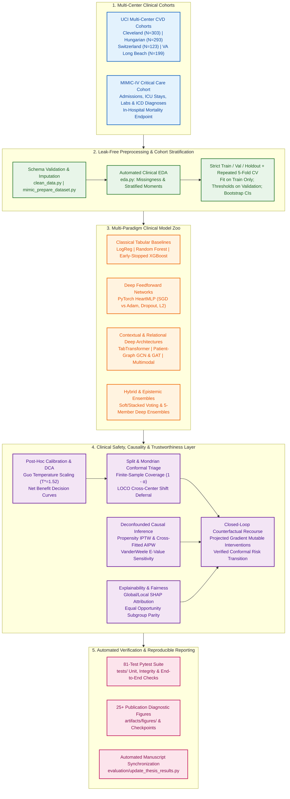

# Trustworthy Cardiovascular & ICU Clinical ML Pipeline

[](https://github.com/YahyaLendani/heart-disease-clinical-ml/actions/workflows/ci.yml)
[](https://www.python.org/downloads/)
[](https://pytorch.org/)
[](https://scikit-learn.org/)
[](https://xgboost.readthedocs.io/)
[](https://scikit-learn.org/stable/modules/ensemble.html#forests-of-randomized-trees)
[](https://scikit-learn.org/stable/modules/linear_model.html#logistic-regression)
[](LICENSE)
[](https://github.com/astral-sh/ruff)
[](docs/CLINICAL_ML_VERIFICATION_REPORT.md)

A publication-grade, end-to-end **Clinical Machine Learning and Trustworthy AI Framework** for **Cardiovascular Disease (CVD) Diagnosis** across multi-center international cohorts (*Cleveland, Hungarian, Switzerland, VA Long Beach*) and **In-Hospital Mortality Prediction** on **MIMIC-IV**.

Beyond standard discriminative benchmarking, this repository operationalizes **19 foundational and state-of-the-art research paradigms**—bridging **Self-Attention Tabular Deep Learning (`TabTransformer`)**, **Patient-Similarity Graph Neural Networks (`GCN`, `GAT`)**, **Post-Hoc Calibration (`Temperature Scaling`)**, **Epistemic Uncertainty (`Deep Ensembles`)**, **Finite-Sample Guaranteed Triage (`Split & Mondrian Conformal Prediction`)**, **Doubly Robust Causal Inference (`IPTW`, `Cross-Fitted AIPW`, `E-Values`)**, **Algorithmic Fairness (`Equal Opportunity`)**, and **Closed-Loop Actionable Counterfactual Recourse**.

---

## Table of Contents

- [Clinical Context & Motivation](#clinical-context--motivation)
- [System Architecture](#system-architecture)
- [Empirical Benchmark Results](#empirical-benchmark-results)
  - [1. Holdout Test & Repeated Cross-Validation Model Comparison](#1-holdout-test--repeated-cross-validation-model-comparison)
  - [2. Leave-One-Center-Out (LOCO) Multi-Center Generalization & Conformal Triage](#2-leave-one-center-out-loco-multi-center-generalization--conformal-triage)
  - [3. Uncertainty, Conformal Triage, Causality & Recourse Highlights](#3-uncertainty-conformal-triage-causality--recourse-highlights)
- [Visual Diagnostic Gallery & Clinical Interpretations](#visual-diagnostic-gallery--clinical-interpretations)
  - [1. Clinical Decision Curve Analysis (DCA) & Net Benefit](#1-clinical-decision-curve-analysis-dca--net-benefit)
  - [2. Model Explainability & Patient-Level Attribution (SHAP)](#2-model-explainability--patient-level-attribution-shap)
  - [3. Distribution-Free Conformal Triage & Uncertainty Calibration](#3-distribution-free-conformal-triage--uncertainty-calibration)
  - [4. Algorithmic Fairness & Demographic Parity](#4-algorithmic-fairness--demographic-parity)
  - [5. Deconfounded Causal Inference & Actionable Recourse](#5-deconfounded-causal-inference--actionable-recourse)
  - [6. Training Dynamics & Optimization Convergence](#6-training-dynamics--optimization-convergence)
- [Repository Structure](#repository-structure)
- [Quick Start & Installation](#quick-start--installation)
- [Step-by-Step Replication Guide](#step-by-step-replication-guide)
- [Theoretical Foundations & Reading List Mapping](#theoretical-foundations--reading-list-mapping)
- [Citation](#citation)
- [License](#license)

---

## Clinical Context & Motivation

Deploying machine learning in high-stakes cardiology and critical care requires far more than maximizing point-estimate ROC-AUC on an i.i.d. holdout split:

1. **Silent Failures Under Cross-Hospital Domain Shift:** Disease prevalence varies drastically across clinical centers (from **36.2%** in Hungarian outpatients to **93.5%** in Switzerland catheterization cohorts). Fixed probability thresholds suffer severe accuracy degradation across sites.
2. **Overconfident Neural Probabilities:** Uncalibrated deep networks distort clinical risk stratification and Net Benefit in Decision Curve Analysis (DCA).
3. **Confounding vs. Causation:** Observational correlations (e.g., exercise-induced angina or resting hypertension) conflate demographic confounding with modifiable causal treatment effects.
4. **Actionability & Recourse:** Identifying a patient as high-risk is clinically incomplete without computing sparse, physiologically plausible, and demographically immutable interventions that transition the patient out of the high-risk regime.

This repository addresses each barrier through an integrated, test-verified pipeline.

---

## System Architecture



---

## Empirical Benchmark Results

### 1. Holdout Test & Repeated Cross-Validation Model Comparison

**Primary benchmark:** the 918-patient 4-center cohort (`data/processed/cleaned_heart_disease_combined.csv`), with identical stratified splits (`--seed 42`) and leak-free preprocessing. Its test split has **184 patients**, three times Cleveland's 61, which roughly halves confidence-interval widths (about ±0.04 instead of ±0.08 in ROC-AUC). Zero-coded cholesterol (172 patients) and blood pressure (1 patient) are recoded as missing; left in, `chol = 0` marks almost every Zurich patient (93.5% prevalence) and acts as a site shortcut.

**How to read these numbers.** Every holdout metric carries a stratified bootstrap **95% confidence interval**; every model family is also scored by **repeated stratified 5-fold CV (5 × 3 = 15 folds, mean ± SD)**; and all models are compared pairwise on the same test patients with **DeLong's test and Holm correction** (`artifacts/model_comparison.md`). **None of the 91 model pairs differs significantly** (smallest Holm-adjusted p = 1.0). Model, optimizer, hyperparameter, early-stopping and threshold choices use validation data or CV only.

#### Classical baselines and HeartMLP

Random Forest and XGBoost are each tuned over an 8-configuration grid (`artifacts/hyperparameter_search_*.csv`). CV runs on each script's training portion (baselines: 60% train; HeartMLP: 80% train+val).

| Architecture / Model | Category | Test Accuracy | Test ROC-AUC [95% CI] | Test PR-AUC | Test Brier $\downarrow$ | CV ROC-AUC (15 folds) | CV Brier $\downarrow$ |
| :--- | :--- | :---: | :---: | :---: | :---: | :---: | :---: |
| **XGBoost** | Gradient Boosted Trees | 0.832 | 0.909 [0.867, 0.947] | 0.924 | 0.121 | 0.878 ± 0.022 | 0.139 ± 0.015 |
| **Random Forest** | Bagged Decision Trees | 0.815 | 0.900 [0.856, 0.939] | 0.916 | 0.130 | 0.877 ± 0.025 | 0.143 ± 0.011 |
| **Logistic Regression** | Linear Baseline | 0.804 | 0.884 [0.835, 0.929] | 0.912 | 0.137 | 0.871 ± 0.022 | 0.143 ± 0.015 |
| **HeartMLP (Adam)** | Feedforward Network | 0.810 | 0.885 [0.835, 0.931] | 0.898 | 0.139 | 0.859 ± 0.038 | 0.155 ± 0.030 |
| **HeartMLP (SGD)** | Feedforward Network | 0.793 | 0.879 [0.829, 0.925] | 0.899 | 0.148 | 0.854 ± 0.035 | 0.162 ± 0.029 |

#### Reading-list architectures

Holdout uses the same test patients; CV uses each of 5 folds × 3 repeats of the full cohort as the test set, with the remainder split 75/25 into train/validation. Weights come from the epoch with the lowest validation loss.

| Architecture / Model | Category | Test Accuracy | Test ROC-AUC [95% CI] | Test PR-AUC | Test Brier $\downarrow$ | CV ROC-AUC (15 folds) | CV Brier $\downarrow$ |
| :--- | :--- | :---: | :---: | :---: | :---: | :---: | :---: |
| **GCN (Kipf & Welling, 2017)** | Spectral Graph ConvNet | 0.799 | 0.887 [0.837, 0.934] | 0.899 | 0.135 | 0.878 ± 0.026 | 0.138 ± 0.016 |
| **TabTransformer (Huang et al., 2020)** | Contextual Self-Attention | 0.799 | 0.885 [0.831, 0.931] | 0.904 | 0.138 | 0.866 ± 0.029 | 0.147 ± 0.016 |
| **GAT (Veličković et al., 2018)** | Graph Attention Network | 0.810 | 0.882 [0.831, 0.929] | 0.905 | 0.138 | 0.874 ± 0.033 | 0.142 ± 0.021 |
| **Multimodal Cross-Attention †** | Synthetic-signal demo | 0.663 | 0.698 [0.620, 0.778] | 0.769 | 0.218 | 0.704 ± 0.043 | 0.216 ± 0.012 |

† Demonstration only: its "waveform" channel is synthesised from the same tabular features, so it adds no information and is not a like-for-like comparison.

#### Operating thresholds (tuned on validation, applied to test)

| Baseline Model | Threshold (F1) | Test F1 at that Threshold | Threshold (Youden's $J$) | Test Youden's $J$ |
| :--- | :---: | :---: | :---: | :---: |
| **XGBoost** | 0.469 | 0.854 | 0.523 | 0.668 |
| **Random Forest** | 0.429 | 0.829 | 0.643 | 0.579 |
| **Logistic Regression** | 0.508 | 0.831 | 0.508 | 0.611 |

#### Sensitivity analysis: Cleveland-only cohort (302 patients, 61 test patients)

Same pipeline with `--dataset cleaned_heart_disease.csv` (full outputs in `artifacts/cleveland/`). Rankings shuffle relative to the primary cohort (e.g., GCN and TabTransformer move to the top) and the intervals are twice as wide; again, 0 of 91 pairs differ after Holm correction.

| Architecture / Model | Category | Test Accuracy | Test ROC-AUC [95% CI] | Test PR-AUC | Test Brier $\downarrow$ | CV ROC-AUC (15 folds) | CV Brier $\downarrow$ |
| :--- | :--- | :---: | :---: | :---: | :---: | :---: | :---: |
| **XGBoost** | Gradient Boosted Trees | 0.803 | 0.900 [0.826, 0.965] | 0.885 | 0.133 | 0.907 ± 0.048 | 0.122 ± 0.039 |
| **Random Forest** | Bagged Decision Trees | 0.803 | 0.877 [0.788, 0.953] | 0.871 | 0.144 | 0.913 ± 0.046 | 0.120 ± 0.031 |
| **Logistic Regression** | Linear Baseline | 0.836 | 0.900 [0.819, 0.968] | 0.883 | 0.129 | 0.898 ± 0.051 | 0.127 ± 0.039 |
| **HeartMLP (Adam)** | Feedforward Network | 0.803 | 0.898 [0.813, 0.969] | 0.852 | 0.145 | 0.882 ± 0.063 | 0.156 ± 0.063 |
| **HeartMLP (SGD)** | Feedforward Network | 0.770 | 0.869 [0.774, 0.951] | 0.817 | 0.171 | 0.816 ± 0.130 | 0.198 ± 0.092 |
| **GCN (Kipf & Welling, 2017)** | Spectral Graph ConvNet | 0.803 | 0.910 [0.832, 0.972] | 0.864 | 0.130 | 0.915 ± 0.025 | 0.119 ± 0.017 |
| **TabTransformer (Huang et al., 2020)** | Contextual Self-Attention | 0.820 | 0.908 [0.830, 0.972] | 0.871 | 0.125 | 0.894 ± 0.027 | 0.135 ± 0.022 |
| **GAT (Veličković et al., 2018)** | Graph Attention Network | 0.820 | 0.897 [0.819, 0.963] | 0.854 | 0.135 | 0.910 ± 0.030 | 0.124 ± 0.024 |
| **Multimodal Cross-Attention †** | Synthetic-signal demo | 0.672 | 0.690 [0.554, 0.821] | 0.646 | 0.223 | 0.682 ± 0.069 | 0.228 ± 0.026 |

> **MIMIC-IV (demonstration only):** the bundled demo extract has 275 admissions and 15 deaths, so its test split holds only 3 deaths and holdout ROC-AUC intervals span roughly 0.1–1.0. `artifacts/mimic_baseline_comparison.md` shows the pipeline running on ICU data with patient-grouped splits, repeated CV and bootstrap CIs; it is not a model ranking. A substantive mortality study needs credentialed access to the full MIMIC-IV database.

---

### 2. Leave-One-Center-Out (LOCO) Multi-Center Generalization & Conformal Triage

Models are trained on three centers and evaluated zero-shot on the fourth. **Split Conformal Prediction** ($\alpha = 0.10$, 90% target) is calibrated on the three source centers. Coverage on the unseen hospital falls short of 90% at three of four centers: conformal deferral rises with shift, as intended, but exchangeability-based guarantees do not transfer across hospitals.

| Held-Out Evaluation Center | Cohort Size ($N$) | Disease Prevalence | Fixed-Threshold Accuracy | 90% Conformal Empirical Coverage | Mean Prediction Set Size | Clinical Deferral (Abstain) Rate |
| :--- | :---: | :---: | :---: | :---: | :---: | :---: |
| **Cleveland** | 303 | 45.9% | 65.3% | 80.9% | 1.22 | 22.4% |
| **Hungarian** | 293 | 36.2% | 77.5% | 91.1% | 1.32 | 32.1% |
| **Switzerland** | 123 | 93.5% | 64.2% | 87.8% | 1.38 | 38.2% |
| **VA Long Beach** | 199 | 74.4% | 73.9% | 88.9% | 1.32 | 31.7% |

No model family transfers best everywhere: Random Forest is best on Cleveland and Zurich, Logistic Regression on Budapest and Long Beach (`artifacts/cross_center_generalization.md`).

---

### 3. Uncertainty, Conformal Triage, Causality & Recourse Highlights

Numbers below come from the 184-patient holdout of the primary cohort.

- **Split & Mondrian Conformal Triage (Angelopoulos & Bates, 2021):**
  - Calibration and test scores use the same (uncalibrated) `HeartMLP` probabilities, which the finite-sample coverage guarantee requires.
  - At $\alpha = 0.10$ (90% target), empirical coverage is **88.6%** (87.3% on disease cases, 90.2% on controls), mean set size **1.255**, deferral rate **25.5%**.
  - At $\alpha = 0.15$ (85% target), deferral falls to **15.2%** with **86.4%** coverage; at $\alpha = 0.05$, coverage is 95.1% with 52.7% deferral.
- **Deep Ensembles & Post-Hoc Calibration (Lakshminarayanan et al., 2017; Guo et al., 2017):**
  - A 5-member Deep Ensemble gives mean epistemic variance $\sigma^2 = 0.0049$.
  - Validation-tuned Temperature Scaling ($T^* = 1.455$) lowers holdout ECE from **0.073** to **0.067**.
- **Causal Inference (Pearl & Mackenzie, 2018; Chernozhukov et al., 2018; VanderWeele & Ding, 2017):**
  - **IPTW:** the naive risk difference for exercise angina (**0.446**) shrinks to **0.075** after weighting, but **7 of 12 covariates** remain imbalanced ($|\text{SMD}| \ge 0.10$; largest 0.264), so residual confounding cannot be excluded.
  - **Cross-Fitted Doubly Robust AIPW:** exercise angina ATE = **+0.060** (95% CI `[-0.047, 0.167]`, E-value 1.457); Stage 2 hypertension ATE = **−0.013** (95% CI `[-0.069, 0.042]`, E-value 1.184). Both intervals include zero, and both point estimates change sign relative to the Cleveland-only cohort.
- **Equal Opportunity Thresholds (Barocas et al., 2020):** thresholds now maximise Youden's $J$ under a sensitivity-parity constraint (the earlier F1 objective chose near-zero thresholds that flagged almost everyone). On the primary cohort they narrow the test sensitivity gap only from **0.226 to 0.215** at an unchanged false-positive rate; on Cleveland, one group's threshold still collapses to 0.05, which the report flags.
- **Actionable Counterfactual Recourse (Wachter et al., 2017; Ustun et al., 2019):**
  - Valid recourse for **80.0%** of high-risk test patients, mean predicted-risk reduction **0.519**, zero change to immutable attributes (`age`, `sex`). About 7.8 features change per patient, so these are explanations rather than sparse treatment plans.
  - **Closed-Loop Conformal Check:** **100.0%** of conformal high-risk patients ($\hat{C}(x) = \{1\}$) move to $\{0\}$ or $\{0, 1\}$ under the model.

---

## Visual Diagnostic Gallery & Clinical Interpretations

All diagnostic visualizations are automatically generated and versioned in `artifacts/figures/` and `artifacts/` to provide transparent, clinician-auditable verification across every stage of the pipeline.

### 1. Clinical Decision Curve Analysis (DCA) & Net Benefit

<table>
  <tr>
    <td width="50%" align="center">
      
      <br/>
      <em><b>Figure 1A:</b> Clinical Decision Curve Analysis (DCA) comparing model-guided Net Benefit against "Treat All" and "Treat None" policies across decision threshold probabilities.</em>
    </td>
    <td width="50%" align="center">
      
      <br/>
      <em><b>Figure 1B:</b> Holdout Precision-Recall trajectories annotated with F1-optimal operating thresholds and positive predictive value (PPV) trade-offs.</em>
    </td>
  </tr>
</table>

**Clinical Interpretation:**
- **Decision Curve Analysis (Vickers & Elkin, 2006):** Discrimination metrics (ROC-AUC) ignore the clinical consequences of false positives (unnecessary invasive coronary angiography) versus false negatives (missed myocardial ischemia). In **Figure 1A**, all three baseline models (Logistic Regression, Random Forest, XGBoost) have higher **Net Benefit** than both *"Treat All"* and *"Treat None"* at every threshold probability from $p_t = 0.10$ to $0.75$ on the 184-patient test set (checked numerically; the same holds on the Cleveland-only cohort). These are point estimates without confidence bands.
- **Precision-Recall Operating Point Selection:** **Figure 1B** shows precision holding up in high-sensitivity regimes (holdout PR-AUC **0.912–0.924** for the baselines; repeated-CV PR-AUC **0.871–0.882**), letting clinicians select operating thresholds tailored to outpatient screening (high sensitivity) or catheterization referral (high PPV).

---

### 2. Model Explainability & Patient-Level Attribution (SHAP)

#### Global Feature Attribution Across Model Paradigms (Neural Network, Random Forest, XGBoost)

<table>
  <tr>
    <td width="33%" align="center">
      
      <br/>
      <em><b>Figure 2A:</b> Global SHAP beeswarm summary for the Deep Neural Network (<code>HeartMLP-Adam</code>).</em>
    </td>
    <td width="33%" align="center">
      
      <br/>
      <em><b>Figure 2B:</b> Global TreeSHAP beeswarm summary for <code>Random Forest</code> (bagged ensemble).</em>
    </td>
    <td width="33%" align="center">
      
      <br/>
      <em><b>Figure 2C:</b> Global TreeSHAP beeswarm summary for early-stopped <code>XGBoost</code>.</em>
    </td>
  </tr>
</table>

#### Local Patient-Level Risk Decomposition (Neural Network vs. Random Forest)

<table>
  <tr>
    <td width="50%" align="center">
      
      <br/>
      <em><b>Figure 2D:</b> Patient-level SHAP waterfall plot for <code>HeartMLP</code> on a <b>High-Risk Patient</b>, decomposing additive non-linear neural activations.</em>
    </td>
    <td width="50%" align="center">
      
      <br/>
      <em><b>Figure 2E:</b> Patient-level SHAP waterfall plot for <code>Random Forest</code> on a <b>High-Risk Patient</b>, confirming concordant tree ensemble attribution.</em>
    </td>
  </tr>
</table>

**Clinical & Methodological Interpretation:**
- **Cross-Model Biomarker Consensus (Neural vs. Trees vs. Linear):** All three model paradigms—**Deep Neural Network (`HeartMLP`)**, **Random Forest**, and **XGBoost**—converge on the same physiologically validated triad of coronary artery disease:
  1. **Anatomical Vessel Narrowing (`ca`):** Number of major vessels (0–3) visualized under fluoroscopy.
  2. **Myocardial Perfusion Defects (`thal`):** Reversible/fixed ischemia on nuclear stress testing.
  3. **Exercise-Induced Ischemia (`oldpeak` & `cp`):** ST depression $\ge 1.0\text{ mm}$ during stress and typical/atypical anginal symptoms.
- **The Role of Tree Ensembles:** **XGBoost** has the highest holdout ROC-AUC (**0.909**, 95% CI 0.867–0.947) and lowest Brier score (**0.121**), and XGBoost and Random Forest share the highest repeated-CV ROC-AUC (**`0.878 ± 0.022`** and **`0.877 ± 0.025`**). Paired DeLong tests find no significant difference from any other model after Holm correction, so this is a tendency, not a demonstrated advantage.
- **The Role of Logistic Regression:** Logistic Regression serves as the foundational **clinical standard of reference** (**CV ROC-AUC = `0.871 ± 0.022`**, validation-tuned test $F_1 = 0.831$), within about 0.025 AUC of every other (non-demo) model. Its linear log-odds formulation ($\log\frac{p}{1-p} = \beta_0 + \sum \beta_j X_j$) provides directly interpretable Odds Ratios ($e^{\beta_j}$), verifying that non-linear deep models preserve the true directional sign of established clinical risk factors while capturing higher-order physiological interactions.

---

### 3. Distribution-Free Conformal Triage & Uncertainty Calibration

<table>
  <tr>
    <td width="50%" align="center">
      
      <br/>
      <em><b>Figure 3A:</b> Conformal Triage Efficiency-Coverage trade-off curve showing empirical coverage vs. clinical deferral (abstention) rate across miscoverage levels $\alpha$.</em>
    </td>
    <td width="50%" align="center">
      
      <br/>
      <em><b>Figure 3B:</b> Reliability diagram of the baseline models' predicted probabilities against the ideal diagonal (temperature scaling, $T^* = 1.455$, is evaluated in the reading-list suite).</em>
    </td>
  </tr>
</table>

**Clinical Interpretation:**
- **Finite-Sample Guaranteed Safe Deferral:** Standard point classifiers force a binary decision even on ambiguous or out-of-distribution patients. Using **Split & Mondrian Conformal Prediction** (**Figure 3A**), the model outputs prediction sets $\hat{C}_{1-\alpha}(x) \subseteq \{0, 1\}$. Singleton sets $\{0\}$ (*Rule-Out*) and $\{1\}$ (*Rule-In*) enable confident automated triage, while doubleton sets $\{0, 1\}$ explicitly flag uncertain cases for **secondary specialist review / diagnostic deferral**. Moving $\alpha$ from $0.10 \to 0.15$ lowers the deferral rate from **25.5% to 15.2%** at **86.4%** empirical coverage (85% target).
- **Post-Hoc Reliability:** As shown in **Figure 3B** (and `artifacts/figures/calibration_heart_mlp.png`), validation-tuned Temperature Scaling ($T^* = 1.455$) softens neural overconfidence and lowers holdout ECE from 0.073 to 0.067; with 184 test patients, per-bin calibration estimates remain noisy.

---

### 4. Algorithmic Fairness & Demographic Parity

<div align="center">
  
  <br/>
  <em><b>Figure 4:</b> Subgroup diagnostic audit evaluating Sensitivity (True Positive Rate), Specificity, and Missed-Disease Rate (False Negative Rate) across biological sex (Female vs. Male) and age strata (&lt;50 vs. 50–64 vs. &ge;65 years).</em>
</div>

**Clinical Interpretation:**
- **Mitigating Historical Under-Diagnosis in Women & Young Adults:** Cardiovascular disease in female and younger patients frequently presents with atypical angina or non-obstructive coronary disease, historically resulting in elevated false-negative (missed disease) rates under uniform probability cutoffs.
- **Subgroup Audit:** **Figure 4** audits subgroup error rates across sex and age on the multi-center cohort ($N=918$, 184 test patients) with `evaluation/fairness_analysis.py`. Sick women are missed more often than sick men (false-negative rate **25.0%**, 35 test patients, vs **7.4%**, 149 patients). Group-specific Equal Opportunity thresholds (`evaluation/fair_mitigation.py`, Youden objective) narrow the sensitivity gap only slightly on this cohort (0.226 → 0.215), and on the 61-patient Cleveland split one group's threshold collapses to 0.05, flagging almost everyone in that group. Threshold post-processing needs a larger validation cohort, or in-processing methods, before it is clinically usable.

---

### 5. Deconfounded Causal Inference & Actionable Recourse

<table>
  <tr>
    <td width="50%" align="center">
      
      <br/>
      <em><b>Figure 5A:</b> Causal Covariate Balance (Love Plot): absolute standardized mean differences before and after propensity weighting, against the $0.10$ balance threshold.</em>
    </td>
    <td width="50%" align="center">
      
      <br/>
      <em><b>Figure 5B:</b> Projected Gradient Counterfactual Recourse trajectory showing sparse, physiologically plausible biomarker modifications while strictly locking immutable attributes (<code>age</code>, <code>sex</code>).</em>
    </td>
  </tr>
</table>

**Clinical Interpretation:**
- **Deconfounding Observational Bias (Love Plot):** In observational clinical registries, exposed patients systematically differ from controls in age, sex and comorbidities. **Figure 5A** shows weighting reduces the largest imbalance from $|\text{SMD}| = 0.961$ to $0.264$, but **7 of 12 covariates** stay at or above the $0.10$ threshold. Residual measured confounding therefore remains, consistent with AIPW intervals that include zero for both exposures. (An earlier version of this README stated that all covariates were balanced below $0.10$; the computed SMDs do not support that.)
- **Closed-Loop Actionable Patient Recourse:** **Figure 5B** visualizes a patient-level counterfactual trajectory. With immutable attributes (`age`, `sex`) locked and projected gradient descent applied to modifiable targets (e.g., resting systolic blood pressure `trestbps`, ST depression `oldpeak`, peak heart rate `thalach`), **80.0%** of high-risk test patients reach the 0.30 risk target, and every conformal high-risk patient leaves the $\hat{C}(x) = \{1\}$ regime under the model. Roughly eight features change per patient, so the counterfactuals explain the model rather than prescribe treatment.

---

### 6. Training Dynamics & Optimization Convergence

<table>
  <tr>
    <td width="50%" align="center">
      
      <br/>
      <em><b>Figure 6A:</b> PyTorch <code>HeartMLP</code> (Adam optimizer) training and validation loss/accuracy trajectories with dropout ($p=0.25$), $L_2$ weight decay, and patience-based early stopping.</em>
    </td>
    <td width="50%" align="center">
      
      <br/>
      <em><b>Figure 6B:</b> Gradient-boosted decision tree (<code>XGBoost</code>) validation log-loss trajectory illustrating automated early-stopping regularization prior to tabular overfitting.</em>
    </td>
  </tr>
</table>

**Clinical Interpretation:**
- **Preventing Small-Cohort Memorization:** Clinical tabular datasets are highly susceptible to over-parameterized memorization and noisy gradient updates. **Figure 6A** (alongside `artifacts/training_curves_sgd.png`) and **Figure 6B** verify that explicit regularization—combining weighted binary cross-entropy, dropout, $L_2$ weight decay, and validation-monitored early stopping—halts optimization at the generalization peak before validation loss diverges.

---

## Repository Structure

```text
heart-disease-clinical-ml/
├── .github/
│   ├── ISSUE_TEMPLATE/                          # Bug report & feature request templates
│   ├── workflows/ci.yml                         # Lint (full Ruff rules), tests on Python 3.10-3.13, pipeline smoke run
│   └── pull_request_template.md                 # Scientific & engineering PR checklist
├── artifacts/                                   # Generated metrics, curves & tables (regenerated by the pipeline)
│   ├── figures/                                 # Diagnostic figures (calibration, DCA, SHAP, conformal, fairness, ...)
│   ├── baseline_comparison.md                   # Holdout (with 95% CIs) & repeated-CV baseline table
│   ├── mlp_holdout_summary.csv                  # HeartMLP holdout metrics with 95% CIs
│   ├── reading_list_advancements_summary.md     # Deep architectures, conformal, causal & LOCO report
│   ├── reading_list_architecture_cv_folds.csv   # Per-fold scores behind the architecture CV table
│   ├── model_comparison.md                      # Paired DeLong tests across all models
│   ├── hyperparameter_search_*.csv              # Every Random Forest / XGBoost configuration tried
│   ├── test_predictions/                        # Per-patient test probabilities from every script
│   └── cleveland/                               # Same benchmarks on the Cleveland-only cohort
├── data/
│   ├── raw/                                     # Source files: heart.csv, cleve.mod, processed.*.data, heart-disease.names
│   └── processed/                               # Model-ready CSVs: cleaned_heart_disease*.csv, mimic_hospital_mortality*.csv
├── docs/
│   ├── AI_Thesis_Reading-List.csv               # Papers implemented by the reading-list suite
│   ├── CLINICAL_ML_VERIFICATION_REPORT.md       # System verification report
│   └── explanations/                            # Architectural & line-by-line guides
├── evaluation/
│   ├── advanced_methodology.py                  # Conformal prediction, AIPW, batched counterfactual recourse
│   ├── clinical_metrics.py                      # PR-AUC, Brier, thresholds, DCA, calibration plots
│   ├── cv_utils.py                              # Single-pass CV scorer, bootstrap CIs, n_jobs handling
│   ├── model_comparison.py                      # Paired DeLong tests with Holm correction
│   ├── fairness_analysis.py                     # Sex & age subgroup audit
│   └── update_thesis_results.py                 # Writes result tables into thesis_draft.md
├── experiments/
│   ├── analyze_overfitting_network_size.py      # Capacity vs. generalization ablation
│   ├── cross_center_generalization.py           # Leave-One-Center-Out (LOCO) generalization
│   ├── run_reading_list_suite.py                # Reading-list benchmark suite (holdout + repeated CV)
│   └── tune_train_model.py                      # Hyperparameter grid, ranked by repeated-CV ROC-AUC
├── models/                                      # HeartMLP, TabTransformer, GCN/GAT, multimodal, temperature scaling
├── tests/                                       # pytest suite (81 tests)
├── training/
│   ├── baseline_models.py                       # LogReg, Random Forest & early-stopped XGBoost
│   ├── device_utils.py                          # CPU/GPU selection for PyTorch and XGBoost
│   ├── ensemble_models.py                       # Soft-voting & stacking ensembles
│   ├── mimic_train_baselines.py / mimic_train_mlp.py  # MIMIC-IV mortality models
│   ├── torch_utils.py                           # Fast tensor mini-batching & seeding
│   └── train_model.py                           # HeartMLP training (SGD vs Adam, repeated CV)
├── clean_data.py                                # Raw heart data -> data/processed/cleaned_heart_disease.csv
├── eda.py                                       # Exploratory data analysis tables
├── mimic_prepare_dataset.py                     # MIMIC-IV demo tables -> admission-level cohort
├── prepare_heart_combined.py                    # 4-center combined cohort (918 patients)
├── project_paths.py                             # Data and artifact locations
├── run_pipeline.py                              # The `heart-pipeline` command
├── pyproject.toml / requirements.txt            # Packaging, dependencies, Ruff & pytest settings
└── README.md
```

---

## Quick Start & Installation

### 1. Clone and Set Up Environment

```bash
git clone https://github.com/YahyaLendani/heart-disease-clinical-ml.git
cd heart-disease-clinical-ml
python -m venv .venv
source .venv/bin/activate            # Windows PowerShell: .\.venv\Scripts\Activate.ps1
pip install --upgrade pip
pip install -e ".[dev]"              # installs dependencies and the heart-pipeline command
```

### 2. Run the Pipeline

`heart-pipeline` (equivalently `python run_pipeline.py`) cleans the data, runs EDA and trains the
PyTorch models, plus any optional stages you switch on. It uses a GPU automatically when one is
available (`--device auto`, the default) and otherwise runs on the CPU. All stages run in one
Python process; CV folds, ensemble fits and LOCO centers run in parallel across CPU cores.

```bash
# Standard pipeline on the 918-patient cohort: prepare data -> EDA -> HeartMLP (SGD & Adam)
# with 5-fold x 3 repeated CV -> paired model comparison
heart-pipeline

# Everything: baselines, SHAP, ensembles, LOCO, fairness, reading-list suite, thesis tables
heart-pipeline --run-baselines --run-xai --run-advancements --run-reading-list --update-thesis-all

# Cleveland-only sensitivity analysis into its own folder
heart-pipeline --dataset cleaned_heart_disease.csv --output-dir artifacts/cleveland \
    --run-baselines --run-ensemble --run-reading-list

# Run the test suite first (CI already runs it on every push)
heart-pipeline --run-tests
```

Every stage can also run on its own: `heart-pipeline <step> [options]`. Run `heart-pipeline --help`
for the list of steps and `heart-pipeline <step> --help` for a step's options.

---

## Step-by-Step Replication Guide

### Stage 1: Data Cleaning & Exploratory Data Analysis (EDA)

```bash
heart-pipeline prepare-combined     # primary: 918-patient 4-center cohort from data/raw/processed.*.data
heart-pipeline clean                # Cleveland-only cohort from data/raw/heart.csv (sensitivity analysis)
heart-pipeline eda
```
- Builds `data/processed/cleaned_heart_disease_combined.csv` (zero-coded `chol`/`trestbps` recoded as missing) and `data/processed/cleaned_heart_disease.csv` (Kaggle placeholders `ca = 4`, `thal = 0` recoded as missing).
- Every training step defaults to the 918-patient cohort; pass `--dataset cleaned_heart_disease.csv` for Cleveland only. Bare file names are looked up in `data/processed` and `data/raw`.

### Stage 2: Deep Feedforward Training (`HeartMLP`: SGD vs. Adam)

```bash
heart-pipeline train-mlp --optimizer both --loss bce_weighted --epochs 80 --patience 12 \
    --dropout 0.25 --weight-decay 1e-4 --cv-folds 5 --cv-repeats 3 --save-checkpoint --save-confusion
```
- **Artifacts:** `heart_mlp_{sgd,adam}.pt`, `training_curves_{sgd,adam}.png`, `mlp_cv_summary.csv`, `mlp_holdout_summary.csv`.

### Stage 3: Classical Baselines & Early-Stopped XGBoost

```bash
heart-pipeline baselines --cv-folds 5 --cv-repeats 3 --xgb-early-stopping-rounds 25 --update-thesis
```
- Logistic Regression, Random Forest and XGBoost (8-configuration grid each, `artifacts/hyperparameter_search_*.csv`) with repeated stratified CV, validation-tuned thresholds and bootstrap 95% CIs (`artifacts/baseline_comparison.md`).

```bash
heart-pipeline compare-models       # paired DeLong tests of every model on the shared test patients
```
- Reads `artifacts/test_predictions/*.csv` (written by every training step) and writes `artifacts/model_comparison.md` with Holm-adjusted p-values.

### Stage 4: AI Thesis Reading List Suite

```bash
heart-pipeline reading-list --cv-folds 5 --cv-repeats 3
```
Writes `artifacts/reading_list_advancements_summary.md` and figures under `artifacts/figures/`:
1. **TabTransformer** (`Huang et al., 2020`) with multi-head contextual self-attention (`Vaswani et al., 2017`).
2. **Patient-Similarity Graph Neural Networks:** **GCN** (`Kipf & Welling, 2017`) and **GAT** (`Veličković et al., 2018`).
3. **Multimodal Cross-Attention demo** (`Baltrušaitis et al., 2018`; `He et al., 2016`; `Dosovitskiy et al., 2020`). Its signal channel is synthesised from the tabular features, so it is reported as a demonstration, not ranked.
4. **Post-Hoc Temperature Scaling** (`Guo et al., 2017`) & **Deep Ensembles** (`Lakshminarayanan et al., 2017`).
5. **Split & Mondrian Conformal Triage** (`Angelopoulos & Bates, 2021`) + LOCO Domain-Shift Generalization.
6. **Causal IPTW, Cross-Fitted AIPW & E-Value Sensitivity** (`Pearl & Mackenzie, 2018`; `Chernozhukov et al., 2018`; `VanderWeele & Ding, 2017`).
7. **Equal Opportunity Fairness Calibration** (`Barocas, Hardt, & Narayanan, 2020`).
8. **Closed-Loop Clinical Counterfactual Recourse** (`Wachter et al., 2017`; `Ustun et al., 2019`).

### Stage 5: Hyperparameter Tuning & Network Capacity Ablation

```bash
# Grid over learning rate, dropout, gradient clipping and label smoothing, ranked by repeated-CV ROC-AUC
heart-pipeline tune --epochs 30 --learning-rates 0.0005 0.001 0.005

# Overfitting across small (32,16), base (64,32) and large (128,64) architectures
heart-pipeline overfit --optimizer adam --epochs 40 --cv-folds 3
```

### Stage 6: MIMIC-IV In-Hospital Mortality Pipeline

```bash
# Build the admission-level cohort (set MIMIC_IV_ROOT or pass --mimic-root to the extracted demo)
heart-pipeline prepare-mimic --mimic-root /path/to/mimic-iv-clinical-database-demo-2.2

# Mortality baselines with patient-grouped repeated CV, then update the thesis tables
heart-pipeline mimic-baselines --cv-folds 5 --cv-repeats 3 --update-thesis
heart-pipeline mimic-mlp
```

---

## Theoretical Foundations & Reading List Mapping

| Research Domain | Seminal References Implemented | Module / Script | Diagnostic Visual Artifact |
| :--- | :--- | :--- | :--- |
| **Deep Learning & Optimization** | Goodfellow, Bengio, & Courville (2016); Kingma & Ba (2015) *Adam* | `models/heart_mlp.py`, `training/train_model.py` | `artifacts/training_curves_adam.png` |
| **Contextual Tabular Attention** | Vaswani et al. (2017) *Transformer*; Huang et al. (2020) *TabTransformer* | `experiments/run_reading_list_suite.py` | `artifacts/reading_list_advancements_summary.md` |
| **Graph Representation Learning** | Kipf & Welling (2017) *GCN*; Veličković et al. (2018) *GAT*; Zhang et al. (2020) *Graph-BERT* | `experiments/run_reading_list_suite.py` | `artifacts/reading_list_advancements_summary.md` |
| **Multimodal Fusion & Vision** | Baltrušaitis et al. (2018); He et al. (2016) *ResNet*; Dosovitskiy et al. (2020) *ViT* | `experiments/run_reading_list_suite.py` | `artifacts/reading_list_advancements_summary.md` |
| **Explainable AI (XAI)** | Lundberg & Lee (2017) *SHAP*; Selvaraju et al. (2017) *Grad-CAM* | `training/train_model.py`, `training/baseline_models.py` | `artifacts/figures/heart_mlp_adam_shap_summary.png` |
| **Calibration & Ensembles** | Guo et al. (2017) *Temperature Scaling*; Lakshminarayanan et al. (2017) *Deep Ensembles* | `training/ensemble_models.py`, `experiments/run_reading_list_suite.py` | `artifacts/figures/calibration_heart.png` |
| **Clinical Utility & Decision Curves** | Vickers & Elkin (2006) *Decision Curve Analysis (DCA)* | `training/baseline_models.py`, `experiments/run_reading_list_suite.py` | `artifacts/figures/dca_curve_heart.png` |
| **Conformal Prediction & Shift** | Angelopoulos & Bates (2021) *Split & Mondrian Conformal Prediction* | `experiments/cross_center_generalization.py` | `artifacts/figures/conformal_triage_curve.png` |
| **Causality & Recourse** | Pearl & Mackenzie (2018); Chernozhukov et al. (2018) *AIPW*; Wachter et al. (2017) | `experiments/run_reading_list_suite.py` | `artifacts/figures/aipw_love_plot.png`, `counterfactual_case_study.png` |
| **Algorithmic Fairness & Ethics** | Barocas, Hardt, & Narayanan (2020); Bryson (2019); Marques et al. (2021) | `evaluation/fairness_analysis.py` | `artifacts/figures/fairness_disparities.png` |

---

## Citation

If you find this repository or its empirical benchmarks useful in your research, please cite:

```bibtex
@mastersthesis{yahya2026trustworthy,
  author       = {Yahya Lendani},
  title        = {Trustworthy Deep Learning and Uncertainty-Aware Clinical Decision Support for Cardiovascular Risk and Hospital Mortality Prediction},
  school       = {Department of Computer Science and Artificial Intelligence},
  year         = {2026},
  url          = {https://github.com/YahyaLendani/heart-disease-clinical-ml}
}
```

---

## License

This project is licensed under the **MIT License** — see the [LICENSE](LICENSE) file for details.
