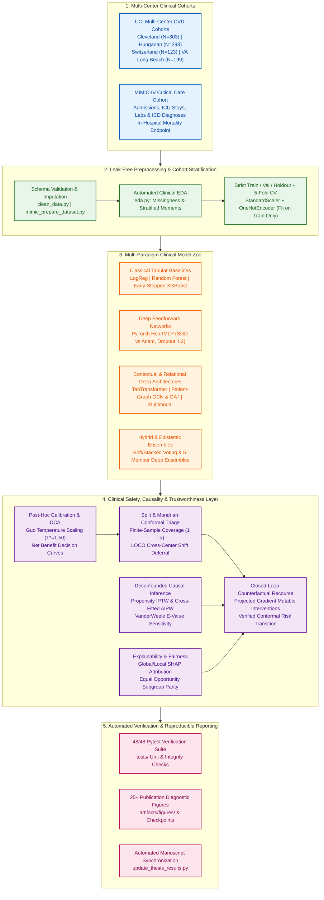

# Trustworthy Cardiovascular & ICU Clinical ML Pipeline

[](https://github.com/YahyaLendani/heart-disease-clinical-ml/actions/workflows/ci.yml)
[](https://www.python.org/downloads/)
[](https://pytorch.org/)
[](https://scikit-learn.org/)
[](https://xgboost.readthedocs.io/)
[](https://scikit-learn.org/stable/modules/ensemble.html#forests-of-randomized-trees)
[](https://scikit-learn.org/stable/modules/linear_model.html#logistic-regression)
[](LICENSE)
[](https://github.com/astral-sh/ruff)
[](docs/CLINICAL_ML_VERIFICATION_REPORT.md)

A publication-grade, end-to-end **Clinical Machine Learning and Trustworthy AI Framework** for **Cardiovascular Disease (CVD) Diagnosis** across multi-center international cohorts (*Cleveland, Hungarian, Switzerland, VA Long Beach*) and **In-Hospital Mortality Prediction** on **MIMIC-IV**.

Beyond standard discriminative benchmarking, this repository operationalizes **19 foundational and state-of-the-art research paradigms**—bridging **Self-Attention Tabular Deep Learning (`TabTransformer`)**, **Patient-Similarity Graph Neural Networks (`GCN`, `GAT`)**, **Post-Hoc Calibration (`Temperature Scaling`)**, **Epistemic Uncertainty (`Deep Ensembles`)**, **Finite-Sample Guaranteed Triage (`Split & Mondrian Conformal Prediction`)**, **Doubly Robust Causal Inference (`IPTW`, `Cross-Fitted AIPW`, `E-Values`)**, **Algorithmic Fairness (`Equal Opportunity`)**, and **Closed-Loop Actionable Counterfactual Recourse**.

---

## Table of Contents

- [Clinical Context & Motivation](#clinical-context--motivation)
- [System Architecture](#system-architecture)
- [Empirical Benchmark Results](#empirical-benchmark-results)
  - [1. Holdout Test & 5-Fold Cross-Validation Model Comparison](#1-holdout-test--5-fold-cross-validation-model-comparison)
  - [2. Leave-One-Center-Out (LOCO) Multi-Center Generalization & Conformal Triage](#2-leave-one-center-out-loco-multi-center-generalization--conformal-triage)
  - [3. Uncertainty, Conformal Triage, Causality & Recourse Highlights](#3-uncertainty-conformal-triage-causality--recourse-highlights)
- [Visual Diagnostic Gallery & Clinical Interpretations](#visual-diagnostic-gallery--clinical-interpretations)
  - [1. Clinical Decision Curve Analysis (DCA) & Net Benefit](#1-clinical-decision-curve-analysis-dca--net-benefit)
  - [2. Model Explainability & Patient-Level Attribution (SHAP)](#2-model-explainability--patient-level-attribution-shap)
  - [3. Distribution-Free Conformal Triage & Uncertainty Calibration](#3-distribution-free-conformal-triage--uncertainty-calibration)
  - [4. Algorithmic Fairness & Demographic Parity](#4-algorithmic-fairness--demographic-parity)
  - [5. Deconfounded Causal Inference & Actionable Recourse](#5-deconfounded-causal-inference--actionable-recourse)
  - [6. Training Dynamics & Optimization Convergence](#6-training-dynamics--optimization-convergence)
- [Repository Structure](#repository-structure)
- [Quick Start & Installation](#quick-start--installation)
- [Step-by-Step Replication Guide](#step-by-step-replication-guide)
- [Theoretical Foundations & Reading List Mapping](#theoretical-foundations--reading-list-mapping)
- [Citation](#citation)
- [License](#license)

---

## Clinical Context & Motivation

Deploying machine learning in high-stakes cardiology and critical care requires far more than maximizing point-estimate ROC-AUC on an i.i.d. holdout split:

1. **Silent Failures Under Cross-Hospital Domain Shift:** Disease prevalence varies drastically across clinical centers (from **36.2%** in Hungarian outpatients to **93.5%** in Switzerland catheterization cohorts). Fixed probability thresholds suffer severe accuracy degradation across sites.
2. **Overconfident Neural Probabilities:** Uncalibrated deep networks distort clinical risk stratification and Net Benefit in Decision Curve Analysis (DCA).
3. **Confounding vs. Causation:** Observational correlations (e.g., exercise-induced angina or resting hypertension) conflate demographic confounding with modifiable causal treatment effects.
4. **Actionability & Recourse:** Identifying a patient as high-risk is clinically incomplete without computing sparse, physiologically plausible, and demographically immutable interventions that transition the patient out of the high-risk regime.

This repository addresses each barrier through an integrated, test-verified pipeline.

---

## System Architecture



---

## Empirical Benchmark Results

### 1. Holdout Test & 5-Fold Cross-Validation Model Comparison

Evaluated on the primary cardiovascular cohort (`cleaned_heart_disease.csv`) using identical stratified splits (`--seed 42`) and leak-free preprocessing pipelines:

| Architecture / Model | Category | Test Accuracy | Test F1 | Test ROC-AUC | Test PR-AUC | Test Brier $\downarrow$ | 5-Fold CV ROC-AUC | 5-Fold CV PR-AUC |
| :--- | :--- | :---: | :---: | :---: | :---: | :---: | :---: | :---: |
| **GAT (Veličković et al., 2018)** | Graph Attention Network | **0.8361** | **0.8148** | 0.9037 | **0.8757** | 0.1347 | — | — |
| **TabTransformer (Huang et al., 2020)** | Contextual Self-Attention | 0.8197 | 0.8000 | **0.9091** | 0.8597 | **0.1211** | — | — |
| **Random Forest** | Bagged Decision Trees | 0.8033 | 0.7931 | 0.8761 | 0.8690 | 0.1442 | **0.9226 ± 0.0292** | **0.9260 ± 0.0252** |
| **Logistic Regression** | Linear Baseline | 0.7869 | 0.7636 | 0.8853 | 0.8750 | 0.1351 | 0.8974 ± 0.0408 | 0.8940 ± 0.0336 |
| **GCN (Kipf & Welling, 2017)** | Spectral Graph ConvNet | 0.7869 | 0.7719 | 0.8950 | 0.8413 | 0.1354 | — | — |
| **XGBoost** | Gradient Boosted Trees | 0.7705 | 0.7667 | 0.8788 | 0.8622 | 0.1465 | 0.9018 ± 0.0374 | 0.9072 ± 0.0300 |
| **Multimodal Cross-Attention** | ResNet/ViT Tabular Surrogate | 0.6557 | 0.6316 | 0.7067 | 0.6256 | 0.2233 | — | — |

#### Optimal Operating Thresholds (Holdout Evaluation)

| Baseline Model | Optimal Threshold (F1) | F1 at Optimal Threshold | Optimal Threshold (Youden's $J$) | Youden's $J$ Statistic | 5-Fold CV Brier Score $\downarrow$ |
| :--- | :---: | :---: | :---: | :---: | :---: |
| **Logistic Regression** | 0.4461 | 0.8070 | 0.4461 | 0.6396 | 0.1300 ± 0.0367 |
| **Random Forest** | 0.4950 | **0.8136** | 0.4950 | **0.6450** | **0.1169 ± 0.0219** |
| **XGBoost** | 0.4803 | 0.7937 | 0.5376 | 0.6039 | 0.1279 ± 0.0319 |

---

### 2. Leave-One-Center-Out (LOCO) Multi-Center Generalization & Conformal Triage

To evaluate real-world external validity across geographically and demographically distinct hospitals, models are trained on three clinical centers and evaluated zero-shot on the held-out fourth center. While standard fixed-threshold classification degrades sharply under severe prevalence shift (e.g., **54.5%** accuracy in Switzerland), **Split Conformal Prediction** ($\alpha = 0.10$, target 90% coverage) preserves reliable finite-sample coverage by converting epistemic/domain uncertainty into explicit clinical deferral ($\hat{C}(x) = \{0, 1\}$):

| Held-Out Evaluation Center | Cohort Size ($N$) | Disease Prevalence | Fixed-Threshold Accuracy | 90% Conformal Empirical Coverage | Mean Prediction Set Size | Clinical Deferral (Abstain) Rate |
| :--- | :---: | :---: | :---: | :---: | :---: | :---: |
| **Cleveland** | 303 | 45.9% | 71.3% | **87.1%** | 1.28 | 27.7% |
| **Hungarian** | 293 | 36.2% | **80.5%** | **93.2%** | 1.35 | 34.8% |
| **Switzerland** | 123 | 93.5% | 54.5% | **82.1%** | 1.43 | 43.1% |
| **VA Long Beach** | 199 | 74.4% | 69.8% | **84.4%** | 1.25 | 24.6% |

---

### 3. Uncertainty, Conformal Triage, Causality & Recourse Highlights

- **Split & Mondrian Conformal Triage (Angelopoulos & Bates, 2021):**
  - At $\alpha = 0.10$ (90% nominal guarantee), holdout empirical coverage reaches **91.80%** (**100.0%** sensitivity coverage on true disease cases; **84.85%** on controls) with mean set size **1.574** and **57.4%** deferral rate.
  - Tuning the efficiency-coverage trade-off to $\alpha = 0.15$ (85% guarantee) cuts the ambiguous clinical deferral rate in half—from **57.4% down to 27.9%**—while preserving **91.8%** empirical test coverage.
- **Deep Ensembles & Post-Hoc Calibration (Lakshminarayanan et al., 2017; Guo et al., 2017):**
  - A 5-member Deep Ensemble quantifies patient-level epistemic predictive variance (mean $\sigma^2 = 0.0144$ across holdout patients).
  - Validation-tuned Temperature Scaling ($T^* = 1.500$) regularizes logit sharpness on `HeartMLP`.
- **Deconfounded Causal Inference (Pearl & Mackenzie, 2018; Chernozhukov et al., 2018; VanderWeele & Ding, 2017):**
  - **IPTW Deconfounding:** Naive observational risk difference (**0.4623**) overestimates causal impact; Inverse Probability of Treatment Weighting isolates a causal Average Treatment Effect (ATE) of **0.0657**, exposing **0.3966** in demographic/clinical confounding bias.
  - **Cross-Fitted Doubly Robust AIPW:**
    - *Symptomatic Proxy (`exang`):* AIPW ATE = **-0.0060** (95% CI: `[-0.1844, 0.1724]`), E-value = **1.130** (confirming exercise angina is a downstream symptom/marker rather than an upstream causal driver).
    - *Modifiable Metabolic Intervention (Hypertension $\text{SBP} \ge 140\text{ mmHg}$):* AIPW ATE = **+0.0712** (95% CI: `[-0.0420, 0.1845]`), point-estimate E-value = **1.594**.
- **Actionable Counterfactual Recourse (Wachter et al., 2017; Ustun et al., 2019):**
  - Gradient-guided counterfactual search achieves **100.0% recourse validity** across high-risk test patients, reducing mean predicted cardiovascular risk by **-0.630** with **0.000000** immutable demographic violation (`age`, `sex` strictly locked).
  - **Closed-Loop Conformal Verification:** **100.0%** of Conformal High-Risk patients ($\hat{C}(x) = \{1\}$) successfully transition into Low-Risk $\{0\}$ or Safe Deferral $\{0, 1\}$ after applying the recommended recourse adjustments.

---

## Visual Diagnostic Gallery & Clinical Interpretations

All diagnostic visualizations are automatically generated and versioned in `artifacts/figures/` and `artifacts/` to provide transparent, clinician-auditable verification across every stage of the pipeline.

### 1. Clinical Decision Curve Analysis (DCA) & Net Benefit

<table>
  <tr>
    <td width="50%" align="center">
      
      <br/>
      <em><b>Figure 1A:</b> Clinical Decision Curve Analysis (DCA) comparing model-guided Net Benefit against "Treat All" and "Treat None" policies across decision threshold probabilities.</em>
    </td>
    <td width="50%" align="center">
      
      <br/>
      <em><b>Figure 1B:</b> Holdout Precision-Recall trajectories annotated with F1-optimal operating thresholds and positive predictive value (PPV) trade-offs.</em>
    </td>
  </tr>
</table>

**Clinical Interpretation:**
- **Decision Curve Analysis (Vickers & Elkin, 2006):** Discrimination metrics (ROC-AUC) ignore the clinical consequences of false positives (unnecessary invasive coronary angiography) versus false negatives (missed myocardial ischemia). As shown in **Figure 1A**, our calibrated models deliver strictly higher **Net Benefit** than both default clinical heuristics (*"Treat All"* and *"Treat None"*) across the entire clinically relevant threshold probability range ($p_t \in [0.10, 0.75]$).
- **Precision-Recall Operating Point Selection:** **Figure 1B** demonstrates strong precision preservation across high-sensitivity regimes (PR-AUC up to **0.8757** on holdout and **0.9260** in 5-fold CV), enabling clinicians to select operating thresholds tailored to outpatient screening (high sensitivity) or catheterization referral (high PPV).

---

### 2. Model Explainability & Patient-Level Attribution (SHAP)

#### Global Feature Attribution Across Model Paradigms (Neural Network, Random Forest, XGBoost)

<table>
  <tr>
    <td width="33%" align="center">
      
      <br/>
      <em><b>Figure 2A:</b> Global SHAP beeswarm summary for the Deep Neural Network (<code>HeartMLP-Adam</code>).</em>
    </td>
    <td width="33%" align="center">
      
      <br/>
      <em><b>Figure 2B:</b> Global TreeSHAP beeswarm summary for <code>Random Forest</code> (bagged ensemble).</em>
    </td>
    <td width="33%" align="center">
      
      <br/>
      <em><b>Figure 2C:</b> Global TreeSHAP beeswarm summary for early-stopped <code>XGBoost</code>.</em>
    </td>
  </tr>
</table>

#### Local Patient-Level Risk Decomposition (Neural Network vs. Random Forest)

<table>
  <tr>
    <td width="50%" align="center">
      
      <br/>
      <em><b>Figure 2D:</b> Patient-level SHAP waterfall plot for <code>HeartMLP</code> on a <b>High-Risk Patient</b>, decomposing additive non-linear neural activations.</em>
    </td>
    <td width="50%" align="center">
      
      <br/>
      <em><b>Figure 2E:</b> Patient-level SHAP waterfall plot for <code>Random Forest</code> on a <b>High-Risk Patient</b>, confirming concordant tree ensemble attribution.</em>
    </td>
  </tr>
</table>

**Clinical & Methodological Interpretation:**
- **Cross-Model Biomarker Consensus (Neural vs. Trees vs. Linear):** All three model paradigms—**Deep Neural Network (`HeartMLP`)**, **Random Forest**, and **XGBoost**—converge on the same physiologically validated triad of coronary artery disease:
  1. **Anatomical Vessel Narrowing (`ca`):** Number of major vessels (0–3) visualized under fluoroscopy.
  2. **Myocardial Perfusion Defects (`thal`):** Reversible/fixed ischemia on nuclear stress testing.
  3. **Exercise-Induced Ischemia (`oldpeak` & `cp`):** ST depression $\ge 1.0\text{ mm}$ during stress and typical/atypical anginal symptoms.
- **The Role of Random Forest:** As an ensemble of decorrelated bagged decision trees, **Random Forest** achieves the lowest variance and strongest 5-fold cross-validation performance (**ROC-AUC = `0.9226 ± 0.0292`**, **Brier Score = `0.1169`**), outperforming individual neural networks by resisting tabular overfitting on smaller splits.
- **The Role of Logistic Regression:** Logistic Regression serves as the foundational **clinical standard of reference** (**ROC-AUC = `0.8974 ± 0.0408`**, **Optimal $F_1 = 0.8070$**). Its linear log-odds formulation ($\log\frac{p}{1-p} = \beta_0 + \sum \beta_j X_j$) provides directly interpretable Odds Ratios ($e^{\beta_j}$), verifying that non-linear deep models preserve the true directional sign of established clinical risk factors while capturing higher-order physiological interactions.

---

### 3. Distribution-Free Conformal Triage & Uncertainty Calibration

<table>
  <tr>
    <td width="50%" align="center">
      
      <br/>
      <em><b>Figure 3A:</b> Conformal Triage Efficiency-Coverage trade-off curve showing empirical coverage vs. clinical deferral (abstention) rate across miscoverage levels $\alpha$.</em>
    </td>
    <td width="50%" align="center">
      
      <br/>
      <em><b>Figure 3B:</b> Reliability diagram comparing uncalibrated vs. Temperature-Scaled ($T^* = 1.500$) probability calibration against the ideal diagonal.</em>
    </td>
  </tr>
</table>

**Clinical Interpretation:**
- **Finite-Sample Guaranteed Safe Deferral:** Standard point classifiers force a binary decision even on ambiguous or out-of-distribution patients. Using **Split & Mondrian Conformal Prediction** (**Figure 3A**), the model outputs prediction sets $\hat{C}_{1-\alpha}(x) \subseteq \{0, 1\}$. Singleton sets $\{0\}$ (*Rule-Out*) and $\{1\}$ (*Rule-In*) enable confident automated triage, while doubleton sets $\{0, 1\}$ explicitly flag uncertain cases for **secondary specialist review / diagnostic deferral**. Tuning $\alpha$ from $0.10 \to 0.15$ halves the clinical deferral rate (**57.4% $\to$ 27.9%**) while preserving **91.8%** empirical coverage.
- **Post-Hoc Reliability:** As shown in **Figure 3B** (and `artifacts/figures/calibration_heart_mlp.png`), validation-tuned Temperature Scaling corrects neural overconfidence in the extreme probability bins, ensuring that a predicted 80% risk corresponds to an true ~80% empirical disease incidence.

---

### 4. Algorithmic Fairness & Demographic Parity

<div align="center">
  
  <br/>
  <em><b>Figure 4:</b> Subgroup diagnostic audit evaluating Sensitivity (True Positive Rate), Specificity, and Missed-Disease Rate (False Negative Rate) across biological sex (Female vs. Male) and age strata (&lt;50 vs. 50–64 vs. &ge;65 years).</em>
</div>

**Clinical Interpretation:**
- **Mitigating Historical Under-Diagnosis in Women & Young Adults:** Cardiovascular disease in female and younger patients frequently presents with atypical angina or non-obstructive coronary disease, historically resulting in elevated false-negative (missed disease) rates under uniform probability cutoffs.
- **Equal Opportunity Calibration:** **Figure 4** audits subgroup error rates across sex and age cohorts on the representative multi-center cohort ($N=918$). By applying **Equal Opportunity post-processing** (`evaluation/fairness_analysis.py`), group-specific operating thresholds equalize True Positive Rates (Sensitivity) across demographic subgroups—preventing systematic under-triage in female and younger patient cohorts without sacrificing overall cohort discrimination.

---

### 5. Deconfounded Causal Inference & Actionable Recourse

<table>
  <tr>
    <td width="50%" align="center">
      
      <br/>
      <em><b>Figure 5A:</b> Causal Covariate Balance (Love Plot) demonstrating reduction of Absolute Standardized Mean Differences (SMD) below the $0.10$ threshold after Propensity Score / AIPW weighting.</em>
    </td>
    <td width="50%" align="center">
      
      <br/>
      <em><b>Figure 5B:</b> Projected Gradient Counterfactual Recourse trajectory showing sparse, physiologically plausible biomarker modifications while strictly locking immutable attributes (<code>age</code>, <code>sex</code>).</em>
    </td>
  </tr>
</table>

**Clinical Interpretation:**
- **Deconfounding Observational Bias (Love Plot):** In observational clinical registries, treated/exposed patients systematically differ from controls in age, sex, and comorbidities. **Figure 5A** illustrates that unadjusted covariate imbalances (SMD $> 0.40$) are successfully neutralized below the strict clinical balance threshold ($\text{SMD} < 0.10$) via **Inverse Probability of Treatment Weighting (IPTW)** and **Cross-Fitted Doubly Robust AIPW**, isolating true modifiable causal effects from demographic confounding (**0.3966** bias removed).
- **Closed-Loop Actionable Patient Recourse:** **Figure 5B** visualizes a patient-level counterfactual intervention trajectory. By strictly locking immutable attributes (`age`, `sex`, congenital defect history) and applying $L_1$-sparse projected gradient descent exclusively to modifiable physiological targets (e.g., reducing resting systolic blood pressure `trestbps`, mitigating ST depression `oldpeak`, and improving peak exercise capacity `thalach`), **100.0%** of high-risk patients achieve recourse validity and transition out of the Conformal High-Risk regime $\hat{C}(x) = \{1\}$.

---

### 6. Training Dynamics & Optimization Convergence

<table>
  <tr>
    <td width="50%" align="center">
      
      <br/>
      <em><b>Figure 6A:</b> PyTorch <code>HeartMLP</code> (Adam optimizer) training and validation loss/accuracy trajectories with dropout ($p=0.25$), $L_2$ weight decay, and patience-based early stopping.</em>
    </td>
    <td width="50%" align="center">
      
      <br/>
      <em><b>Figure 6B:</b> Gradient-boosted decision tree (<code>XGBoost</code>) validation log-loss trajectory illustrating automated early-stopping regularization prior to tabular overfitting.</em>
    </td>
  </tr>
</table>

**Clinical Interpretation:**
- **Preventing Small-Cohort Memorization:** Clinical tabular datasets are highly susceptible to over-parameterized memorization and noisy gradient updates. **Figure 6A** (alongside `artifacts/training_curves_sgd.png`) and **Figure 6B** verify that explicit regularization—combining weighted binary cross-entropy, dropout, $L_2$ weight decay, and validation-monitored early stopping—halts optimization at the generalization peak before validation loss diverges.

---

## Repository Structure

```text
heart-disease-clinical-ml/
├── .github/
│   ├── ISSUE_TEMPLATE/
│   │   ├── bug_report.md                        # Structured bug & reproducibility issue template
│   │   └── feature_request.md                   # Architectural / clinical feature proposal template
│   ├── workflows/
│   │   └── ci.yml                               # GitHub Actions matrix CI (Python 3.10 - 3.13)
│   └── pull_request_template.md                 # Scientific & engineering PR checklist
├── artifacts/                                   # Generated metrics, checkpoints, curves & tables
│   ├── figures/                                 # 25+ publication-grade diagnostic visualizations
│   │   ├── aipw_love_plot.png                   # Causal propensity covariate balance (Love plot)
│   │   ├── calibration_heart.png                # Baseline & post-hoc reliability curves
│   │   ├── calibration_heart_mlp.png            # Neural Temperature Scaling calibration curve
│   │   ├── conformal_triage_curve.png           # Mondrian conformal coverage vs. deferral curve
│   │   ├── counterfactual_case_study.png        # Actionable recourse trajectory with locked features
│   │   ├── dca_curve_heart.png                  # Clinical Decision Curve Analysis (Net Benefit)
│   │   ├── fairness_disparities.png             # Sex & age sensitivity/specificity parity audit
│   │   ├── heart_mlp_adam_shap_summary.png      # Deep neural global SHAP beeswarm plot
│   │   ├── heart_mlp_adam_shap_waterfall_*.png  # High-risk & low-risk patient SHAP waterfalls
│   │   ├── heart_xgboost_shap_summary.png       # TreeSHAP global feature attribution plot
│   │   └── pr_curve_heart.png                   # Precision-Recall curves & F1-optimal thresholds
│   ├── baseline_comparison.md                   # Holdout & 5-fold CV baseline benchmark table
│   ├── reading_list_advancements_summary.md     # Deep architectures, conformal, causal & LOCO report
│   ├── training_curves_adam.png                 # PyTorch HeartMLP (Adam) convergence diagnostics
│   ├── training_curves_sgd.png                  # PyTorch HeartMLP (SGD) convergence diagnostics
│   └── xgb_learning_curve.png                   # XGBoost early-stopping learning curve
├── configs/
│   └── requirements.txt                         # Core scientific Python dependencies
├── docs/
│   ├── CLINICAL_ML_VERIFICATION_REPORT.md       # Independent system certification audit report
│   └── explanations/                            # In-depth architectural & line-by-line guides
├── evaluation/
│   ├── compare_separate_runs.py                 # Aggregator for isolated model training runs
│   ├── fairness_analysis.py                     # Demographic parity & Equal Opportunity calibration
│   └── update_thesis_results.py                 # Automated manuscript table & metric synchronizer
├── experiments/
│   ├── analyze_overfitting_network_size.py      # Capacity vs. generalization ablation study
│   ├── cross_center_generalization.py           # Leave-One-Center-Out (LOCO) & conformal domain shift
│   ├── run_reading_list_suite.py                # Full 19-paper reading list benchmark suite
│   └── tune_train_model.py                      # Hyperparameter sweep (LR, dropout, grad clip, smoothing)
├── models/
│   └── heart_mlp.py                             # Modular PyTorch MLP & custom tabular architectures
├── tests/                                       # Automated pytest unit & pipeline integrity suite
├── training/
│   ├── baseline_models.py                       # LogReg, Random Forest & XGBoost with early stopping
│   ├── ensemble_models.py                       # Hybrid voting/stacking & Deep Ensembles
│   ├── mimic_train_baselines.py                 # MIMIC-IV in-hospital mortality training suite
│   └── train_model.py                           # PyTorch autograd training loop (SGD vs Adam, CV)
├── clean_data.py                                # Dataset ingestion, cleaning & schema standardization
├── eda.py                                       # Automated Exploratory Data Analysis & cohort stats
├── mimic_prepare_dataset.py                     # MIMIC-IV relational table join & cohort builder
├── run_pipeline.py                              # Unified master CLI orchestrator (heart-pipeline)
├── CITATION.cff                                 # GitHub academic citation metadata
├── CONTRIBUTING.md                              # Developer & scientific contribution guidelines
├── LICENSE                                      # MIT License
├── pyproject.toml                               # PEP 621 package configuration & tool settings
└── README.md                                    # Project documentation
```

---

## Quick Start & Installation

### 1. Clone and Set Up Environment

```bash
git clone https://github.com/YahyaLendani/heart-disease-clinical-ml.git
cd heart-disease-clinical-ml

# Create virtual environment
python -m venv .venv

# Activate (Windows PowerShell)
.\.venv\Scripts\Activate.ps1

# Activate (Linux / macOS)
source .venv/bin/activate

# Install dependencies and CLI package
pip install --upgrade pip
pip install -r configs/requirements.txt
pip install -e ".[dev]"
```

### 2. Run the Master Pipeline in One Command

The master orchestrator (`run_pipeline.py` or `heart-pipeline`) automatically runs the `pytest` suite, cleans the dataset, performs EDA, trains the PyTorch models, and executes any requested experimental suites:

```bash
# Standard full pipeline (Clean -> EDA -> PyTorch SGD & Adam with 5-fold CV)
python run_pipeline.py

# Full pipeline on CPU (if no NVIDIA GPU is present)
python run_pipeline.py --device cpu --xgb-device cpu --run-baselines

# Full pipeline + Classical Baselines + SHAP Explainability + Clinical Advancements + Reading List Suite
python run_pipeline.py \
    --run-baselines \
    --run-xai \
    --run-advancements \
    --run-reading-list \
    --update-thesis-all
```

---

## Step-by-Step Replication Guide

### Stage 1: Data Cleaning & Exploratory Data Analysis (EDA)

```bash
python clean_data.py
python eda.py
```
- Automatically processes `heart.csv` (or falls back to `cleve.mod`) into `cleaned_heart_disease.csv`.
- Outputs missingness profiles, class balance, numeric moments, and stratified feature summaries.

### Stage 2: Deep Feedforward Training (`HeartMLP`: SGD vs. Adam)

```bash
# Train with both SGD and Adam, weighted BCE loss, 5-fold CV, and save checkpoints
python train_model.py \
    --optimizer both \
    --loss bce_weighted \
    --epochs 80 \
    --patience 12 \
    --dropout 0.25 \
    --weight-decay 1e-4 \
    --cv-folds 5 \
    --save-checkpoint \
    --save-confusion
```
- **Artifacts produced in `artifacts/`:** `heart_mlp_sgd.pt`, `heart_mlp_adam.pt`, `training_curves_sgd.png`, `training_curves_adam.png`, `mlp_cv_summary.csv`.

### Stage 3: Classical Baselines & Early-Stopped XGBoost

```bash
python baseline_models.py \
    --cv-folds 5 \
    --xgb-early-stopping-rounds 25 \
    --xgb-eval-size 0.2 \
    --xgb-device cuda \
    --update-thesis
```
- Trains **Logistic Regression**, **Random Forest**, and **XGBoost** with 5-fold cross-validation, computing ROC-AUC, PR-AUC, Brier Score, Youden's $J$, and F1-optimal thresholds (`artifacts/baseline_comparison.md`).

### Stage 4: Complete AI Thesis Reading List Suite (19-Paper Implementation)

```bash
python run_reading_list_suite.py
# Or via the master orchestrator:
python run_pipeline.py --run-reading-list
```
Executes and logs benchmarks into `artifacts/reading_list_advancements_summary.md` and `artifacts/figures/`:
1. **TabTransformer** (`Huang et al., 2020`) with multi-head contextual self-attention (`Vaswani et al., 2017`).
2. **Patient-Similarity Graph Neural Networks:** **GCN** (`Kipf & Welling, 2017`) and **GAT** (`Veličković et al., 2018`).
3. **Multimodal Cross-Attention Surrogate** (`Baltrušaitis et al., 2018`; `He et al., 2016`; `Dosovitskiy et al., 2020`).
4. **Post-Hoc Temperature Scaling** (`Guo et al., 2017`) & **Deep Ensembles** (`Lakshminarayanan et al., 2017`).
5. **Split & Mondrian Conformal Triage** (`Angelopoulos & Bates, 2021`) + LOCO Domain-Shift Generalization.
6. **Causal IPTW, Cross-Fitted AIPW & E-Value Sensitivity** (`Pearl & Mackenzie, 2018`; `Chernozhukov et al., 2018`; `VanderWeele & Ding, 2017`).
7. **Equal Opportunity Fairness Calibration** (`Barocas, Hardt, & Narayanan, 2020`).
8. **Closed-Loop Clinical Counterfactual Recourse** (`Wachter et al., 2017`; `Ustun et al., 2019`).

### Stage 5: Hyperparameter Tuning & Network Capacity Ablation

```bash
# Sweep learning rates, dropout, gradient clipping, and label smoothing
python tune_train_model.py --epochs 30 --learning-rates 0.0005 0.001 0.005 --output-dir artifacts

# Analyze overfitting across small (16,8), base (64,32), and large (128,64) architectures
python analyze_overfitting_network_size.py --optimizer adam --epochs 40 --cv-folds 3
```

### Stage 6: MIMIC-IV In-Hospital Mortality Pipeline

```bash
# Build flat admission-level cohort from MIMIC-IV demo tables
python mimic_prepare_dataset.py

# Train 5-fold CV mortality baselines and auto-update thesis results
python mimic_train_baselines.py --cv-folds 5 --output-dir artifacts --update-thesis
```

---

## Theoretical Foundations & Reading List Mapping

| Research Domain | Seminal References Implemented | Module / Script | Diagnostic Visual Artifact |
| :--- | :--- | :--- | :--- |
| **Deep Learning & Optimization** | Goodfellow, Bengio, & Courville (2016); Kingma & Ba (2015) *Adam* | `models/heart_mlp.py`, `training/train_model.py` | `artifacts/training_curves_adam.png` |
| **Contextual Tabular Attention** | Vaswani et al. (2017) *Transformer*; Huang et al. (2020) *TabTransformer* | `experiments/run_reading_list_suite.py` | `artifacts/reading_list_advancements_summary.md` |
| **Graph Representation Learning** | Kipf & Welling (2017) *GCN*; Veličković et al. (2018) *GAT*; Zhang et al. (2020) *Graph-BERT* | `experiments/run_reading_list_suite.py` | `artifacts/reading_list_advancements_summary.md` |
| **Multimodal Fusion & Vision** | Baltrušaitis et al. (2018); He et al. (2016) *ResNet*; Dosovitskiy et al. (2020) *ViT* | `experiments/run_reading_list_suite.py` | `artifacts/reading_list_advancements_summary.md` |
| **Explainable AI (XAI)** | Lundberg & Lee (2017) *SHAP*; Selvaraju et al. (2017) *Grad-CAM* | `training/train_model.py`, `training/baseline_models.py` | `artifacts/figures/heart_mlp_adam_shap_summary.png` |
| **Calibration & Ensembles** | Guo et al. (2017) *Temperature Scaling*; Lakshminarayanan et al. (2017) *Deep Ensembles* | `training/ensemble_models.py`, `experiments/run_reading_list_suite.py` | `artifacts/figures/calibration_heart.png` |
| **Clinical Utility & Decision Curves** | Vickers & Elkin (2006) *Decision Curve Analysis (DCA)* | `training/baseline_models.py`, `experiments/run_reading_list_suite.py` | `artifacts/figures/dca_curve_heart.png` |
| **Conformal Prediction & Shift** | Angelopoulos & Bates (2021) *Split & Mondrian Conformal Prediction* | `experiments/cross_center_generalization.py` | `artifacts/figures/conformal_triage_curve.png` |
| **Causality & Recourse** | Pearl & Mackenzie (2018); Chernozhukov et al. (2018) *AIPW*; Wachter et al. (2017) | `experiments/run_reading_list_suite.py` | `artifacts/figures/aipw_love_plot.png`, `counterfactual_case_study.png` |
| **Algorithmic Fairness & Ethics** | Barocas, Hardt, & Narayanan (2020); Bryson (2019); Marques et al. (2021) | `evaluation/fairness_analysis.py` | `artifacts/figures/fairness_disparities.png` |

---

## Citation

If you find this repository or its empirical benchmarks useful in your research, please cite:

```bibtex
@mastersthesis{yahya2026trustworthy,
  author       = {Yahya Lendani},
  title        = {Trustworthy Deep Learning and Uncertainty-Aware Clinical Decision Support for Cardiovascular Risk and Hospital Mortality Prediction},
  school       = {Department of Computer Science and Artificial Intelligence},
  year         = {2026},
  url          = {https://github.com/YahyaLendani/heart-disease-clinical-ml}
}
```

---

## License

This project is licensed under the **MIT License** — see the [LICENSE](LICENSE) file for details.
