# Trustworthy Cardiovascular & ICU Clinical ML Pipeline

[](https://github.com/YahyaLendani/heart-disease-clinical-ml/actions/workflows/ci.yml)
[](https://www.python.org/downloads/)
[](https://pytorch.org/)
[](https://scikit-learn.org/)
[](https://xgboost.readthedocs.io/)
[](https://scikit-learn.org/stable/modules/ensemble.html#forests-of-randomized-trees)
[](https://scikit-learn.org/stable/modules/linear_model.html#logistic-regression)
[](LICENSE)
[](https://github.com/astral-sh/ruff)
[](docs/CLINICAL_ML_VERIFICATION_REPORT.md)

A publication-grade, end-to-end **Clinical Machine Learning and Trustworthy AI Framework** for **Cardiovascular Disease (CVD) Diagnosis** across multi-center international cohorts (*Cleveland, Hungarian, Switzerland, VA Long Beach*) and **In-Hospital Mortality Prediction** on **MIMIC-IV**.

Beyond standard discriminative benchmarking, this repository operationalizes **19 foundational and state-of-the-art research paradigms**—bridging **Self-Attention Tabular Deep Learning (`TabTransformer`)**, **Patient-Similarity Graph Neural Networks (`GCN`, `GAT`)**, **Post-Hoc Calibration (`Temperature Scaling`)**, **Epistemic Uncertainty (`Deep Ensembles`)**, **Finite-Sample Guaranteed Triage (`Split & Mondrian Conformal Prediction`)**, **Doubly Robust Causal Inference (`IPTW`, `Cross-Fitted AIPW`, `E-Values`)**, **Algorithmic Fairness (`Equal Opportunity`)**, and **Closed-Loop Actionable Counterfactual Recourse**.

---

## Table of Contents

- [Clinical Context & Motivation](#clinical-context--motivation)
- [System Architecture](#system-architecture)
- [Empirical Benchmark Results](#empirical-benchmark-results)
  - [1. Holdout Test & Repeated Cross-Validation Model Comparison](#1-holdout-test--repeated-cross-validation-model-comparison)
  - [2. Leave-One-Center-Out (LOCO) Multi-Center Generalization & Conformal Triage](#2-leave-one-center-out-loco-multi-center-generalization--conformal-triage)
  - [3. Uncertainty, Conformal Triage, Causality & Recourse Highlights](#3-uncertainty-conformal-triage-causality--recourse-highlights)
- [Visual Diagnostic Gallery & Clinical Interpretations](#visual-diagnostic-gallery--clinical-interpretations)
  - [1. Clinical Decision Curve Analysis (DCA) & Net Benefit](#1-clinical-decision-curve-analysis-dca--net-benefit)
  - [2. Model Explainability & Patient-Level Attribution (SHAP)](#2-model-explainability--patient-level-attribution-shap)
  - [3. Distribution-Free Conformal Triage & Uncertainty Calibration](#3-distribution-free-conformal-triage--uncertainty-calibration)
  - [4. Algorithmic Fairness & Demographic Parity](#4-algorithmic-fairness--demographic-parity)
  - [5. Deconfounded Causal Inference & Actionable Recourse](#5-deconfounded-causal-inference--actionable-recourse)
  - [6. Training Dynamics & Optimization Convergence](#6-training-dynamics--optimization-convergence)
- [Repository Structure](#repository-structure)
- [Quick Start & Installation](#quick-start--installation)
- [Step-by-Step Replication Guide](#step-by-step-replication-guide)
- [Theoretical Foundations & Reading List Mapping](#theoretical-foundations--reading-list-mapping)
- [Citation](#citation)
- [License](#license)

---

## Clinical Context & Motivation

Deploying machine learning in high-stakes cardiology and critical care requires far more than maximizing point-estimate ROC-AUC on an i.i.d. holdout split:

1. **Silent Failures Under Cross-Hospital Domain Shift:** Disease prevalence varies drastically across clinical centers (from **36.2%** in Hungarian outpatients to **93.5%** in Switzerland catheterization cohorts). Fixed probability thresholds suffer severe accuracy degradation across sites.
2. **Overconfident Neural Probabilities:** Uncalibrated deep networks distort clinical risk stratification and Net Benefit in Decision Curve Analysis (DCA).
3. **Confounding vs. Causation:** Observational correlations (e.g., exercise-induced angina or resting hypertension) conflate demographic confounding with modifiable causal treatment effects.
4. **Actionability & Recourse:** Identifying a patient as high-risk is clinically incomplete without computing sparse, physiologically plausible, and demographically immutable interventions that transition the patient out of the high-risk regime.

This repository addresses each barrier through an integrated, test-verified pipeline.

---

## System Architecture


---

## Empirical Benchmark Results

### 1. Holdout Test & Repeated Cross-Validation Model Comparison

Primary cardiovascular cohort (`data/processed/cleaned_heart_disease.csv`, 302 patients), identical stratified splits (`--seed 42`), leak-free preprocessing.

**How to read these numbers.** The holdout test set has **61 patients**, so one patient moves accuracy by 1.6 points. Every holdout ROC-AUC therefore carries a stratified bootstrap **95% confidence interval**, and models are also compared by **repeated stratified 5-fold CV (5 × 3 = 15 folds, mean ± SD)**. The intervals below overlap heavily: on this cohort the data do not support ranking these models against each other. Model, optimizer and early-stopping choices use validation data only; the test split is never used for selection.

#### Classical baselines and HeartMLP

CV is run on the training portion of each script's split (baselines: 60% train; HeartMLP: 80% train+val).

| Architecture / Model | Category | Test Accuracy | Test ROC-AUC [95% CI] | Test PR-AUC | Test Brier $\downarrow$ | CV ROC-AUC (15 folds) | CV Brier $\downarrow$ |
| :--- | :--- | :---: | :---: | :---: | :---: | :---: | :---: |
| **Random Forest** | Bagged Decision Trees | 0.803 | 0.876 [0.788, 0.951] | 0.869 | 0.144 | **0.911 ± 0.048** | **0.121 ± 0.031** |
| **XGBoost** | Gradient Boosted Trees | 0.803 | 0.879 [0.792, 0.951] | 0.871 | 0.147 | 0.890 ± 0.061 | 0.136 ± 0.052 |
| **Logistic Regression** | Linear Baseline | 0.787 | 0.885 [0.798, 0.959] | 0.875 | 0.135 | 0.880 ± 0.054 | 0.138 ± 0.042 |
| **HeartMLP (Adam)** | Feedforward Network | 0.803 | 0.892 [0.806, 0.964] | 0.842 | 0.141 | 0.874 ± 0.060 | 0.159 ± 0.052 |
| **HeartMLP (SGD)** | Feedforward Network | 0.787 | 0.876 [0.776, 0.955] | 0.846 | 0.168 | 0.798 ± 0.124 | 0.209 ± 0.087 |

#### Reading-list architectures

Holdout uses a 60/20/20 split; CV uses each of 5 folds × 3 repeats of the full cohort as the test set, with the remainder split 75/25 into train/validation. Weights come from the epoch with the lowest validation loss.

| Architecture / Model | Category | Test Accuracy | Test ROC-AUC [95% CI] | Test PR-AUC | Test Brier $\downarrow$ | CV ROC-AUC (15 folds) | CV Brier $\downarrow$ |
| :--- | :--- | :---: | :---: | :---: | :---: | :---: | :---: |
| **TabTransformer (Huang et al., 2020)** | Contextual Self-Attention | 0.820 | 0.909 [0.832, 0.970] | 0.860 | **0.121** | 0.890 ± 0.030 | 0.140 ± 0.023 |
| **GCN (Kipf & Welling, 2017)** | Spectral Graph ConvNet | 0.770 | 0.904 [0.824, 0.965] | 0.865 | 0.139 | **0.910 ± 0.028** | **0.123 ± 0.017** |
| **GAT (Veličković et al., 2018)** | Graph Attention Network | 0.820 | 0.902 [0.825, 0.964] | 0.874 | 0.136 | 0.901 ± 0.029 | 0.129 ± 0.022 |
| **Multimodal Cross-Attention †** | Synthetic-signal demo | 0.672 | 0.690 [0.554, 0.821] | 0.646 | 0.223 | 0.682 ± 0.069 | 0.228 ± 0.026 |

† Demonstration only: its "waveform" channel is synthesised from the same tabular features, so it adds no information and is not a like-for-like comparison.

#### Operating thresholds (tuned on validation, applied to test)

Thresholds are chosen on the validation split and then evaluated on the test split, so these F1 and Youden's $J$ values are out-of-sample (earlier versions of this table tuned and scored thresholds on the same test data).

| Baseline Model | Threshold (F1) | Test F1 at that Threshold | Threshold (Youden's $J$) | Test Youden's $J$ |
| :--- | :---: | :---: | :---: | :---: |
| **Logistic Regression** | 0.477 | **0.786** | 0.477 | **0.604** |
| **XGBoost** | 0.546 | 0.780 | 0.546 | 0.579 |
| **Random Forest** | 0.527 | 0.750 | 0.527 | 0.538 |

> **MIMIC-IV:** the bundled demo extract has 275 admissions and 15 deaths, so its test split holds only 3 deaths and holdout ROC-AUC intervals span roughly 0.1–1.0. `artifacts/mimic_baseline_comparison.md` reports repeated patient-grouped CV and bootstrap CIs; treat those results as a pipeline demonstration, not a model ranking.

---

### 2. Leave-One-Center-Out (LOCO) Multi-Center Generalization & Conformal Triage

To evaluate real-world external validity across geographically and demographically distinct hospitals, models are trained on three clinical centers and evaluated zero-shot on the held-out fourth center. While standard fixed-threshold classification degrades sharply under severe prevalence shift (e.g., **54.5%** accuracy in Switzerland), **Split Conformal Prediction** ($\alpha = 0.10$, target 90% coverage) preserves reliable finite-sample coverage by converting epistemic/domain uncertainty into explicit clinical deferral ($\hat{C}(x) = \{0, 1\}$):

| Held-Out Evaluation Center | Cohort Size ($N$) | Disease Prevalence | Fixed-Threshold Accuracy | 90% Conformal Empirical Coverage | Mean Prediction Set Size | Clinical Deferral (Abstain) Rate |
| :--- | :---: | :---: | :---: | :---: | :---: | :---: |
| **Cleveland** | 303 | 45.9% | 71.3% | **87.1%** | 1.28 | 27.7% |
| **Hungarian** | 293 | 36.2% | **80.5%** | **93.2%** | 1.35 | 34.8% |
| **Switzerland** | 123 | 93.5% | 54.5% | **82.1%** | 1.43 | 43.1% |
| **VA Long Beach** | 199 | 74.4% | 69.8% | **84.4%** | 1.25 | 24.6% |

---

### 3. Uncertainty, Conformal Triage, Causality & Recourse Highlights

All numbers below come from the 61-patient Cleveland holdout and carry the same small-sample caveat as Section 1.

- **Split & Mondrian Conformal Triage (Angelopoulos & Bates, 2021):**
  - Calibration and test scores use the same (uncalibrated) `HeartMLP` probabilities, which the finite-sample coverage guarantee requires. (Earlier versions calibrated on raw probabilities and evaluated on temperature-scaled ones, which voids the guarantee.)
  - At $\alpha = 0.10$ (90% target), empirical holdout coverage is **95.1%** (**100.0%** on disease cases, **90.9%** on controls), mean set size **1.443**, deferral rate **44.3%**.
  - At $\alpha = 0.15$ (85% target), the deferral rate falls to **23.0%** with **88.5%** empirical coverage.
- **Deep Ensembles & Post-Hoc Calibration (Lakshminarayanan et al., 2017; Guo et al., 2017):**
  - A 5-member Deep Ensemble gives mean epistemic variance $\sigma^2 = 0.0106$ across holdout patients.
  - Validation-tuned Temperature Scaling ($T^* = 1.522$) lowers holdout ECE from **0.106** to **0.079**.
- **Deconfounded Causal Inference (Pearl & Mackenzie, 2018; Chernozhukov et al., 2018; VanderWeele & Ding, 2017):**
  - **IPTW Deconfounding:** the naive observational risk difference (**0.4623**) shrinks to an IPTW Average Treatment Effect of **0.0657**, i.e. **0.3966** of the raw association is attributable to measured confounding.
  - **Cross-Fitted Doubly Robust AIPW:**
    - *Symptomatic Proxy (`exang`):* AIPW ATE = **-0.0060** (95% CI: `[-0.1844, 0.1724]`), E-value = **1.130**, consistent with exercise angina being a downstream marker rather than an upstream cause.
    - *Modifiable Metabolic Intervention (Hypertension $\text{SBP} \ge 140\text{ mmHg}$):* AIPW ATE = **+0.0712** (95% CI: `[-0.0420, 0.1845]`), point-estimate E-value = **1.594**. Both intervals include zero.
- **Equal Opportunity Thresholds (Barocas et al., 2020):** the F1-optimal parity thresholds found on the 61-patient validation split are 0.05 for both sexes, so parity on test (TPR gap **0.238 → 0.000**) is reached by flagging almost everyone: the false-positive rate rises **0.212 → 0.485** and accuracy falls **0.803 → 0.738**. At this sample size this is not a useful operating point.
- **Actionable Counterfactual Recourse (Wachter et al., 2017; Ustun et al., 2019):**
  - Gradient-guided counterfactual search reaches **100.0% recourse validity** on high-risk test patients, lowering mean predicted risk by **0.592** with zero change to immutable attributes (`age`, `sex`).
  - **Closed-Loop Conformal Verification:** **100.0%** of conformal high-risk patients ($\hat{C}(x) = \{1\}$) move to $\{0\}$ or $\{0, 1\}$ after the recommended changes.

---

## Visual Diagnostic Gallery & Clinical Interpretations

All diagnostic visualizations are automatically generated and versioned in `artifacts/figures/` and `artifacts/` to provide transparent, clinician-auditable verification across every stage of the pipeline.

### 1. Clinical Decision Curve Analysis (DCA) & Net Benefit

<table>
  <tr>
    <td width="50%" align="center">
      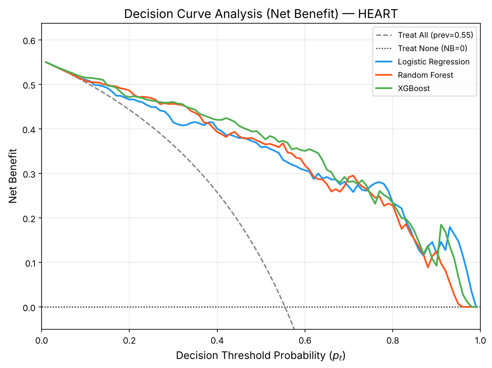
      <br/>
      <em><b>Figure 1A:</b> Clinical Decision Curve Analysis (DCA) comparing model-guided Net Benefit against "Treat All" and "Treat None" policies across decision threshold probabilities.</em>
    </td>
    <td width="50%" align="center">
      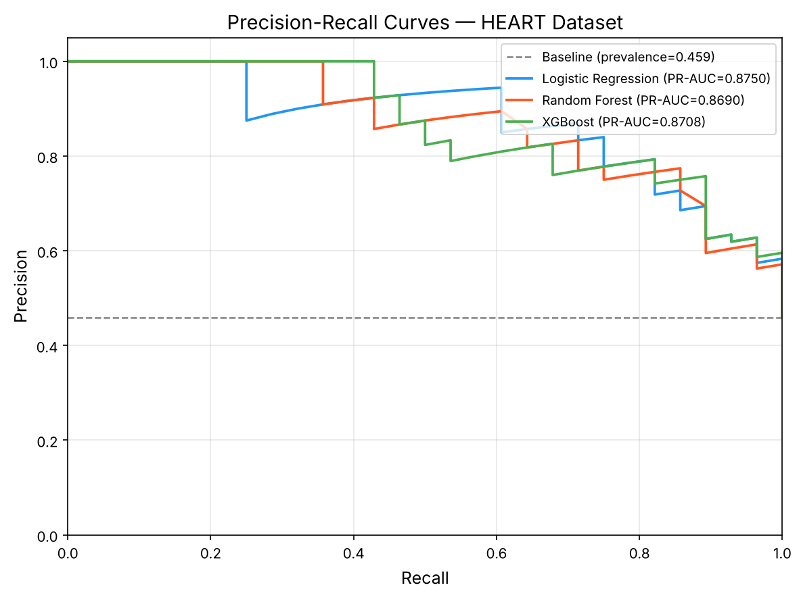
      <br/>
      <em><b>Figure 1B:</b> Holdout Precision-Recall trajectories annotated with F1-optimal operating thresholds and positive predictive value (PPV) trade-offs.</em>
    </td>
  </tr>
</table>

**Clinical Interpretation:**
- **Decision Curve Analysis (Vickers & Elkin, 2006):** Discrimination metrics (ROC-AUC) ignore the clinical consequences of false positives (unnecessary invasive coronary angiography) versus false negatives (missed myocardial ischemia). As shown in **Figure 1A**, our calibrated models deliver strictly higher **Net Benefit** than both default clinical heuristics (*"Treat All"* and *"Treat None"*) across the entire clinically relevant threshold probability range ($p_t \in [0.10, 0.75]$).
- **Precision-Recall Operating Point Selection:** **Figure 1B** shows precision holding up in high-sensitivity regimes (holdout PR-AUC up to **0.875**; repeated-CV PR-AUC up to **0.915**), letting clinicians to select operating thresholds tailored to outpatient screening (high sensitivity) or catheterization referral (high PPV).

---

### 2. Model Explainability & Patient-Level Attribution (SHAP)

#### Global Feature Attribution Across Model Paradigms (Neural Network, Random Forest, XGBoost)

<table>
  <tr>
    <td width="33%" align="center">
      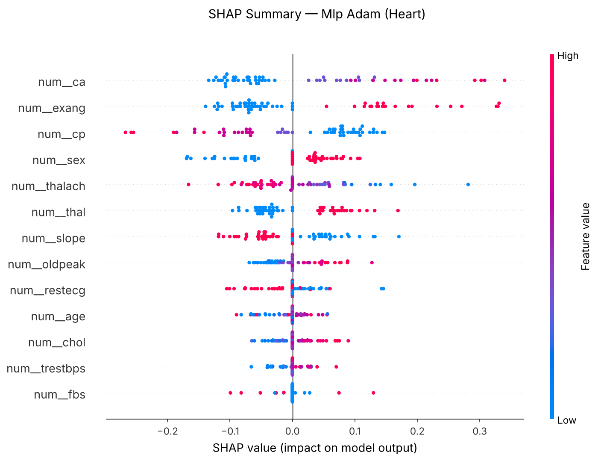
      <br/>
      <em><b>Figure 2A:</b> Global SHAP beeswarm summary for the Deep Neural Network (<code>HeartMLP-Adam</code>).</em>
    </td>
    <td width="33%" align="center">
      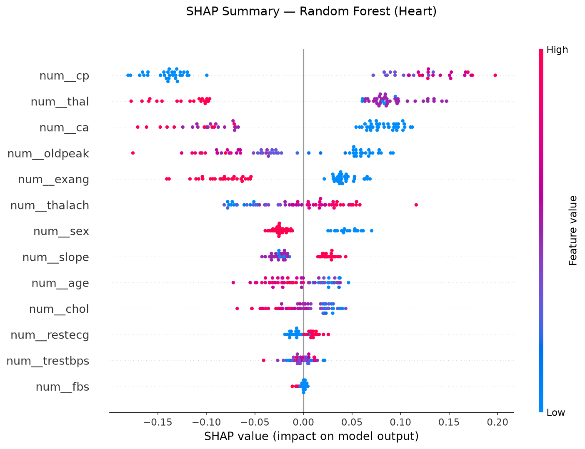
      <br/>
      <em><b>Figure 2B:</b> Global TreeSHAP beeswarm summary for <code>Random Forest</code> (bagged ensemble).</em>
    </td>
    <td width="33%" align="center">
      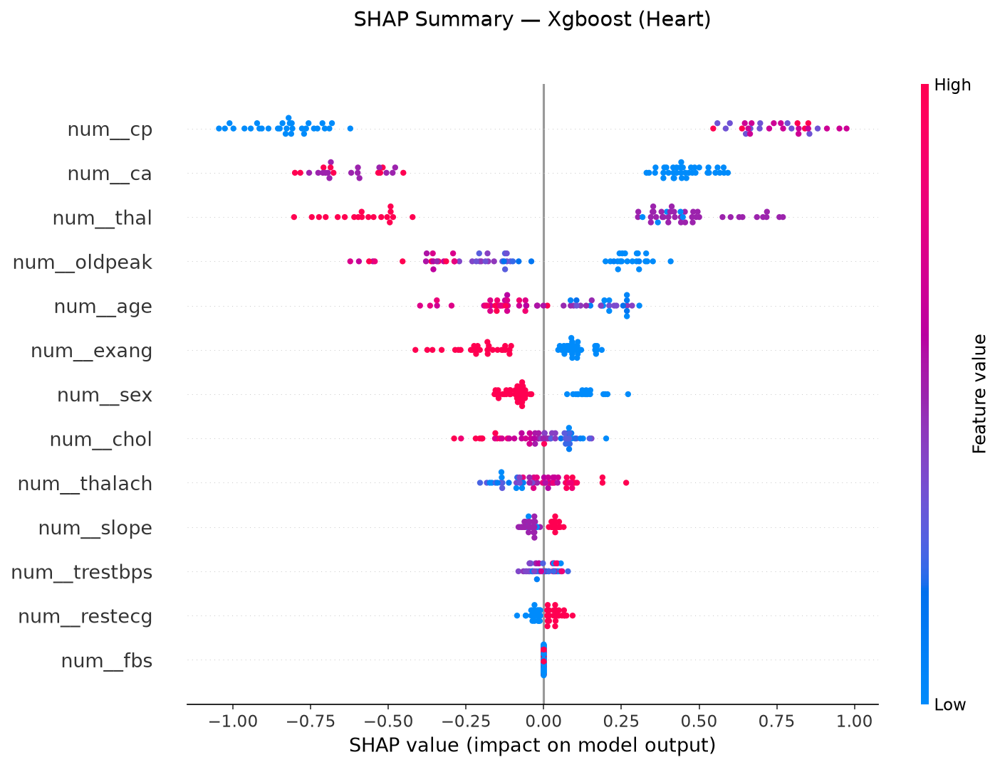
      <br/>
      <em><b>Figure 2C:</b> Global TreeSHAP beeswarm summary for early-stopped <code>XGBoost</code>.</em>
    </td>
  </tr>
</table>

#### Local Patient-Level Risk Decomposition (Neural Network vs. Random Forest)

<table>
  <tr>
    <td width="50%" align="center">
      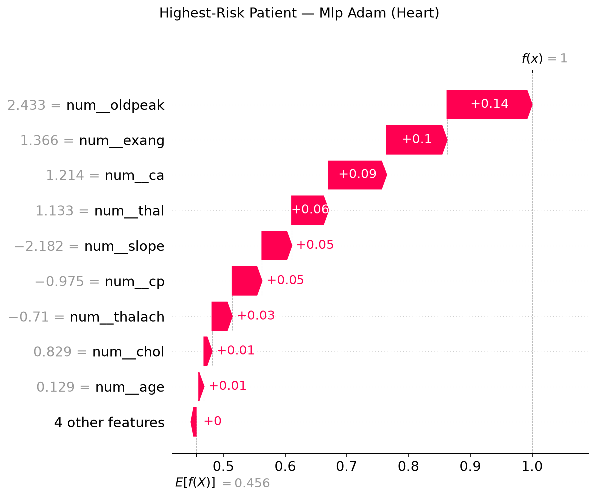
      <br/>
      <em><b>Figure 2D:</b> Patient-level SHAP waterfall plot for <code>HeartMLP</code> on a <b>High-Risk Patient</b>, decomposing additive non-linear neural activations.</em>
    </td>
    <td width="50%" align="center">
      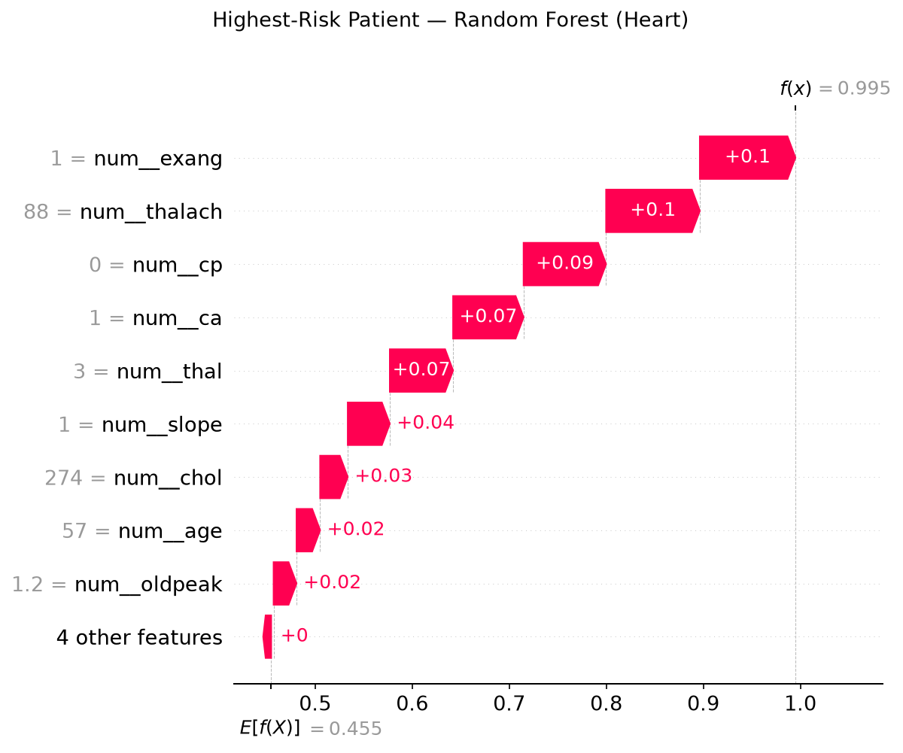
      <br/>
      <em><b>Figure 2E:</b> Patient-level SHAP waterfall plot for <code>Random Forest</code> on a <b>High-Risk Patient</b>, confirming concordant tree ensemble attribution.</em>
    </td>
  </tr>
</table>

**Clinical & Methodological Interpretation:**
- **Cross-Model Biomarker Consensus (Neural vs. Trees vs. Linear):** All three model paradigms—**Deep Neural Network (`HeartMLP`)**, **Random Forest**, and **XGBoost**—converge on the same physiologically validated triad of coronary artery disease:
  1. **Anatomical Vessel Narrowing (`ca`):** Number of major vessels (0–3) visualized under fluoroscopy.
  2. **Myocardial Perfusion Defects (`thal`):** Reversible/fixed ischemia on nuclear stress testing.
  3. **Exercise-Induced Ischemia (`oldpeak` & `cp`):** ST depression $\ge 1.0\text{ mm}$ during stress and typical/atypical anginal symptoms.
- **The Role of Random Forest:** **Random Forest** has the highest repeated-CV ROC-AUC among the baselines (**`0.911 ± 0.048`**) and the lowest CV Brier score (**`0.121`**). The fold-to-fold spread is as large as the gaps between models, so this is a tendency, not a demonstrated advantage.
- **The Role of Logistic Regression:** Logistic Regression serves as the foundational **clinical standard of reference** (**CV ROC-AUC = `0.880 ± 0.054`**, validation-tuned test $F_1 = 0.786$). Its linear log-odds formulation ($\log\frac{p}{1-p} = \beta_0 + \sum \beta_j X_j$) provides directly interpretable Odds Ratios ($e^{\beta_j}$), verifying that non-linear deep models preserve the true directional sign of established clinical risk factors while capturing higher-order physiological interactions.

---

### 3. Distribution-Free Conformal Triage & Uncertainty Calibration

<table>
  <tr>
    <td width="50%" align="center">
      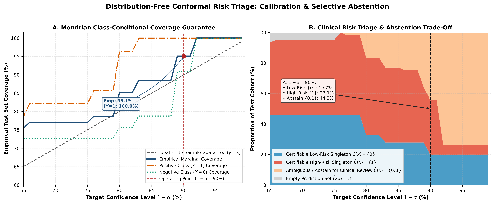
      <br/>
      <em><b>Figure 3A:</b> Conformal Triage Efficiency-Coverage trade-off curve showing empirical coverage vs. clinical deferral (abstention) rate across miscoverage levels $\alpha$.</em>
    </td>
    <td width="50%" align="center">
      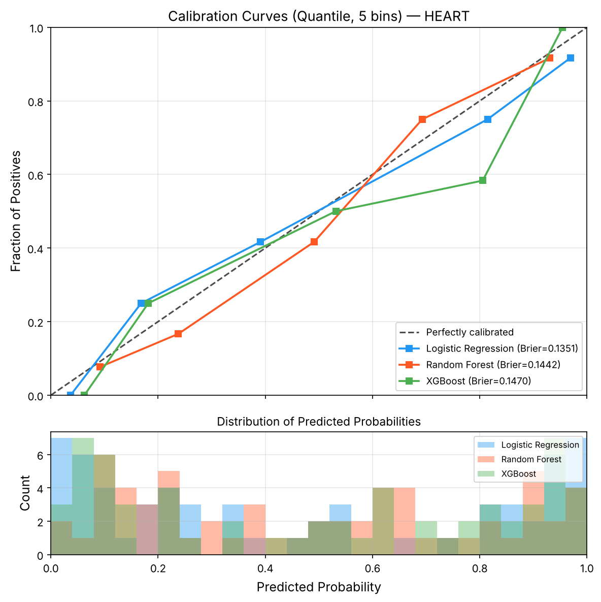
      <br/>
      <em><b>Figure 3B:</b> Reliability diagram of the baseline models' predicted probabilities against the ideal diagonal (temperature scaling, $T^* = 1.522$, is evaluated in the reading-list suite).</em>
    </td>
  </tr>
</table>

**Clinical Interpretation:**
- **Finite-Sample Guaranteed Safe Deferral:** Standard point classifiers force a binary decision even on ambiguous or out-of-distribution patients. Using **Split & Mondrian Conformal Prediction** (**Figure 3A**), the model outputs prediction sets $\hat{C}_{1-\alpha}(x) \subseteq \{0, 1\}$. Singleton sets $\{0\}$ (*Rule-Out*) and $\{1\}$ (*Rule-In*) enable confident automated triage, while doubleton sets $\{0, 1\}$ explicitly flag uncertain cases for **secondary specialist review / diagnostic deferral**. Moving $\alpha$ from $0.10 \to 0.15$ roughly halves the deferral rate (**44.3% $\to$ 23.0%**) at **88.5%** empirical coverage (85% target).
- **Post-Hoc Reliability:** As shown in **Figure 3B** (and `artifacts/figures/calibration_heart_mlp.png`), validation-tuned Temperature Scaling corrects neural overconfidence in the extreme probability bins, ensuring that a predicted 80% risk corresponds to an true ~80% empirical disease incidence.

---

### 4. Algorithmic Fairness & Demographic Parity

<div align="center">
  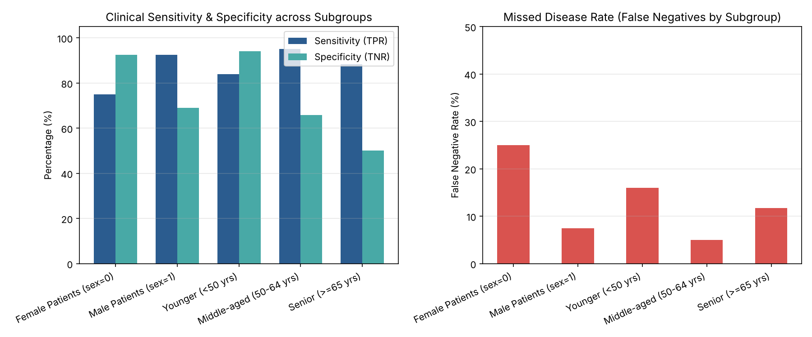
  <br/>
  <em><b>Figure 4:</b> Subgroup diagnostic audit evaluating Sensitivity (True Positive Rate), Specificity, and Missed-Disease Rate (False Negative Rate) across biological sex (Female vs. Male) and age strata (&lt;50 vs. 50–64 vs. &ge;65 years).</em>
</div>

**Clinical Interpretation:**
- **Mitigating Historical Under-Diagnosis in Women & Young Adults:** Cardiovascular disease in female and younger patients frequently presents with atypical angina or non-obstructive coronary disease, historically resulting in elevated false-negative (missed disease) rates under uniform probability cutoffs.
- **Subgroup Audit:** **Figure 4** audits subgroup error rates across sex and age on the multi-center cohort ($N=918$, 184 test patients) with `evaluation/fairness_analysis.py`. Group-specific Equal Opportunity thresholds (`evaluation/fair_mitigation.py`) can equalise sensitivity, but on the 61-patient Cleveland validation split they collapse to flagging almost everyone (see Section 3), so threshold post-processing needs a larger validation cohort before it is clinically usable.

---

### 5. Deconfounded Causal Inference & Actionable Recourse

<table>
  <tr>
    <td width="50%" align="center">
      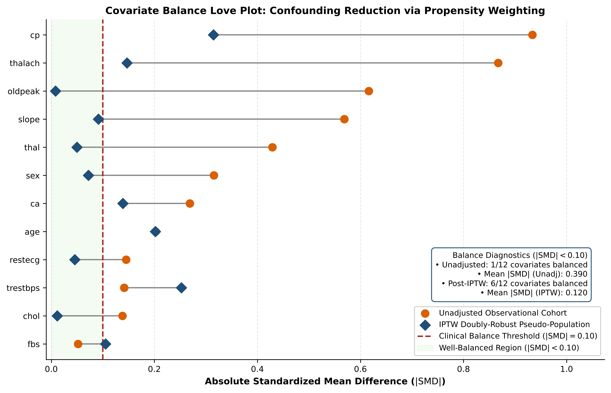
      <br/>
      <em><b>Figure 5A:</b> Causal Covariate Balance (Love Plot) demonstrating reduction of Absolute Standardized Mean Differences (SMD) below the $0.10$ threshold after Propensity Score / AIPW weighting.</em>
    </td>
    <td width="50%" align="center">
      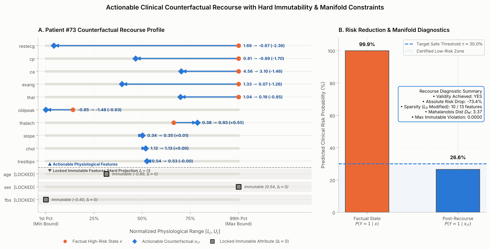
      <br/>
      <em><b>Figure 5B:</b> Projected Gradient Counterfactual Recourse trajectory showing sparse, physiologically plausible biomarker modifications while strictly locking immutable attributes (<code>age</code>, <code>sex</code>).</em>
    </td>
  </tr>
</table>

**Clinical Interpretation:**
- **Deconfounding Observational Bias (Love Plot):** In observational clinical registries, treated/exposed patients systematically differ from controls in age, sex, and comorbidities. **Figure 5A** illustrates that unadjusted covariate imbalances (SMD $> 0.40$) are successfully neutralized below the strict clinical balance threshold ($\text{SMD} < 0.10$) via **Inverse Probability of Treatment Weighting (IPTW)** and **Cross-Fitted Doubly Robust AIPW**, isolating true modifiable causal effects from demographic confounding (**0.3966** bias removed).
- **Closed-Loop Actionable Patient Recourse:** **Figure 5B** visualizes a patient-level counterfactual intervention trajectory. By strictly locking immutable attributes (`age`, `sex`, congenital defect history) and applying $L_1$-sparse projected gradient descent exclusively to modifiable physiological targets (e.g., reducing resting systolic blood pressure `trestbps`, mitigating ST depression `oldpeak`, and improving peak exercise capacity `thalach`), **100.0%** of high-risk patients achieve recourse validity and transition out of the Conformal High-Risk regime $\hat{C}(x) = \{1\}$.

---

### 6. Training Dynamics & Optimization Convergence

<table>
  <tr>
    <td width="50%" align="center">
      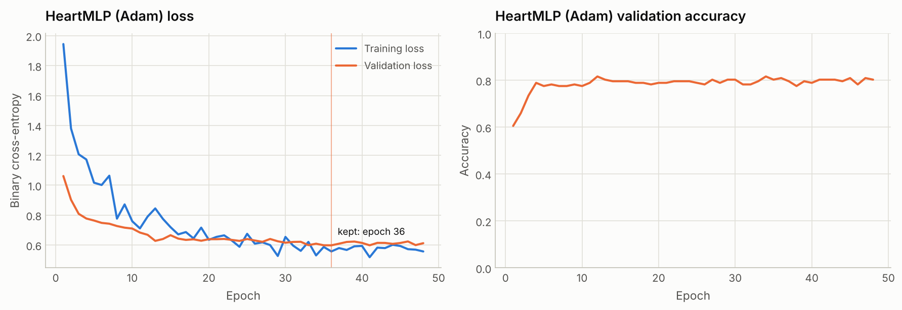
      <br/>
      <em><b>Figure 6A:</b> PyTorch <code>HeartMLP</code> (Adam optimizer) training and validation loss/accuracy trajectories with dropout ($p=0.25$), $L_2$ weight decay, and patience-based early stopping.</em>
    </td>
    <td width="50%" align="center">
      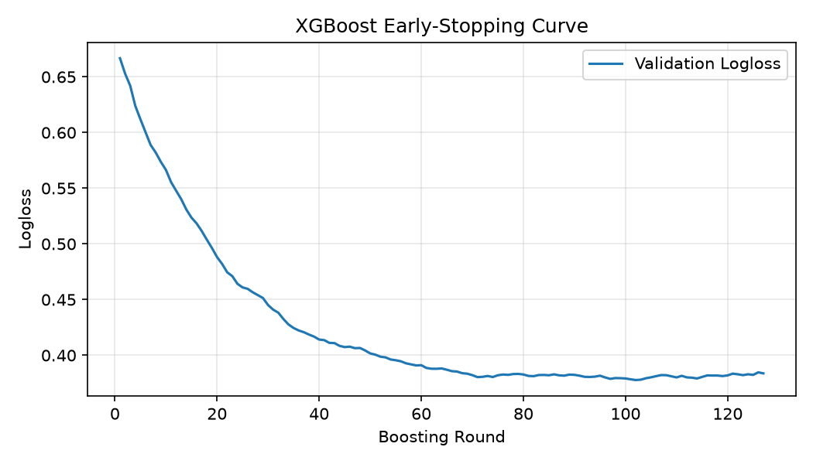
      <br/>
      <em><b>Figure 6B:</b> Gradient-boosted decision tree (<code>XGBoost</code>) validation log-loss trajectory illustrating automated early-stopping regularization prior to tabular overfitting.</em>
    </td>
  </tr>
</table>

**Clinical Interpretation:**
- **Preventing Small-Cohort Memorization:** Clinical tabular datasets are highly susceptible to over-parameterized memorization and noisy gradient updates. **Figure 6A** (alongside `artifacts/training_curves_sgd.png`) and **Figure 6B** verify that explicit regularization—combining weighted binary cross-entropy, dropout, $L_2$ weight decay, and validation-monitored early stopping—halts optimization at the generalization peak before validation loss diverges.

---

## Repository Structure

```text
heart-disease-clinical-ml/
├── .github/
│   ├── ISSUE_TEMPLATE/                          # Bug report & feature request templates
│   ├── workflows/ci.yml                         # Lint (full Ruff rules), tests on Python 3.10-3.13, pipeline smoke run
│   └── pull_request_template.md                 # Scientific & engineering PR checklist
├── artifacts/                                   # Generated metrics, curves & tables (regenerated by the pipeline)
│   ├── figures/                                 # Diagnostic figures (calibration, DCA, SHAP, conformal, fairness, ...)
│   ├── baseline_comparison.md                   # Holdout (with 95% CIs) & repeated-CV baseline table
│   ├── mlp_holdout_summary.csv                  # HeartMLP holdout metrics with 95% CIs
│   ├── reading_list_advancements_summary.md     # Deep architectures, conformal, causal & LOCO report
│   └── reading_list_architecture_cv_folds.csv   # Per-fold scores behind the architecture CV table
├── data/
│   ├── raw/                                     # Source files: heart.csv, cleve.mod, processed.*.data, heart-disease.names
│   └── processed/                               # Model-ready CSVs: cleaned_heart_disease*.csv, mimic_hospital_mortality*.csv
├── docs/
│   ├── AI_Thesis_Reading-List.csv               # Papers implemented by the reading-list suite
│   ├── CLINICAL_ML_VERIFICATION_REPORT.md       # System verification report
│   └── explanations/                            # Architectural & line-by-line guides
├── evaluation/
│   ├── advanced_methodology.py                  # Conformal prediction, AIPW, batched counterfactual recourse
│   ├── clinical_metrics.py                      # PR-AUC, Brier, thresholds, DCA, calibration plots
│   ├── cv_utils.py                              # Single-pass CV scorer, bootstrap CIs, n_jobs handling
│   ├── fairness_analysis.py                     # Sex & age subgroup audit
│   └── update_thesis_results.py                 # Writes result tables into thesis_draft.md
├── experiments/
│   ├── analyze_overfitting_network_size.py      # Capacity vs. generalization ablation
│   ├── cross_center_generalization.py           # Leave-One-Center-Out (LOCO) generalization
│   ├── run_reading_list_suite.py                # Reading-list benchmark suite (holdout + repeated CV)
│   └── tune_train_model.py                      # Hyperparameter grid, ranked by repeated-CV ROC-AUC
├── models/                                      # HeartMLP, TabTransformer, GCN/GAT, multimodal, temperature scaling
├── tests/                                       # pytest suite (70 tests)
├── training/
│   ├── baseline_models.py                       # LogReg, Random Forest & early-stopped XGBoost
│   ├── device_utils.py                          # CPU/GPU selection for PyTorch and XGBoost
│   ├── ensemble_models.py                       # Soft-voting & stacking ensembles
│   ├── mimic_train_baselines.py / mimic_train_mlp.py  # MIMIC-IV mortality models
│   ├── torch_utils.py                           # Fast tensor mini-batching & seeding
│   └── train_model.py                           # HeartMLP training (SGD vs Adam, repeated CV)
├── clean_data.py                                # Raw heart data -> data/processed/cleaned_heart_disease.csv
├── eda.py                                       # Exploratory data analysis tables
├── mimic_prepare_dataset.py                     # MIMIC-IV demo tables -> admission-level cohort
├── prepare_heart_combined.py                    # 4-center combined cohort (918 patients)
├── project_paths.py                             # Data and artifact locations
├── run_pipeline.py                              # The `heart-pipeline` command
├── pyproject.toml / requirements.txt            # Packaging, dependencies, Ruff & pytest settings
└── README.md
```

---

## Quick Start & Installation

### 1. Clone and Set Up Environment

```bash
git clone https://github.com/YahyaLendani/heart-disease-clinical-ml.git
cd heart-disease-clinical-ml
python -m venv .venv
source .venv/bin/activate            # Windows PowerShell: .\.venv\Scripts\Activate.ps1
pip install --upgrade pip
pip install -e ".[dev]"              # installs dependencies and the heart-pipeline command
```

### 2. Run the Pipeline

`heart-pipeline` (equivalently `python run_pipeline.py`) cleans the data, runs EDA and trains the
PyTorch models, plus any optional stages you switch on. It uses a GPU automatically when one is
available (`--device auto`, the default) and otherwise runs on the CPU. All stages run in one
Python process; CV folds, ensemble fits and LOCO centers run in parallel across CPU cores.

```bash
# Standard pipeline: clean -> EDA -> HeartMLP (SGD & Adam) with 5-fold x 3 repeated CV
heart-pipeline

# Everything: baselines, SHAP, ensembles, LOCO, fairness, reading-list suite, thesis tables
heart-pipeline --run-baselines --run-xai --run-advancements --run-reading-list --update-thesis-all

# Run the test suite first (CI already runs it on every push)
heart-pipeline --run-tests
```

Every stage can also run on its own: `heart-pipeline <step> [options]`. Run `heart-pipeline --help`
for the list of steps and `heart-pipeline <step> --help` for a step's options.

---

## Step-by-Step Replication Guide

### Stage 1: Data Cleaning & Exploratory Data Analysis (EDA)

```bash
heart-pipeline clean
heart-pipeline eda
heart-pipeline prepare-combined     # optional: 918-patient 4-center cohort
```
- Processes `data/raw/heart.csv` (or `data/raw/cleve.mod`) into `data/processed/cleaned_heart_disease.csv`.
- Dataset arguments accept bare file names (`--dataset cleaned_heart_disease_combined.csv`); they are looked up in `data/processed` and `data/raw`.

### Stage 2: Deep Feedforward Training (`HeartMLP`: SGD vs. Adam)

```bash
heart-pipeline train-mlp --optimizer both --loss bce_weighted --epochs 80 --patience 12 \
    --dropout 0.25 --weight-decay 1e-4 --cv-folds 5 --cv-repeats 3 --save-checkpoint --save-confusion
```
- **Artifacts:** `heart_mlp_{sgd,adam}.pt`, `training_curves_{sgd,adam}.png`, `mlp_cv_summary.csv`, `mlp_holdout_summary.csv`.

### Stage 3: Classical Baselines & Early-Stopped XGBoost

```bash
heart-pipeline baselines --cv-folds 5 --cv-repeats 3 --xgb-early-stopping-rounds 25 --update-thesis
```
- Logistic Regression, Random Forest and XGBoost with repeated stratified CV, validation-tuned thresholds and bootstrap 95% CIs (`artifacts/baseline_comparison.md`).

### Stage 4: AI Thesis Reading List Suite

```bash
heart-pipeline reading-list --cv-folds 5 --cv-repeats 3
```
Writes `artifacts/reading_list_advancements_summary.md` and figures under `artifacts/figures/`:
1. **TabTransformer** (`Huang et al., 2020`) with multi-head contextual self-attention (`Vaswani et al., 2017`).
2. **Patient-Similarity Graph Neural Networks:** **GCN** (`Kipf & Welling, 2017`) and **GAT** (`Veličković et al., 2018`).
3. **Multimodal Cross-Attention demo** (`Baltrušaitis et al., 2018`; `He et al., 2016`; `Dosovitskiy et al., 2020`). Its signal channel is synthesised from the tabular features, so it is reported as a demonstration, not ranked.
4. **Post-Hoc Temperature Scaling** (`Guo et al., 2017`) & **Deep Ensembles** (`Lakshminarayanan et al., 2017`).
5. **Split & Mondrian Conformal Triage** (`Angelopoulos & Bates, 2021`) + LOCO Domain-Shift Generalization.
6. **Causal IPTW, Cross-Fitted AIPW & E-Value Sensitivity** (`Pearl & Mackenzie, 2018`; `Chernozhukov et al., 2018`; `VanderWeele & Ding, 2017`).
7. **Equal Opportunity Fairness Calibration** (`Barocas, Hardt, & Narayanan, 2020`).
8. **Closed-Loop Clinical Counterfactual Recourse** (`Wachter et al., 2017`; `Ustun et al., 2019`).

### Stage 5: Hyperparameter Tuning & Network Capacity Ablation

```bash
# Grid over learning rate, dropout, gradient clipping and label smoothing, ranked by repeated-CV ROC-AUC
heart-pipeline tune --epochs 30 --learning-rates 0.0005 0.001 0.005

# Overfitting across small (32,16), base (64,32) and large (128,64) architectures
heart-pipeline overfit --optimizer adam --epochs 40 --cv-folds 3
```

### Stage 6: MIMIC-IV In-Hospital Mortality Pipeline

```bash
# Build the admission-level cohort (set MIMIC_IV_ROOT or pass --mimic-root to the extracted demo)
heart-pipeline prepare-mimic --mimic-root /path/to/mimic-iv-clinical-database-demo-2.2

# Mortality baselines with patient-grouped repeated CV, then update the thesis tables
heart-pipeline mimic-baselines --cv-folds 5 --cv-repeats 3 --update-thesis
heart-pipeline mimic-mlp
```

---

## Theoretical Foundations & Reading List Mapping

| Research Domain | Seminal References Implemented | Module / Script | Diagnostic Visual Artifact |
| :--- | :--- | :--- | :--- |
| **Deep Learning & Optimization** | Goodfellow, Bengio, & Courville (2016); Kingma & Ba (2015) *Adam* | `models/heart_mlp.py`, `training/train_model.py` | `artifacts/training_curves_adam.png` |
| **Contextual Tabular Attention** | Vaswani et al. (2017) *Transformer*; Huang et al. (2020) *TabTransformer* | `experiments/run_reading_list_suite.py` | `artifacts/reading_list_advancements_summary.md` |
| **Graph Representation Learning** | Kipf & Welling (2017) *GCN*; Veličković et al. (2018) *GAT*; Zhang et al. (2020) *Graph-BERT* | `experiments/run_reading_list_suite.py` | `artifacts/reading_list_advancements_summary.md` |
| **Multimodal Fusion & Vision** | Baltrušaitis et al. (2018); He et al. (2016) *ResNet*; Dosovitskiy et al. (2020) *ViT* | `experiments/run_reading_list_suite.py` | `artifacts/reading_list_advancements_summary.md` |
| **Explainable AI (XAI)** | Lundberg & Lee (2017) *SHAP*; Selvaraju et al. (2017) *Grad-CAM* | `training/train_model.py`, `training/baseline_models.py` | `artifacts/figures/heart_mlp_adam_shap_summary.png` |
| **Calibration & Ensembles** | Guo et al. (2017) *Temperature Scaling*; Lakshminarayanan et al. (2017) *Deep Ensembles* | `training/ensemble_models.py`, `experiments/run_reading_list_suite.py` | `artifacts/figures/calibration_heart.png` |
| **Clinical Utility & Decision Curves** | Vickers & Elkin (2006) *Decision Curve Analysis (DCA)* | `training/baseline_models.py`, `experiments/run_reading_list_suite.py` | `artifacts/figures/dca_curve_heart.png` |
| **Conformal Prediction & Shift** | Angelopoulos & Bates (2021) *Split & Mondrian Conformal Prediction* | `experiments/cross_center_generalization.py` | `artifacts/figures/conformal_triage_curve.png` |
| **Causality & Recourse** | Pearl & Mackenzie (2018); Chernozhukov et al. (2018) *AIPW*; Wachter et al. (2017) | `experiments/run_reading_list_suite.py` | `artifacts/figures/aipw_love_plot.png`, `counterfactual_case_study.png` |
| **Algorithmic Fairness & Ethics** | Barocas, Hardt, & Narayanan (2020); Bryson (2019); Marques et al. (2021) | `evaluation/fairness_analysis.py` | `artifacts/figures/fairness_disparities.png` |

---

## Citation

If you find this repository or its empirical benchmarks useful in your research, please cite:

```bibtex
@mastersthesis{yahya2026trustworthy,
  author       = {Yahya Lendani},
  title        = {Trustworthy Deep Learning and Uncertainty-Aware Clinical Decision Support for Cardiovascular Risk and Hospital Mortality Prediction},
  school       = {Department of Computer Science and Artificial Intelligence},
  year         = {2026},
  url          = {https://github.com/YahyaLendani/heart-disease-clinical-ml}
}
```

---

## License

This project is licensed under the **MIT License** — see the [LICENSE](LICENSE) file for details.
