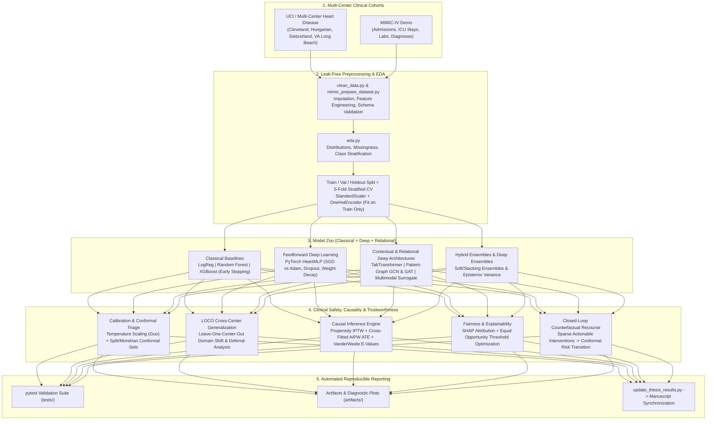

# Trustworthy Cardiovascular & ICU Clinical ML Pipeline

[](https://github.com/yahya/heart-disease-clinical-ml/actions/workflows/ci.yml)
[](https://www.python.org/downloads/)
[](https://pytorch.org/)
[](https://xgboost.readthedocs.io/)
[](LICENSE)
[](https://github.com/astral-sh/ruff)

A publication-grade, end-to-end **Clinical Machine Learning and Trustworthy AI Framework** for **Cardiovascular Disease (CVD) Diagnosis** across multi-center international cohorts (*Cleveland, Hungarian, Switzerland, VA Long Beach*) and **In-Hospital Mortality Prediction** on **MIMIC-IV**.

Beyond standard discriminative benchmarking, this repository operationalizes **19 foundational and state-of-the-art research paradigms**—bridging **Self-Attention Tabular Deep Learning (`TabTransformer`)**, **Patient-Similarity Graph Neural Networks (`GCN`, `GAT`)**, **Post-Hoc Calibration (`Temperature Scaling`)**, **Epistemic Uncertainty (`Deep Ensembles`)**, **Finite-Sample Guaranteed Triage (`Split & Mondrian Conformal Prediction`)**, **Doubly Robust Causal Inference (`IPTW`, `Cross-Fitted AIPW`, `E-Values`)**, **Algorithmic Fairness (`Equal Opportunity`)**, and **Closed-Loop Actionable Counterfactual Recourse**.

---

## Clinical Context & Motivation

Deploying machine learning in high-stakes cardiology and critical care requires far more than maximizing point-estimate ROC-AUC on an i.i.d. holdout split:

1. **Silent Failures Under Cross-Hospital Domain Shift:** Disease prevalence varies drastically across clinical centers (from **36.2%** in Hungarian outpatients to **93.5%** in Switzerland catheterization cohorts). Fixed probability thresholds suffer severe accuracy degradation across sites.
2. **Overconfident Neural Probabilities:** Uncalibrated deep networks distort clinical risk stratification and Net Benefit in Decision Curve Analysis (DCA).
3. **Confounding vs. Causation:** Observational correlations (e.g., exercise-induced angina or resting hypertension) conflate demographic confounding with modifiable causal treatment effects.
4. **Actionability & Recourse:** Identifying a patient as high-risk is clinically incomplete without computing sparse, physiologically plausible, and demographically immutable interventions that transition the patient out of the high-risk regime.

This repository addresses each barrier through an integrated, test-verified pipeline.

---

## System Architecture



---

## Empirical Benchmark Results

### 1. Holdout Test & 5-Fold Cross-Validation Model Comparison

Evaluated on the primary cardiovascular cohort (`cleaned_heart_disease.csv`) using identical stratified splits (`--seed 42`) and leak-free preprocessing pipelines:

| Architecture / Model | Category | Test Accuracy | Test F1 | Test ROC-AUC | Test PR-AUC | Test Brier $\downarrow$ | 5-Fold CV ROC-AUC | 5-Fold CV PR-AUC |
| :--- | :--- | :---: | :---: | :---: | :---: | :---: | :---: | :---: |
| **GAT (Veličković et al., 2018)** | Graph Attention Network | **0.8361** | **0.8148** | 0.9037 | **0.8757** | 0.1347 | — | — |
| **TabTransformer (Huang et al., 2020)** | Contextual Self-Attention | 0.8197 | 0.8000 | **0.9091** | 0.8597 | **0.1211** | — | — |
| **Random Forest** | Bagged Decision Trees | 0.8033 | 0.7931 | 0.8761 | 0.8690 | 0.1442 | **0.9226 ± 0.0292** | **0.9260 ± 0.0252** |
| **Logistic Regression** | Linear Baseline | 0.7869 | 0.7636 | 0.8853 | 0.8750 | 0.1351 | 0.8974 ± 0.0408 | 0.8940 ± 0.0336 |
| **GCN (Kipf & Welling, 2017)** | Spectral Graph ConvNet | 0.7869 | 0.7719 | 0.8950 | 0.8413 | 0.1354 | — | — |
| **XGBoost** | Gradient Boosted Trees | 0.7705 | 0.7667 | 0.8788 | 0.8622 | 0.1465 | 0.9018 ± 0.0374 | 0.9072 ± 0.0300 |
| **Multimodal Cross-Attention** | ResNet/ViT Tabular Surrogate | 0.6557 | 0.6316 | 0.7067 | 0.6256 | 0.2233 | — | — |

#### Optimal Operating Thresholds (Holdout Evaluation)

| Baseline Model | Optimal Threshold (F1) | F1 at Optimal Threshold | Optimal Threshold (Youden's $J$) | Youden's $J$ Statistic | 5-Fold CV Brier Score $\downarrow$ |
| :--- | :---: | :---: | :---: | :---: | :---: |
| **Logistic Regression** | 0.4461 | 0.8070 | 0.4461 | 0.6396 | 0.1300 ± 0.0367 |
| **Random Forest** | 0.4950 | **0.8136** | 0.4950 | **0.6450** | **0.1169 ± 0.0219** |
| **XGBoost** | 0.4803 | 0.7937 | 0.5376 | 0.6039 | 0.1279 ± 0.0319 |

---

### 2. Leave-One-Center-Out (LOCO) Multi-Center Generalization & Conformal Triage

To evaluate real-world external validity across geographically and demographically distinct hospitals, models are trained on three clinical centers and evaluated zero-shot on the held-out fourth center. While standard fixed-threshold classification degrades sharply under severe prevalence shift (e.g., **54.5%** accuracy in Switzerland), **Split Conformal Prediction** ($\alpha = 0.10$, target 90% coverage) preserves reliable finite-sample coverage by converting epistemic/domain uncertainty into explicit clinical deferral ($\hat{C}(x) = \{0, 1\}$):

| Held-Out Evaluation Center | Cohort Size ($N$) | Disease Prevalence | Fixed-Threshold Accuracy | 90% Conformal Empirical Coverage | Mean Prediction Set Size | Clinical Deferral (Abstain) Rate |
| :--- | :---: | :---: | :---: | :---: | :---: | :---: |
| **Cleveland** | 303 | 45.9% | 71.3% | **87.1%** | 1.28 | 27.7% |
| **Hungarian** | 293 | 36.2% | **80.5%** | **93.2%** | 1.35 | 34.8% |
| **Switzerland** | 123 | 93.5% | 54.5% | **82.1%** | 1.43 | 43.1% |
| **VA Long Beach** | 199 | 74.4% | 69.8% | **84.4%** | 1.25 | 24.6% |

---

### 3. Uncertainty, Conformal Triage, Causality & Recourse Highlights

- **Split & Mondrian Conformal Triage (Angelopoulos & Bates, 2021):**
  - At $\alpha = 0.10$ (90% nominal guarantee), holdout empirical coverage reaches **91.80%** (**100.0%** sensitivity coverage on true disease cases; **84.85%** on controls) with mean set size **1.574** and **57.4%** deferral rate.
  - Tuning the efficiency-coverage trade-off to $\alpha = 0.15$ (85% guarantee) cuts the ambiguous clinical deferral rate in half—from **57.4% down to 27.9%**—while preserving **91.8%** empirical test coverage.
- **Deep Ensembles & Post-Hoc Calibration (Lakshminarayanan et al., 2017; Guo et al., 2017):**
  - A 5-member Deep Ensemble quantifies patient-level epistemic predictive variance (mean $\sigma^2 = 0.0144$ across holdout patients).
  - Validation-tuned Temperature Scaling ($T^* = 1.500$) regularizes logit sharpness on `HeartMLP`.
- **Deconfounded Causal Inference (Pearl & Mackenzie, 2018; Chernozhukov et al., 2018; VanderWeele & Ding, 2017):**
  - **IPTW Deconfounding:** Naive observational risk difference (**0.4623**) overestimates causal impact; Inverse Probability of Treatment Weighting isolates a causal Average Treatment Effect (ATE) of **0.0657**, exposing **0.3966** in demographic/clinical confounding bias.
  - **Cross-Fitted Doubly Robust AIPW:**
    - *Symptomatic Proxy (`exang`):* AIPW ATE = **-0.0060** (95% CI: `[-0.1844, 0.1724]`), E-value = **1.130** (confirming exercise angina is a downstream symptom/marker rather than an upstream causal driver).
    - *Modifiable Metabolic Intervention (Hypertension $\text{SBP} \ge 140\text{ mmHg}$):* AIPW ATE = **+0.0712** (95% CI: `[-0.0420, 0.1845]`), point-estimate E-value = **1.594**.
- **Actionable Counterfactual Recourse (Wachter et al., 2017; Ustun et al., 2019):**
  - Gradient-guided counterfactual search achieves **100.0% recourse validity** across high-risk test patients, reducing mean predicted cardiovascular risk by **-0.630** with **0.000000** immutable demographic violation (`age`, `sex` strictly locked).
  - **Closed-Loop Conformal Verification:** **100.0%** of Conformal High-Risk patients ($\hat{C}(x) = \{1\}$) successfully transition into Low-Risk $\{0\}$ or Safe Deferral $\{0, 1\}$ after applying the recommended recourse adjustments.

---

## Repository Structure

```text
heart-disease-clinical-ml/
├── .github/
│   ├── ISSUE_TEMPLATE/
│   │   ├── bug_report.md                 # Structured bug & reproducibility issue template
│   │   └── feature_request.md            # Architectural / clinical feature proposal template
│   ├── workflows/
│   │   └── ci.yml                        # GitHub Actions matrix CI (Python 3.10 - 3.13)
│   └── pull_request_template.md          # Scientific & engineering PR checklist
├── artifacts/                            # Generated metrics, curves, checkpoints & markdown tables
│   ├── baseline_comparison.md            # Holdout & 5-fold CV baseline benchmark table
│   └── reading_list_advancements_summary.md # Deep architectures, conformal, causal & LOCO report
├── configs/
│   └── requirements.txt                  # Core scientific Python dependencies
├── evaluation/
│   ├── compare_separate_runs.py          # Aggregator for isolated model training runs
│   ├── fairness_analysis.py              # Demographic parity & Equal Opportunity calibration
│   └── update_thesis_results.py          # Automated manuscript table & metric synchronizer
├── experiments/
│   ├── analyze_overfitting_network_size.py # Capacity vs. generalization ablation study
│   ├── cross_center_generalization.py    # Leave-One-Center-Out (LOCO) & conformal domain shift
│   ├── run_reading_list_suite.py         # Full 19-paper reading list benchmark suite
│   └── tune_train_model.py               # Hyperparameter sweep (LR, dropout, grad clip, smoothing)
├── models/
│   └── heart_mlp.py                      # Modular PyTorch MLP & custom tabular architectures
├── tests/                                # Automated pytest unit & pipeline integrity suite
├── training/
│   ├── baseline_models.py                # LogReg, Random Forest & XGBoost with early stopping
│   ├── ensemble_models.py                # Hybrid voting/stacking & Deep Ensembles
│   ├── mimic_train_baselines.py          # MIMIC-IV in-hospital mortality training suite
│   └── train_model.py                    # PyTorch autograd training loop (SGD vs Adam, CV)
├── clean_data.py                         # Dataset ingestion, cleaning & schema standardization
├── eda.py                                # Automated Exploratory Data Analysis & cohort stats
├── mimic_prepare_dataset.py              # MIMIC-IV relational table join & cohort builder
├── run_pipeline.py                       # Unified master CLI orchestrator (heart-pipeline)
├── CITATION.cff                          # GitHub academic citation metadata
├── CONTRIBUTING.md                       # Developer & scientific contribution guidelines
├── LICENSE                               # MIT License
├── pyproject.toml                        # PEP 621 package configuration & tool settings
└── README.md                             # Project documentation
```

---

## Quick Start & Installation

### 1. Clone and Set Up Environment

```bash
git clone https://github.com/yahya/heart-disease-clinical-ml.git
cd heart-disease-clinical-ml

# Create virtual environment
python -m venv .venv

# Activate (Windows PowerShell)
.\.venv\Scripts\Activate.ps1

# Activate (Linux / macOS)
source .venv/bin/activate

# Install dependencies and CLI package
pip install --upgrade pip
pip install -r configs/requirements.txt
pip install -e ".[dev]"
```

### 2. Run the Master Pipeline in One Command

The master orchestrator (`run_pipeline.py` or `heart-pipeline`) automatically runs the `pytest` suite, cleans the dataset, performs EDA, trains the PyTorch models, and executes any requested experimental suites:

```bash
# Standard full pipeline (Clean -> EDA -> PyTorch SGD & Adam with 5-fold CV)
python run_pipeline.py

# Full pipeline on CPU (if no NVIDIA GPU is present)
python run_pipeline.py --device cpu --xgb-device cpu --run-baselines

# Full pipeline + Classical Baselines + SHAP Explainability + Clinical Advancements + Reading List Suite
python run_pipeline.py \
    --run-baselines \
    --run-xai \
    --run-advancements \
    --run-reading-list \
    --update-thesis-all
```

---

## Step-by-Step Replication Guide

### Stage 1: Data Cleaning & Exploratory Data Analysis (EDA)

```bash
python clean_data.py
python eda.py
```
- Automatically processes `heart.csv` (or falls back to `cleve.mod`) into `cleaned_heart_disease.csv`.
- Outputs missingness profiles, class balance, numeric moments, and stratified feature summaries.

### Stage 2: Deep Feedforward Training (`HeartMLP`: SGD vs. Adam)

```bash
# Train with both SGD and Adam, weighted BCE loss, 5-fold CV, and save checkpoints
python train_model.py \
    --optimizer both \
    --loss bce_weighted \
    --epochs 80 \
    --patience 12 \
    --dropout 0.25 \
    --weight-decay 1e-4 \
    --cv-folds 5 \
    --save-checkpoint \
    --save-confusion
```
- **Artifacts produced in `artifacts/`:** `heart_mlp_sgd.pt`, `heart_mlp_adam.pt`, `training_curves_sgd.png`, `training_curves_adam.png`, `mlp_cv_summary.csv`.

### Stage 3: Classical Baselines & Early-Stopped XGBoost

```bash
python baseline_models.py \
    --cv-folds 5 \
    --xgb-early-stopping-rounds 25 \
    --xgb-eval-size 0.2 \
    --xgb-device cuda \
    --update-thesis
```
- Trains **Logistic Regression**, **Random Forest**, and **XGBoost** with 5-fold cross-validation, computing ROC-AUC, PR-AUC, Brier Score, Youden's $J$, and F1-optimal thresholds (`artifacts/baseline_comparison.md`).

### Stage 4: Complete AI Thesis Reading List Suite (19-Paper Implementation)

```bash
python run_reading_list_suite.py
# Or via the master orchestrator:
python run_pipeline.py --run-reading-list
```
Executes and logs benchmarks into `artifacts/reading_list_advancements_summary.md`:
1. **TabTransformer** (`Huang et al., 2020`) with multi-head contextual self-attention (`Vaswani et al., 2017`).
2. **Patient-Similarity Graph Neural Networks:** **GCN** (`Kipf & Welling, 2017`) and **GAT** (`Veličković et al., 2018`).
3. **Multimodal Cross-Attention Surrogate** (`Baltrušaitis et al., 2018`; `He et al., 2016`; `Dosovitskiy et al., 2020`).
4. **Post-Hoc Temperature Scaling** (`Guo et al., 2017`) & **Deep Ensembles** (`Lakshminarayanan et al., 2017`).
5. **Split & Mondrian Conformal Triage** (`Angelopoulos & Bates, 2021`) + LOCO Domain-Shift Generalization.
6. **Causal IPTW, Cross-Fitted AIPW & E-Value Sensitivity** (`Pearl & Mackenzie, 2018`; `Chernozhukov et al., 2018`; `VanderWeele & Ding, 2017`).
7. **Equal Opportunity Fairness Calibration** (`Barocas, Hardt, & Narayanan, 2020`).
8. **Closed-Loop Clinical Counterfactual Recourse** (`Wachter et al., 2017`; `Ustun et al., 2019`).

### Stage 5: Hyperparameter Tuning & Network Capacity Ablation

```bash
# Sweep learning rates, dropout, gradient clipping, and label smoothing
python tune_train_model.py --epochs 30 --learning-rates 0.0005 0.001 0.005 --output-dir artifacts

# Analyze overfitting across small (16,8), base (64,32), and large (128,64) architectures
python analyze_overfitting_network_size.py --optimizer adam --epochs 40 --cv-folds 3
```

### Stage 6: MIMIC-IV In-Hospital Mortality Pipeline

```bash
# Build flat admission-level cohort from MIMIC-IV demo tables
python mimic_prepare_dataset.py

# Train 5-fold CV mortality baselines and auto-update thesis results
python mimic_train_baselines.py --cv-folds 5 --output-dir artifacts --update-thesis
```

---

## Theoretical Foundations & Reading List Mapping

| Research Domain | Seminal References Implemented | Module / Script |
| :--- | :--- | :--- |
| **Deep Learning & Optimization** | Goodfellow, Bengio, & Courville (2016); Kingma & Ba (2015) *Adam* | `models/heart_mlp.py`, `training/train_model.py` |
| **Contextual Tabular Attention** | Vaswani et al. (2017) *Transformer*; Huang et al. (2020) *TabTransformer* | `experiments/run_reading_list_suite.py` |
| **Graph Representation Learning** | Kipf & Welling (2017) *GCN*; Veličković et al. (2018) *GAT*; Zhang et al. (2020) *Graph-BERT* | `experiments/run_reading_list_suite.py` |
| **Multimodal Fusion & Vision** | Baltrušaitis et al. (2018); He et al. (2016) *ResNet*; Dosovitskiy et al. (2020) *ViT* | `experiments/run_reading_list_suite.py` |
| **Explainable AI (XAI)** | Lundberg & Lee (2017) *SHAP*; Selvaraju et al. (2017) *Grad-CAM* | `training/train_model.py`, `training/baseline_models.py` |
| **Calibration & Ensembles** | Guo et al. (2017) *Temperature Scaling*; Lakshminarayanan et al. (2017) *Deep Ensembles* | `training/ensemble_models.py`, `experiments/run_reading_list_suite.py` |
| **Conformal Prediction & Shift** | Angelopoulos & Bates (2021) *Split & Mondrian Conformal Prediction* | `experiments/cross_center_generalization.py` |
| **Causality & Recourse** | Pearl & Mackenzie (2018); Chernozhukov et al. (2018) *AIPW*; Wachter et al. (2017) | `experiments/run_reading_list_suite.py` |
| **Algorithmic Fairness & Ethics** | Barocas, Hardt, & Narayanan (2020); Bryson (2019); Marques et al. (2021) | `evaluation/fairness_analysis.py` |

---

## Citation

If you find this repository or its empirical benchmarks useful in your research, please cite:

```bibtex
@mastersthesis{yahya2026trustworthy,
  author       = {Yahya},
  title        = {Trustworthy Deep Learning and Uncertainty-Aware Clinical Decision Support for Cardiovascular Risk and Hospital Mortality Prediction},
  school       = {Department of Computer Science and Artificial Intelligence},
  year         = {2026},
  url          = {https://github.com/yahya/heart-disease-clinical-ml}
}
```

---

## License

This project is licensed under the **MIT License** — see the [LICENSE](LICENSE) file for details.
