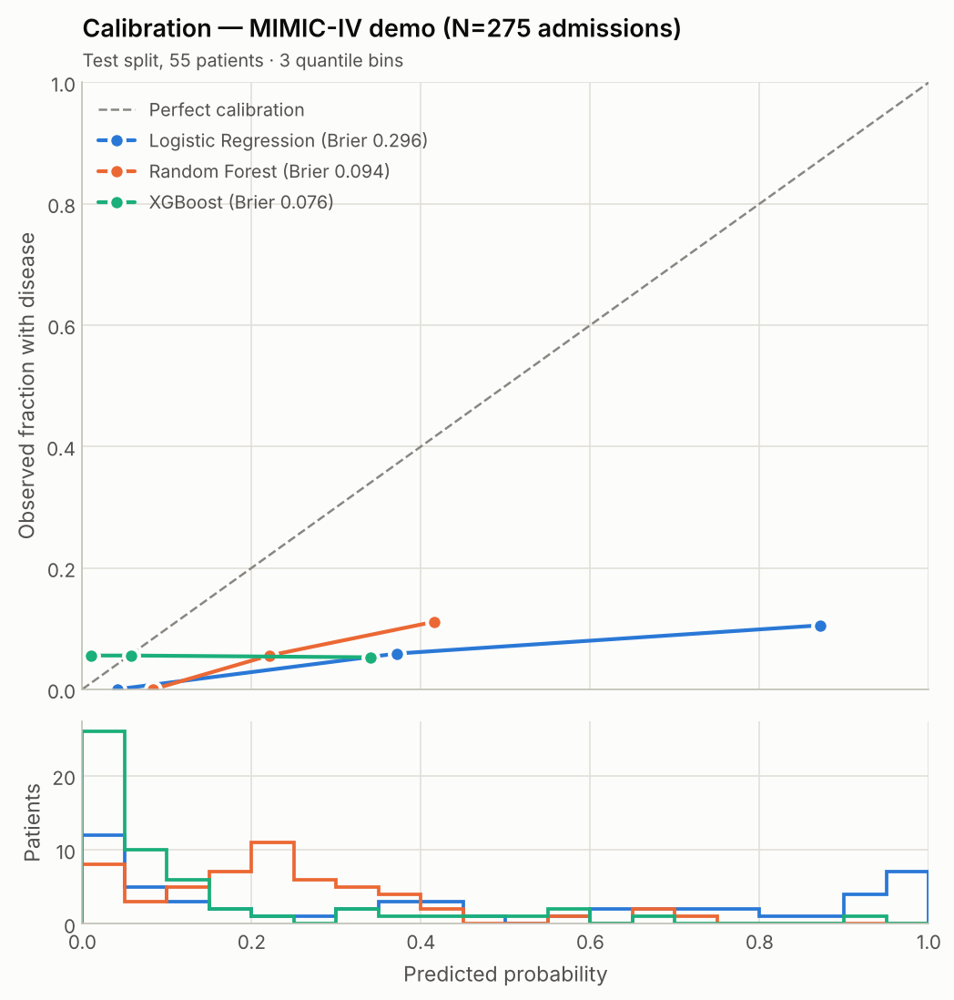
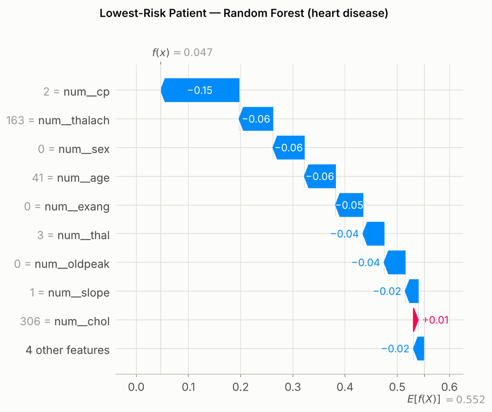
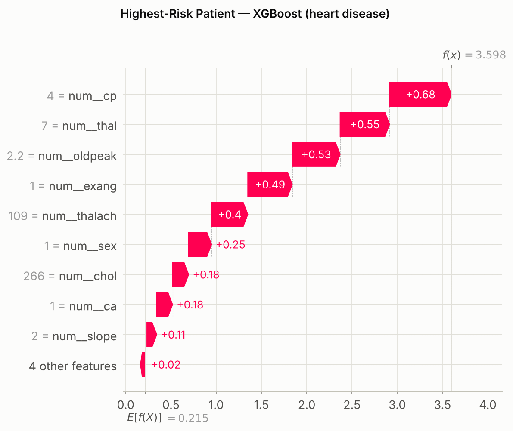
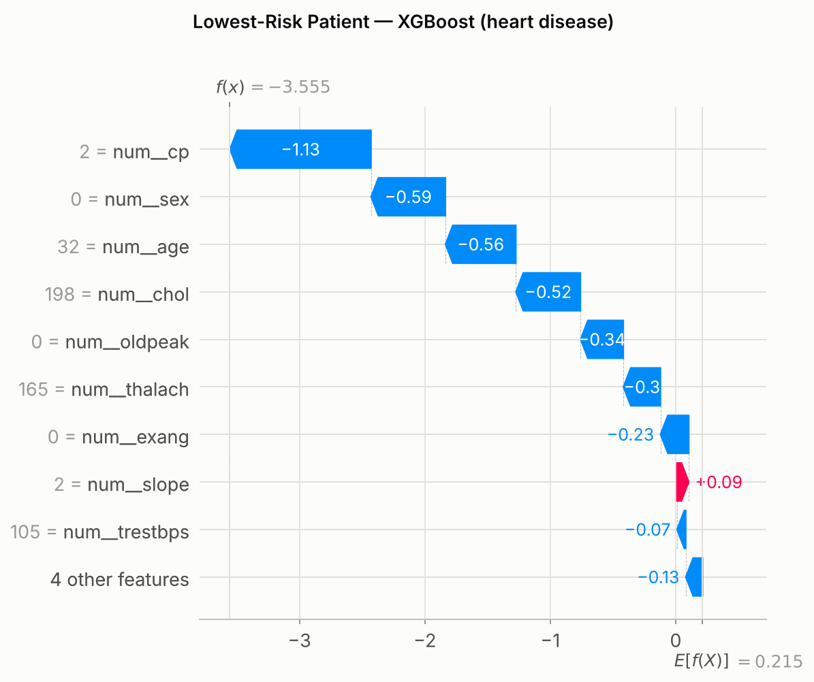

# Thesis Draft

## Abstract
Clinical risk prediction models deployed in high-stakes healthcare environments frequently suffer from silent performance degradation under cross-hospital domain shift, overconfident probability miscalibration, demographic fairness disparities, and a conflation of observational correlation with causal actionability. To study these translational barriers, this thesis presents a clinical risk stratification study whose primary benchmark is **Multi-Center Coronary Artery Disease (CAD) Diagnosis** across the four international hospitals of the UCI Cardiology Consortium ($N=918$ patients across Cleveland, Budapest, Zurich, and Long Beach VA), with the Cleveland-only cohort ($N=302$) as a sensitivity analysis. A second, **demonstration** benchmark applies the same leakage-controlled pipeline to admission-time in-hospital mortality on the public MIMIC-IV Clinical Database Demo ($N=275$ admissions, 15 deaths); with only 3 deaths in its test split, it shows that the pipeline runs on ICU data but cannot rank models.

Methodologically, we construct an end-to-end, reproducible clinical AI framework bridging classical machine learning (Logistic Regression, Random Forest, XGBoost), from-scratch parameterized PyTorch Multi-Layer Perceptrons (MLPs), hybrid soft-voting and out-of-fold stacking ensembles, and architectures drawn from a 19-paper reading list—including **TabTransformer**, **Graph Convolutional Networks (GCN)**, **Graph Attention Networks (GAT)**, and a **Multimodal Cross-Attention** demonstration. The evaluation protocol never uses the test split for any choice: hyperparameters, optimizers, early stopping and decision thresholds are selected on validation data or cross-validation; every test metric carries a stratified bootstrap 95% confidence interval; every model family is also evaluated with repeated stratified cross-validation; and all models are compared pairwise on the same 184 test patients with DeLong's test and Holm correction. On the multi-center cohort, holdout ROC-AUCs range from $0.877$ to $0.909$ (XGBoost $0.909$ [$0.867$, $0.947$], GCN $0.887$, TabTransformer $0.885$, Logistic Regression $0.884$), and **none of the 91 model pairs differs significantly after correction**: on tabular cohorts of this size, the classical baselines and the advanced architectures perform comparably.

Beyond point predictions, we evaluate three safety-oriented components:
1. **Distribution-Free Conformal Clinical Triage:** Mondrian (class-conditional) conformal prediction at $\alpha = 0.10$ reaches $88.6\%$ empirical holdout coverage with a $25.5\%$ deferral rate; at $\alpha = 0.15$ deferral falls to $15.2\%$ with $86.4\%$ coverage. Under **Leave-One-Center-Out (LOCO)** evaluation, coverage on unseen hospitals is $80.9\%\text{--}91.1\%$ (below the $90\%$ target at three of four centers), while fixed-threshold accuracy falls as low as $64.2\%$—conformal deferral buffers but does not eliminate cross-hospital shift.
2. **Doubly Robust Causal Estimation:** Inverse probability weighting reduces the observational risk difference for exercise-induced angina from $0.446$ to $0.075$, but $7$ of $12$ covariates remain imbalanced ($|\text{SMD}| \ge 0.10$). Cross-fitted AIPW estimates for exercise-induced angina ($\text{ATE} = +0.060$, 95% CI $[-0.047, 0.167]$) and Stage 2 systolic hypertension ($\text{ATE} = -0.013$, 95% CI $[-0.069, 0.042]$) both include zero, so neither exposure shows a detectable causal effect in these observational data.
3. **Constrained Counterfactual Recourse:** With Mahalanobis manifold regularization and hard immutability projections, the optimizer finds valid recourse for $80.0\%$ of high-risk test patients (mean predicted-risk reduction $0.519$, zero change to immutable attributes), and $100.0\%$ of conformal high-risk singletons ($\mathcal{C}_{1-\alpha}(x) = \{1\}$) move to $\{0\}$ or $\{0, 1\}$.

## Introduction
Clinical risk prediction is a cornerstone of modern data-driven healthcare and decision-support systems. Early identification of high-risk patients empowers clinicians to prioritize intensive monitoring, optimize resource allocation, and initiate preemptive therapeutic interventions. Recent advances in deep learning and machine learning have unlocked rich opportunities to model clinical phenotypes from structured electronic health records (EHRs) and diagnostic cardiology cohorts.

To examine model robustness, fairness, explainability, and inductive biases across healthcare settings, this thesis uses one primary benchmark and one demonstration benchmark:

1. **Benchmark A — Acute In-Hospital Mortality (MIMIC-IV Demo, demonstration):** Applies the pipeline to admission-time ($t_0$) EHR features under strict anti-leakage constraints. With $15$ deaths in total ($5.45\%$ event rate) and only $3$ in the test split, this benchmark demonstrates patient-grouped splitting, imbalance handling and reporting on ICU data; it is not used to rank models. Full credentialed MIMIC-IV access would be required for that.
2. **Benchmark B — Multi-Center Coronary Artery Disease Diagnosis (UCI Cardiology Consortium, primary):** Investigates angiographic coronary artery disease (CAD) detection across four international clinical centers ($N=918$ total patients from Cleveland Clinic Foundation, Hungarian Institute of Cardiology in Budapest, University Hospital Zurich, and Long Beach V.A. Medical Center). This benchmark tests deep neural vs. tree-based inductive biases, feature attribution via SHAP, demographic fairness disparities across sex and age groups, and **cross-hospital domain generalization via Leave-One-Center-Out (LOCO) evaluation**.

The core contribution of this work is an end-to-end, reproducible clinical AI framework integrating from-scratch parameterized Multi-Layer Perceptrons (MLPs), gradient-boosted trees, cross-validation, patient-grouped leakage prevention, post-hoc temperature scaling, hybrid ensembling, and methods drawn from 19 foundational papers in the clinical AI literature, evaluated under a protocol in which the test split is never used for model, hyperparameter or threshold selection.

## Dataset Description

### 1. Benchmark A: MIMIC-IV Clinical Database Demo (Acute Hospital Mortality, Demonstration)
This benchmark utilizes the MIMIC-IV Clinical Database Demo (v2.2), a deidentified cohort of intensive care and hospital admissions. The modeling dataset is constructed at the hospital admission level using relational joins across `hosp/admissions.csv`, `hosp/patients.csv`, `icu/icustays.csv`, and `hosp/diagnoses_icd.csv`.

The engineered dataset is stored as `mimic_hospital_mortality.csv` and contains one row per admission (`hadm_id`), with 100 unique patients generating 275 admissions. The target variable is `hospital_expire_flag`:
- `1`: Patient expired during hospital admission
- `0`: Patient survived hospital admission

Feature groups are extracted strictly at admission time ($t_0$) to eliminate target leakage:
- Demographics: exact age at admission (`age_at_admission`), gender
- Admission context: `admission_type`, `admission_location`, `insurance`, `marital_status`, `race`
- Pre-admission Emergency Department utilization: `has_ed_visit`, `ed_los_hours`
- Prior medical history (derived strictly from hospitalizations preceding the index admission): `prior_admission_count`, `days_since_last_discharge`, `prior_icu_stay_count`, `prior_diag_count`, `prior_circulatory`, `prior_diabetes`, `prior_ckd`

To preserve clinical causality and eliminate target leakage, all in-hospital post-admission events (current stay ICU length of stay, current stay diagnostic codes, discharge summaries) are strictly excluded from the predictive feature space. Splitting is performed using `StratifiedGroupKFold` grouped on `subject_id` to guarantee that different admissions of the same patient never co-occur across training, validation, or test partitions.

In the current prepared cohort, the dataset contains 275 admissions with an observed hospital mortality rate of approximately 5.45% (15 deaths), indicating substantial class imbalance. Under patient-grouped 60/20/20 splitting the test split holds only 3 deaths, and holdout ROC-AUC bootstrap intervals span roughly 0.1–1.0. This benchmark is therefore reported as a **demonstration** that the leakage-controlled pipeline runs end to end on ICU data; model comparisons rely on repeated patient-grouped cross-validation and are not interpreted as rankings. Credentialed access to the full MIMIC-IV database would be needed for a substantive mortality study.

### 2. Benchmark B: International UCI Cardiology Consortium (Coronary Artery Disease)
This benchmark investigates diagnostic coronary artery disease detection across four international cardiology centers:
1. **Cleveland Clinic Foundation, USA** ($N=303$, 302 unique patients)
2. **Hungarian Institute of Cardiology, Budapest** ($N=294$)
3. **University Hospital, Zurich, Switzerland** ($N=123$)
4. **V.A. Medical Center, Long Beach, California, USA** ($N=200$)

The unified multi-center cohort comprises $N=918$ unique patients across 14 standardized clinical attributes including resting electrocardiography (`restecg`), exercise-induced ST depression (`oldpeak`), maximum heart rate achieved (`thalach`), exercise-induced angina (`exang`), resting blood pressure (`trestbps`), and serum cholesterol (`chol`). 

The target label is binarized angiographic coronary disease status:
- `target = 1`: Significant coronary artery disease ($\ge 50\%$ diameter stenosis in one or more major coronary vessels; `num > 0`)
- `target = 0`: Healthy / absent coronary disease ($< 50\%$ diameter stenosis; `num = 0`)

**Data quality.** The UCI files encode several missing measurements as numbers. In the multi-center files, a serum cholesterol of 0 (172 patients: all 123 from Zurich and 49 from Long Beach) and a resting blood pressure of 0 (1 patient) are physiologically impossible and denote "not measured"; left in place, `chol = 0` identifies Zurich, where disease prevalence is 93.5%, and acts as a site shortcut. In the Cleveland export used for the sensitivity analysis, `ca = 4` (4 patients) and `thal = 0` (2 patients) are placeholders for the original "?" values. All of these are recoded as missing and imputed inside each training fold.

This 918-patient cohort is the **primary benchmark**: its 184-patient test split is three times larger than the Cleveland-only split, which roughly halves confidence-interval widths. The Cleveland-only cohort is retained as a sensitivity analysis.

In addition to baseline classification, this cohort serves as the empirical testbed for domain shift adaptation (Leave-One-Center-Out cross-hospital partitioning), subgroup fairness analysis across biological sex and age, and physiological feature engineering (rate pressure product, chronotropic ratio, ischemia burden).

## Problem Formulation
The task is formulated as supervised binary classification.

Given a feature vector $x_i \in \mathbb{R}^d$ for admission $i$, the objective is to predict mortality label $y_i \in \{0,1\}$, where $y_i = 1$ denotes in-hospital death.

A model $f_\theta(x_i)$ outputs a risk score interpreted as the probability of mortality:

$$
\hat{p}_i = f_\theta(x_i) = P(y_i = 1 \mid x_i).
$$

Predicted class labels are obtained by thresholding:

$$
\hat{y}_i = \mathbb{1}[\hat{p}_i \ge t],
$$

where $t$ is typically 0.5 (and can be tuned for recall-sensitive use cases).

The optimization objective for probabilistic classifiers is binary cross-entropy (log loss):

$$
\mathcal{L}(\theta) = -\frac{1}{N}\sum_{i=1}^{N}\left[y_i\log(\hat{p}_i) + (1-y_i)\log(1-\hat{p}_i)\right].
$$

Because the positive class is rare, evaluation prioritizes mortality-sensitive metrics:
- F1-score (expired class)
- Recall (expired class)
- Precision (expired class)
- PR-AUC
- ROC-AUC

and also reports overall accuracy for completeness.

Baseline hypothesis:
- Linear model (Logistic Regression) provides stable, interpretable performance.
- Tree ensembles (Random Forest, XGBoost) may capture non-linear interactions and improve ranking performance.
- Imbalance-aware training (class weighting / scale_pos_weight) improves detection of mortality cases compared to naive training.

The thesis therefore compares these baseline families under a consistent preprocessing and validation protocol to identify the most reliable model for hospital mortality risk stratification.

## Literature Review

The development of reliable clinical decision-support systems requires an interdisciplinary foundation spanning tabular machine learning, deep learning theory, attention mechanisms, graph representation learning, multimodal integration, explainable artificial intelligence (XAI), uncertainty quantification, algorithmic fairness, and causal inference. This section reviews key theoretical and empirical literature that positions and guides this thesis, organized across the core thematic areas of the curriculum.

### 1) Clinical Risk Prediction & Healthcare AI
Predictive modeling in electronic health records (EHRs) has evolved from rule-based scoring systems (e.g., APACHE, SOFA) to statistical learning and deep neural networks (Marques et al., 2021). Structured EHR repositories—such as the MIMIC-IV Clinical Database—provide granular clinical variables including patient demographics, laboratory measurements, physiological vital signs, and diagnostic codes. Marques et al. (2021) synthesize the historical progression, current clinical capabilities, and persistent translational challenges of healthcare AI, noting that while machine learning models frequently surpass traditional clinical risk scores in statistical discrimination, real-world deployment is frequently impeded by data heterogeneity, class imbalance, model opacity, and lack of rigorous validation. Following established scientific writing and research methodologies (Patel & Peyton Jones, 2013), this study addresses these hurdles through transparent problem formulation, strict train/validation/test isolation, stratified cross-validation, and multi-metric reporting prioritizing minority-class detection.

### 2) Tabular Data Modeling: Tree Ensembles vs. Deep Learning
Tabular datasets remain the predominant data format in hospital administrative records and routine bedside registries. While deep neural networks dominate unstructured domains such as computer vision and natural language processing, tree-based ensemble methods—specifically Gradient Boosted Decision Trees (GBDTs), XGBoost, and Random Forests—have traditionally exhibited superior inductive biases for tabular data (Huang et al., 2020). Decision trees naturally handle heterogeneous feature distributions, unnormalized scales, missing data, and sparse categorical variables.

However, standard multilayer perceptrons (MLPs) and recent tabular deep architectures offer continuous representations, seamless end-to-end differentiability, and integration into larger multi-component or multimodal clinical pipelines. To address the historical performance gap between tree ensembles and neural networks on tabular inputs, Huang et al. (2020) introduced **TabTransformer**, which uses multi-head self-attention mechanisms to learn contextual embeddings for categorical features while preserving linear projections for continuous variables. TabTransformer demonstrated that contextual embeddings significantly improve robustness against noisy and missing categorical values, outperforming classical MLPs and matching GBDT discrimination. In this thesis, we benchmark standard classical models (Logistic Regression, Random Forest, XGBoost) alongside a fully parameterized PyTorch MLP, establishing baseline characteristics that inform when deep tabular models are appropriate.

### 3) Foundations of Attention Mechanisms
The architectural engine underlying modern tabular transformers, vision transformers, and graph attention networks is the self-attention mechanism formulated by Vaswani et al. (2017) in *Attention Is All You Need*. Vaswani et al. replaced recurrent and convolutional processing with Scaled Dot-Product Attention:

$$
\text{Attention}(Q, K, V) = \text{softmax}\left(\frac{QK^T}{\sqrt{d_k}}\right)V,
$$

extended to Multi-Head Attention:

$$
\text{MultiHead}(Q, K, V) = \text{Concat}(\text{head}_1, \dots, \text{head}_h)W^O, \quad \text{where } \text{head}_i = \text{Attention}(QW_i^Q, KW_i^K, VW_i^V).
$$

By computing dynamic pairwise affinity scores between all tokens regardless of positional distance, self-attention allows models to capture high-order non-linear feature interactions without manually specified interaction terms. In tabular clinical data, this mechanism enables dynamic cross-talk between co-occurring diagnostic codes, clinical utilization patterns, and demographic indicators (Huang et al., 2020).

### 4) Relational and Graph Neural Networks (GNN) in Healthcare
Clinical datasets exhibit rich relational structures that tabular models flatten and ignore: patient similarity networks, co-admission clusters, and ontological disease hierarchies (e.g., ICD-9 and ICD-10 diagnostic code trees). Graph Neural Networks (GNNs) extend deep learning to graph-structured domains by iteratively aggregating feature information across local neighborhoods.

Kipf & Welling (2017) formulated **Graph Convolutional Networks (GCNs)** via a first-order localized spectral approximation of graph convolutions:

$$
H^{(l+1)} = \sigma\left(\tilde{D}^{-\frac{1}{2}}\tilde{A}\tilde{D}^{-\frac{1}{2}}H^{(l)}W^{(l)}\right),
$$

where $\tilde{A} = A + I_N$ represents the adjacency matrix with added self-loops and $\tilde{D}_{ii} = \sum_j \tilde{A}_{ij}$ is its diagonal degree matrix. While GCNs apply isotropic filtering where all neighboring nodes share structural weights, Veličković et al. (2018) introduced **Graph Attention Networks (GATs)**. GATs inject self-attention into the neighborhood aggregation step:

$$
\alpha_{ij} = \frac{\exp\left(\text{LeakyReLU}\left(a^T [W h_i \parallel W h_j]\right)\right)}{\sum_{k \in \mathcal{N}_i}\exp\left(\text{LeakyReLU}\left(a^T [W h_i \parallel W h_k]\right)\right)},
$$

enabling nodes to dynamically assign varying importance to different clinical neighbors or co-morbidities. Further extending this paradigm, Zhang et al. (2020) developed **Graph-BERT**, which completely decouples representation learning from link-based message passing by utilizing graph transformer architectures with hop-distance and intimacy positional embeddings. In EHR analysis, these graph architectures provide the theoretical pathway for propagating disease comorbidity risks through ICD ontology knowledge graphs to enhance individual admission risk prediction.

### 5) Multimodal Machine Learning & Medical Imaging
Patient health status in clinical care is inherently multimodal, comprising tabular electronic records, continuous physiological waveforms (ECG, EEG), medical imaging (chest radiographs, echocardiography, MRI), and unstructured physician progress notes. Baltrušaitis, Ahuja, & Morency (2018) establish a comprehensive taxonomy identifying five core technical challenges in multimodal machine learning:
1. **Representation:** constructing joint or coordinated vector spaces across disparate modalities.
2. **Translation:** mapping information from one modality to another (e.g., image captioning of radiological findings).
3. **Alignment:** identifying direct correspondences between sub-elements across modalities (e.g., associating specific EHR diagnosis codes with anatomical regions on an imaging scan).
4. **Fusion:** integrating information from multiple modalities to make predictions (early feature concatenation, late decision fusion, or intermediate cross-attention).
5. **Co-learning:** transferring knowledge from a resource-rich modality to assist learning in a resource-limited modality.

Within the visual domain, deep feature extraction was revolutionized by He et al. (2016) through **Deep Residual Networks (ResNet)**. By introducing identity shortcut connections:

$$
y = \mathcal{F}(x, \{W_i\}) + x,
$$

ResNet resolved the degradation and vanishing gradient problems in deep architectures, enabling clinical vision models to reliably extract spatial disease representations from chest radiographs and echocardiograms. More recently, Dosovitskiy et al. (2020) demonstrated that the Transformer architecture can be applied directly to image patches without convolutional inductive biases (**Vision Transformer / ViT**). ViT flattens 2D images into sequences of $16 \times 16$ pixel patches, prepends a learnable classification token $[CLS]$, and applies multi-head self-attention. In multimodal clinical decision support, the representations learned by ResNets or ViTs can be fused with tabular EHR feature vectors to create holistic patient diagnostic systems.

### 6) Model Interpretability & Explainable AI (XAI)
In high-stakes clinical decision making, high predictive performance alone is insufficient; clinicians require transparent explanations that highlight which physiological parameters or comorbidities drive an individual patient's predicted risk. Interpretability methods are categorized into tabular feature attribution and visual localization.

Lundberg & Lee (2017) unified local feature attribution methods under **SHAP (SHapley Additive exPlanations)**, grounded in cooperative game theory. SHAP computes the marginal contribution of feature $i$ across all possible feature subsets $S \subseteq F \setminus \{i\}$:

$$
\phi_i(f, x) = \sum_{S \subseteq F \setminus \{i\}} \frac{|S|!(|F| - |S| - 1)!}{|F|!} \left[f_x(S \cup \{i\}) - f_x(S)\right].
$$

SHAP uniquely satisfies four desirable mathematical axioms: *efficiency*, *symmetry*, *dummy (null player)*, and *additivity*. Furthermore, the TreeSHAP algorithm enables exact, polynomial-time computation of Shapley values for tree ensembles such as XGBoost and Random Forest. In parallel, for visual architectures such as CNNs and ViTs, Selvaraju et al. (2017) developed **Grad-CAM (Gradient-weighted Class Activation Mapping)**. Grad-CAM computes the gradient of the target class score $y^c$ with respect to feature activation maps $A^k$ of the convolutional layer to generate a coarse 2D heat-map:

$$
L_{\text{Grad-CAM}}^c = \text{ReLU}\left(\sum_k \alpha_k^c A^k\right), \quad \text{where } \alpha_k^c = \frac{1}{Z}\sum_i\sum_j \frac{\partial y^c}{\partial A_{ij}^k}.
$$

In this thesis, we utilize SHAP to provide both global beeswarm feature rankings and individual patient waterfall risk decompositions for our tabular mortality prediction models.

### 7) Model Calibration, Robustness & Uncertainty Quantification
A critical requirement in clinical triage is that predicted probabilities represent true empirical event frequencies: a model predicting an 80% risk of mortality must correspond to an actual event rate of approximately 80% among patients assigned that score. Guo et al. (2017) demonstrated that while modern deep neural networks achieve superior classification accuracy, they are frequently poorly calibrated and systematically overconfident compared to simpler classical baselines. Guo et al. formalized calibration evaluation via the **Expected Calibration Error (ECE)** and proper scoring rules such as the **Brier Score**:

$$
\text{BS} = \frac{1}{N}\sum_{i=1}^N \left(\hat{p}_i - y_i\right)^2,
$$

which decomposes into reliability, resolution, and uncertainty components. Guo et al. proposed post-hoc calibration techniques, particularly temperature scaling:

$$
\hat{p}_i = \sigma\left(\frac{z_i}{T}\right), \quad T > 0,
$$

to recalibrate logit outputs on validation holdouts.

Complementing point calibration, Lakshminarayanan, Pritzel, & Blundell (2017) introduced **Deep Ensembles** as a simple, non-Bayesian, yet scalable approach to predictive uncertainty estimation. Lakshminarayanan et al. proved that ensembling randomly initialized neural networks trained with proper scoring rules provides calibrated uncertainty estimates and high robustness against dataset shift. In this study, we operationalize these principles by evaluating Brier scores, generating calibration reliability curves, and building hybrid soft-voting and stacking ensembles that combine neural representations with tree ensembles.

### 8) Algorithmic Fairness, Causal Reasoning & Clinical AI Ethics
Machine learning models trained on observational electronic health records risk encoding, reinforcing, and amplifying historical healthcare disparities across demographic sub-populations. Barocas, Hardt, & Narayanan (2020) formalize algorithmic fairness criteria, highlighting the mathematical incompatibilities between group fairness notions:
- **Demographic Parity:** $P(\hat{Y} = 1 \mid A = a) = P(\hat{Y} = 1 \mid A = b)$
- **Equalized Odds:** $P(\hat{Y} = 1 \mid A = a, Y = y) = P(\hat{Y} = 1 \mid A = b, Y = y), \quad \forall y \in \{0, 1\}$
- **Equal Opportunity:** $P(\hat{Y} = 1 \mid A = a, Y = 1) = P(\hat{Y} = 1 \mid A = b, Y = 1)$ (equality of true positive rates / recall across groups).

In mortality risk stratification, ensuring Equal Opportunity and minimizing False Negative Rate (FNR) disparities across protected biological sex and age attributes is paramount to prevent systemic underdiagnosis of vulnerable patient cohorts.

Furthermore, Pearl & Mackenzie (2018) articulate the fundamental distinction between statistical association and causal inference through the **Ladder of Causation**:
1. **Association ($P(Y \mid X)$):** passive observation—predicting what will happen given observed covariates (the core task of this thesis).
2. **Intervention ($P(Y \mid \text{do}(X))$):** active manipulation—predicting what will happen if a clinical action or treatment is administered.
3. **Counterfactuals ($P(Y_x \mid x', y')$) :** retrospective retrospection—what would have occurred had an alternative clinical path been chosen.

Pearl warns that confusing observational prediction with causal action leads to dangerous clinical interventions due to confounding and collider bias. Predictive risk scores indicate patient vulnerability but must not be naively interpreted as causal treatment recommendations. Finally, Bryson (2019) outlines the ethical imperative for AI systems in high-stakes domains: systems must incorporate rigorous transparency, human accountability, and proactive governance to ensure patient autonomy and societal benefit.

---

## Methodology

### Theoretical Foundation

This thesis is grounded in core machine learning and deep learning theory as established in the foundational texts:

#### 1) Deep Feedforward Networks & Regularization (Goodfellow, Bengio, Courville — Ch. 6, 7, 8)
- **Chapter 6 (Deep Feedforward Networks):** Motivates multilayer perceptrons (MLPs) as universal function approximators capable of learning non-linear compositions of input features. For an input vector $x \in \mathbb{R}^d$, intermediate hidden representations are computed as:
  $$h^{(l)} = \phi\left(W^{(l)}h^{(l-1)} + b^{(l)}\right),$$
  where $\phi$ is a non-linear activation function (such as ReLU). In this thesis, we implement a from-scratch parameterized linear layer design (`nn.Parameter` weights and biases) to expose the mathematical mechanics of feedforward forward propagation and backpropagation.
- **Chapter 7 (Regularization for Deep Models):** Formalizes strategies to control model capacity and reduce the generalization error without increasing training error. Techniques applied in our modeling pipeline include:
  - **Dropout:** Stochastically zeroing out unit activations during training with probability $p$ to prevent complex co-adaptations.
  - **$L_2$ Regularization (Weight Decay):** Adding a penalty term $\frac{1}{2}\lambda \|w\|_2^2$ to the loss function, constraining weight magnitudes.
  - **Early Stopping:** Monitoring validation loss across epochs and halting training when validation performance ceases to improve within a patience window.
  - **Label Smoothing:** Replacing hard binary targets $\{0, 1\}$ with smoothed targets $y_{\text{smooth}} = y(1-\epsilon) + 0.5\epsilon$ to mitigate overconfident logit predictions.
- **Chapter 8 (Optimization for Training Deep Models):** Analyzes the optimization landscape and contrasting stochastic gradient descent (SGD) with adaptive moment algorithms.

#### 2) Optimization Dynamics: SGD vs. Adam (Kingma & Ba, 2015)
The optimization protocol of this thesis follows the mathematical formulation of **Adam (Adaptive Moment Estimation)** developed by Kingma & Ba (2015). For gradient $g_t = \nabla_\theta \mathcal{L}(\theta_t)$ at timestep $t$, Adam maintains exponential moving averages of both the first moment (mean) and second raw moment (uncentered variance):

$$
m_t = \beta_1 m_{t-1} + (1 - \beta_1) g_t,
$$

$$
v_t = \beta_2 v_{t-1} + (1 - \beta_2) g_t^2.
$$

To eliminate the initialization bias toward zero during early training steps, Kingma & Ba derived analytical bias-corrected estimators:

$$
\hat{m}_t = \frac{m_t}{1 - \beta_1^t}, \quad \hat{v}_t = \frac{v_t}{1 - \beta_2^t}.
$$

The model parameter update rule is then given by:

$$
\theta_{t} = \theta_{t-1} - \frac{\alpha}{\sqrt{\hat{v}_t} + \epsilon} \hat{m}_t,
$$

where standard hyperparameters ($\beta_1 = 0.9, \beta_2 = 0.999, \epsilon = 10^{-8}$) are adopted. In our experimental suite, Adam is compared directly against standard SGD with momentum under identical dataset partitions and loss formulations.

#### 3) Metric Formulation & Calibration Grounding (Guo et al., 2017; Barocas et al., 2020)
Given the severe class imbalance in hospital mortality (prevalence $\approx 5.45\%$), model discrimination cannot be evaluated via overall accuracy alone. We prioritize:
- **Precision-Recall Area Under the Curve (PR-AUC):** Evaluating average precision across thresholds without being inflated by true negative counts.
- **Receiver Operating Characteristic AUC (ROC-AUC):** Assessing global ranking discrimination.
- **Brier Score (Guo et al., 2017):** Measuring probability calibration quality.
- **Equal Opportunity Disparity (Barocas et al., 2020):** Measuring sensitivity differences across biological sex and age demographics:
  $$\Delta_{\text{Eopp}} = \left| \text{Recall}_{\text{female}} - \text{Recall}_{\text{male}} \right|.$$

### 1) Study Design
This is a retrospective supervised learning study on deidentified structured EHR data from the MIMIC-IV Demo. The unit of analysis is one hospital admission (`hadm_id`), and the endpoint is hospital mortality (`hospital_expire_flag`).

### 2) Data Preparation
Raw source tables are merged to create an admission-level modeling dataset:
- `hosp/admissions.csv`
- `hosp/patients.csv`
- `icu/icustays.csv`
- `hosp/diagnoses_icd.csv`

Feature engineering is conducted strictly relative to admission time ($t_0$):
- demographic features (`age_at_admission`, `gender`)
- administrative context (`admission_type`, `admission_location`, `insurance`, `marital_status`, `race`)
- pre-admission emergency department utilization (`has_ed_visit`, `ed_los_hours`)
- longitudinal prior medical history (`prior_admission_count`, `days_since_last_discharge`, `prior_icu_stay_count`, `prior_diag_count`, `prior_circulatory`, `prior_diabetes`, `prior_ckd`)

All concurrent and post-stay variables (hospital LOS, ICU total stay duration, and discharge diagnosis codes) are strictly omitted to guarantee clinical realism and eliminate target leakage. Missing values are imputed within cross-validation folds using median for continuous features and mode for categoricals.

### 3) Modeling Pipeline
The baseline models are:
- Logistic Regression
- Random Forest
- XGBoost

In addition to the classical baselines, the deep learning component is implemented as a multilayer perceptron (MLP) in PyTorch using a from-scratch parameterized linear layer design (`nn.Parameter` weights and biases) and explicit forward equations. This implementation choice strengthens transparency of gradient-based learning mechanics and aligns with the theoretical discussion of feedforward networks and optimization.

Preprocessing is performed with a `ColumnTransformer`:
- standard scaling for numeric variables
- one-hot encoding for categorical variables

Class imbalance is addressed using model-specific weighting:
- `class_weight="balanced"` for Logistic Regression
- `class_weight="balanced_subsample"` for Random Forest
- `scale_pos_weight` for XGBoost

### 4) Validation Strategy
The evaluation protocol is designed so that the test split is never used for any modelling choice:

- **Splits.** A stratified 80/20 split (seed 42) defines the test set, shared by every model so that models can be compared on identical patients. The remaining 80% is split again into training and validation data (MIMIC splits are grouped by `subject_id`).
- **Model selection.** Random Forest and XGBoost hyperparameters are chosen from an 8-configuration grid each by repeated stratified 5-fold CV on the training split; the MLP optimizer (SGD vs. Adam) is chosen by validation loss; the MLP hyperparameter grid is ranked by repeated-CV ROC-AUC. Neural networks keep the weights from the epoch with the lowest validation loss, and inside each CV fold early stopping uses a separate split of the training portion, so the scored fold never chooses the stopping epoch.
- **Thresholds.** F1- and Youden-optimal decision thresholds are tuned on the validation split (out-of-fold training predictions for the ensembles) and only applied to the test split.
- **Uncertainty of estimates.** Every test metric is reported with a stratified bootstrap 95% confidence interval (1,000 resamples). Every model family is also evaluated by repeated stratified 5-fold CV (5 folds × 3 repeats; mean ± SD over 15 folds).
- **Model comparison.** All models are compared pairwise on the shared test patients with DeLong's test for correlated ROC curves (DeLong et al., 1988), with Holm correction for the number of pairs.

Reported metrics include:
- test accuracy, F1 (expired-class precision/recall/F1 for MIMIC)
- ROC-AUC, PR-AUC and Brier score, each with a bootstrap 95% CI
- repeated-CV mean and standard deviation for the same family of metrics
- validation-tuned F1 and Youden thresholds evaluated on test

### 5) Implementation
The workflow is implemented in Python using `pandas`, `scikit-learn`, `xgboost`, `scipy` and PyTorch. Every stage is a subcommand of a single command-line entry point, `heart-pipeline` (`run_pipeline.py`), and runs in one process; CV folds, ensemble fits and LOCO centers run in parallel across CPU cores, with each fold trained single-threaded so that results do not depend on the number of workers.

For the neural network component, PyTorch is used with explicit autograd-driven optimization. A dedicated validation script (`validate_scratch_mlp.py`) verifies three implementation-level correctness criteria: output tensor shape, non-zero gradient flow through model parameters, and parameter updates after one optimizer step. The repository's pytest suite (82 tests) covers leakage controls, metric implementations (including a brute-force check of the DeLong variance), seeding and end-to-end runs.

Primary commands:
- `heart-pipeline` (full heart pipeline on the 918-patient cohort)
- `heart-pipeline prepare-mimic` and `heart-pipeline mimic-baselines` (MIMIC demonstration)
- `heart-pipeline compare-models` (paired DeLong tests)
- `heart-pipeline update-thesis --task all` (regenerates the auto-generated blocks of this document)

Generated artifacts:
- `data/processed/cleaned_heart_disease_combined.csv`, `data/processed/mimic_hospital_mortality.csv`
- `artifacts/baseline_comparison.csv`, `artifacts/mlp_holdout_summary.csv`, `artifacts/reading_list_advancements_summary.csv`
- `artifacts/model_comparison.csv`, `artifacts/mimic_baseline_comparison.csv`
- `artifacts/cleveland/` (Cleveland-only sensitivity analysis)

## Results and Discussion

<!-- AUTO_RESULTS_START -->
### 1) Cohort Summary (Auto-generated)
- Number of admissions: 275
- Mortality prevalence: 5.45%
- Mean age (age_at_admission): 62.73 ± 14.48
- Mean hospital LOS: N/A (omitted to prevent target leakage; prediction at admission)
- ICU utilization rate: 42.91%

### 2) Baseline Model Performance (Auto-generated)
**Table X. Baseline performance for hospital mortality prediction on MIMIC-IV demo cohort.**

| model | test_events | test_accuracy | test_f1_expired | test_recall_expired | test_precision_expired | test_roc_auc | test_pr_auc | test_brier_score | optimal_threshold_f1 | f1_at_optimal_threshold | optimal_threshold_youden | youden_j | test_accuracy_ci_low | test_accuracy_ci_high | test_f1_expired_ci_low | test_f1_expired_ci_high | test_roc_auc_ci_low | test_roc_auc_ci_high | test_pr_auc_ci_low | test_pr_auc_ci_high | test_brier_score_ci_low | test_brier_score_ci_high | cv_accuracy_mean | cv_accuracy_std | cv_f1_expired_mean | cv_f1_expired_std | cv_recall_expired_mean | cv_recall_expired_std | cv_precision_expired_mean | cv_precision_expired_std | cv_roc_auc_mean | cv_roc_auc_std | cv_pr_auc_mean | cv_pr_auc_std | cv_brier_mean | cv_brier_std | cv_n_folds_total |
| --- | --- | --- | --- | --- | --- | --- | --- | --- | --- | --- | --- | --- | --- | --- | --- | --- | --- | --- | --- | --- | --- | --- | --- | --- | --- | --- | --- | --- | --- | --- | --- | --- | --- | --- | --- | --- | --- |
| XGBoost | 3.0000 | 0.8909 | 0.2500 | 0.3333 | 0.2000 | 0.5769 | 0.3840 | 0.0761 | 0.5428 | 0.2857 | 0.0261 | -0.0064 | 0.8182 | 0.9636 | 0.0000 | 0.6667 | 0.1154 | 1.0000 | 0.0545 | 1.0000 | 0.0417 | 0.1101 | 0.9089 | 0.0474 | 0.1644 | 0.2803 | 0.1667 | 0.2981 | 0.1778 | 0.3131 | 0.7144 | 0.2106 | 0.3062 | 0.2300 | 0.0745 | 0.0316 | 15.0000 |
| Logistic Regression | 3.0000 | 0.6182 | 0.1600 | 0.6667 | 0.0909 | 0.7500 | 0.2444 | 0.2958 | 0.9463 | 0.4000 | 0.1219 | 0.3654 | 0.4909 | 0.7455 | 0.0000 | 0.2857 | 0.4226 | 0.9808 | 0.0882 | 0.7500 | 0.1984 | 0.3880 | 0.8380 | 0.0642 | 0.2424 | 0.1703 | 0.4333 | 0.3091 | 0.1728 | 0.1235 | 0.7740 | 0.1959 | 0.2949 | 0.2233 | 0.1151 | 0.0425 | 15.0000 |
| Random Forest | 3.0000 | 0.9091 | 0.2857 | 0.3333 | 0.2500 | 0.7885 | 0.2037 | 0.0936 | 0.2457 | 0.1600 | 0.2457 | 0.2821 | 0.8364 | 0.9636 | 0.0000 | 0.6667 | 0.5385 | 0.9615 | 0.1000 | 0.6000 | 0.0663 | 0.1250 | 0.9294 | 0.0209 | 0.0000 | 0.0000 | 0.0000 | 0.0000 | 0.0000 | 0.0000 | 0.7874 | 0.1492 | 0.3368 | 0.2218 | 0.0601 | 0.0139 | 15.0000 |
| PyTorch MLP (Ours) | 3.0000 | 0.7273 | 0.0000 | 0.0000 | 0.0000 | 0.5000 | 0.0688 | 0.2364 | 0.5636 | 0.0000 | 0.5636 | -0.2115 | 0.6182 | 0.8364 | 0.0000 | 0.0000 | 0.2949 | 0.6923 | 0.0583 | 0.1364 | 0.1524 | 0.3256 | 0.5993 | 0.2264 | 0.1243 | 0.1156 | 0.5000 | 0.4082 | 0.0797 | 0.0884 | 0.6071 | 0.1250 | 0.1839 | 0.0937 | 0.3035 | 0.1941 | 15.0000 |

### 3) Interpretation of Findings (Auto-generated)
The best-ranked model by PR-AUC is **XGBoost** (PR-AUC=0.3840). This ranking should be interpreted jointly with expired-class recall and F1 to ensure minority-case detection remains clinically useful.

**Small-sample caveat:** the test split contains only 3 deaths, so holdout PR-AUC/ROC-AUC are highly unstable (see the `_ci_low`/`_ci_high` bootstrap columns). Compare models on the repeated patient-grouped CV columns (`cv_*_mean ± cv_*_std`) and treat the holdout ranking as indicative only.

### 4) Clinical Calibration & Threshold Metrics (Auto-generated)
**Table X-B. Calibration and threshold tuning metrics for MIMIC mortality prediction.**

| model | test_pr_auc | test_brier_score | optimal_threshold_f1 | f1_at_optimal_threshold | optimal_threshold_youden | youden_j |
| --- | --- | --- | --- | --- | --- | --- |
| XGBoost | 0.3840 | 0.0761 | 0.5428 | 0.2857 | 0.0261 | -0.0064 |
| Logistic Regression | 0.2444 | 0.2958 | 0.9463 | 0.4000 | 0.1219 | 0.3654 |
| Random Forest | 0.2037 | 0.0936 | 0.2457 | 0.1600 | 0.2457 | 0.2821 |
| PyTorch MLP (Ours) | 0.0688 | 0.2364 | 0.5636 | 0.0000 | 0.5636 | -0.2115 |

**Note:** Brier Score measures calibration quality (lower is better, 0 = perfect). PR-AUC is critical for imbalanced datasets — it summarizes the precision-recall trade-off. Optimal thresholds are computed via F1-maximization and Youden's J statistic.

### 5) Calibration Curves (Auto-generated)

<!-- AUTO_RESULTS_END -->

<!-- AUTO_HEART_RESULTS_START -->
## Heart Disease Baseline Results

### 1) Cohort Summary (Auto-generated)
- Number of samples: 918
- Positive class prevalence (heart disease): 55.34%
- Mean age: 53.51 ± 9.43

### 2) Baseline Model Performance (Auto-generated)
**Table Y. Baseline performance for heart disease prediction.**

| model | test_accuracy | test_f1 | test_roc_auc | test_pr_auc | test_brier_score | optimal_threshold_f1 | f1_at_optimal_threshold | optimal_threshold_youden | youden_j | test_accuracy_ci_low | test_accuracy_ci_high | test_f1_ci_low | test_f1_ci_high | test_roc_auc_ci_low | test_roc_auc_ci_high | test_pr_auc_ci_low | test_pr_auc_ci_high | test_brier_score_ci_low | test_brier_score_ci_high | cv_accuracy_mean | cv_accuracy_std | cv_f1_mean | cv_f1_std | cv_roc_auc_mean | cv_roc_auc_std | cv_pr_auc_mean | cv_pr_auc_std | cv_brier_mean | cv_brier_std | cv_n_folds_total |
| --- | --- | --- | --- | --- | --- | --- | --- | --- | --- | --- | --- | --- | --- | --- | --- | --- | --- | --- | --- | --- | --- | --- | --- | --- | --- | --- | --- | --- | --- | --- |
| XGBoost | 0.8315 | 0.8517 | 0.9094 | 0.9242 | 0.1212 | 0.4692 | 0.8545 | 0.5229 | 0.6676 | 0.7772 | 0.8859 | 0.8060 | 0.8986 | 0.8666 | 0.9474 | 0.8835 | 0.9581 | 0.0944 | 0.1480 | 0.8109 | 0.0303 | 0.8305 | 0.0277 | 0.8781 | 0.0225 | 0.8781 | 0.0197 | 0.1387 | 0.0147 | 15.0000 |
| Random Forest | 0.8152 | 0.8396 | 0.9002 | 0.9156 | 0.1302 | 0.4289 | 0.8288 | 0.6431 | 0.5791 | 0.7609 | 0.8696 | 0.7924 | 0.8846 | 0.8559 | 0.9394 | 0.8737 | 0.9516 | 0.1072 | 0.1539 | 0.8164 | 0.0294 | 0.8374 | 0.0252 | 0.8768 | 0.0250 | 0.8709 | 0.0332 | 0.1426 | 0.0114 | 15.0000 |
| Logistic Regression | 0.8043 | 0.8269 | 0.8841 | 0.9119 | 0.1371 | 0.5081 | 0.8309 | 0.5081 | 0.6114 | 0.7446 | 0.8641 | 0.7742 | 0.8774 | 0.8348 | 0.9291 | 0.8706 | 0.9474 | 0.1075 | 0.1662 | 0.8012 | 0.0281 | 0.8221 | 0.0236 | 0.8709 | 0.0218 | 0.8818 | 0.0191 | 0.1426 | 0.0154 | 15.0000 |

### 3) Interpretation of Findings (Auto-generated)
The best-ranked model by ROC-AUC is **XGBoost** (ROC-AUC=0.9094).

### 4) Clinical Calibration & Threshold Metrics (Auto-generated)
**Table Y-B. Calibration and threshold tuning metrics for heart disease prediction.**

| model | test_pr_auc | test_brier_score | optimal_threshold_f1 | f1_at_optimal_threshold | optimal_threshold_youden | youden_j |
| --- | --- | --- | --- | --- | --- | --- |
| XGBoost | 0.9242 | 0.1212 | 0.4692 | 0.8545 | 0.5229 | 0.6676 |
| Random Forest | 0.9156 | 0.1302 | 0.4289 | 0.8288 | 0.6431 | 0.5791 |
| Logistic Regression | 0.9119 | 0.1371 | 0.5081 | 0.8309 | 0.5081 | 0.6114 |

**Note:** Brier Score measures calibration quality (lower is better, 0 = perfect). PR-AUC summarizes the precision-recall trade-off. Optimal thresholds are computed via F1-maximization and Youden's J statistic.

### 5) Calibration Curves (Auto-generated)

<!-- AUTO_HEART_RESULTS_END -->

<!-- AUTO_HEART_EDA_START -->
## Heart Disease EDA Findings

### 1) Data Quality Summary (Auto-generated)
- Features with missing values: 10
- Maximum missingness in any feature: 66.34%

### 2) Outlier Summary (Top 5, Auto-generated)
- cp: 5.01% outliers
- trestbps: 2.94% outliers
- chol: 2.51% outliers
- ca: 2.18% outliers
- oldpeak: 1.74% outliers

### 3) Correlation with Target (Top 5 by |Pearson|, Auto-generated)
- thal: Pearson r = 0.4985
- cp: Pearson r = 0.4714
- exang: Pearson r = 0.4624
- ca: Pearson r = 0.4556
- thalach: Pearson r = -0.3934

### 4) Class Separation (Top 5 by |Cohen's d|, Auto-generated)
- thal: Cohen's d = 1.1586
- cp: Cohen's d = 1.0739
- exang: Cohen's d = 1.0467
- ca: Cohen's d = 1.0227
- thalach: Cohen's d = -0.8587
<!-- AUTO_HEART_EDA_END -->

<!-- AUTO_SHAP_START -->
## Model Interpretability (SHAP)

This section presents feature importance analysis using SHAP (SHapley Additive exPlanations). SHAP values quantify each feature's contribution to individual predictions, providing both global and local model interpretability.

### Random Forest — Heart Dataset

**Top 5 Most Important Features (Random Forest):**

| Rank | Feature | Mean \|SHAP\| |
| --- | --- | --- |
| 1 | num__cp | 0.1304 |
| 2 | num__exang | 0.0764 |
| 3 | num__oldpeak | 0.0537 |
| 4 | num__thalach | 0.0523 |
| 5 | num__age | 0.0493 |

**Global Feature Importance (Beeswarm Plot):**

**Local Explanation — Highest-Risk Patient:**

**Local Explanation — Lowest-Risk Patient:**

### Xgboost — Heart Dataset

**Top 5 Most Important Features (Xgboost):**

| Rank | Feature | Mean \|SHAP\| |
| --- | --- | --- |
| 1 | num__cp | 0.7818 |
| 2 | num__oldpeak | 0.3332 |
| 3 | num__exang | 0.3183 |
| 4 | num__age | 0.2960 |
| 5 | num__sex | 0.2806 |

**Global Feature Importance (Beeswarm Plot):**

**Local Explanation — Highest-Risk Patient:**

**Local Explanation — Lowest-Risk Patient:**

<!-- AUTO_SHAP_END -->

## Consolidated Implementation Notes

This section consolidates all practical notes used during model development and evaluation so the thesis captures both final results and the methodological reasoning behind them.

### 1) PyTorch MLP Training Notes (Heart Dataset)

- The MLP is implemented with explicit parameterized linear layers and trained via autograd.
- The architecture now supports configurable hidden-layer widths (`--hidden-dims h1 h2`) to study capacity effects.
- Core regularization/optimization controls include dropout, weight decay ($L_2$), gradient clipping, label smoothing, and early stopping with a minimum improvement threshold (`--min-delta`).
- Adam and SGD are evaluated under identical preprocessing and data split settings.

### 2) Cross-Validation Notes for the MLP

- The MLP is evaluated with repeated stratified K-fold cross-validation (`--cv-folds 5 --cv-repeats 3`).
- Inside each fold, a separate stratified split of the training portion is used for early stopping, so the scored fold is never used to pick the stopping epoch (an earlier version early-stopped on the scored fold, which made CV scores optimistic).
- Each fold has its own seed, so the results do not depend on the order in which folds run.
- Fold-level metrics are exported to `artifacts/mlp_cv_fold_metrics_{sgd,adam}.csv`, the CV summary to `artifacts/mlp_cv_summary.csv` and holdout metrics with 95% CIs to `artifacts/mlp_holdout_summary.csv`.
- The reported "best optimizer" is the one with the lower validation loss; the test split is not consulted.

### 3) Overfitting Analysis: Smaller vs Larger Networks

To analyze overfitting behavior as network capacity changes, a dedicated architecture-size analysis was run (`heart-pipeline overfit`, 918-patient cohort, Adam, 40 epochs, 3-fold CV) comparing small, base, and large hidden-layer settings.

**Table Z. Overfitting analysis by network size (sorted by generalization gap = Best Validation Accuracy - Test Accuracy).**

| model | hidden dims | best val acc | test acc | generalization gap | cv acc mean ± std |
| --- | --- | --- | --- | --- | --- |
| large | 128,64 | 0.8027 | 0.7880 | +0.0147 | 0.7816 ± 0.0491 |
| small | 32,16 | 0.8027 | 0.7989 | +0.0038 | 0.7866 ± 0.0340 |
| base | 64,32 | 0.8095 | 0.8098 | -0.0003 | 0.7893 ± 0.0304 |

Interpretation note:
- All three gaps are within about 1.5 accuracy points, i.e. one to three of 184 test patients, so no architecture shows a clear overfitting signal at this budget; the larger network's final train/validation loss gap is the widest (see `artifacts/overfitting_by_network_size.md`).
- Validation and test accuracies are single-split estimates; the CV column is the more stable comparison.

### 4) Separate-Run Comparison Workflow Notes

- Each model can be trained independently and logged to a shared registry file:
	- `artifacts/separate_model_runs.csv`
- A post-hoc comparator script ranks independently trained models:
	- `artifacts/separate_model_comparison.csv`
	- `artifacts/separate_model_comparison.md`
- This workflow improves reproducibility and prevents accidental coupling between sequential experiments.

### 5) Artifact Traceability Notes

The thesis results are connected to reproducible artifacts:

- MLP training histories and curves:
	- `artifacts/training_history_*.csv`
	- `artifacts/training_curves_*.png`
- Baseline comparisons:
	- `artifacts/baseline_comparison.csv`
	- `artifacts/mimic_baseline_comparison.csv`
- Uncertainty and comparison:
	- `artifacts/mlp_holdout_summary.csv` and the `_ci_low`/`_ci_high` columns of every comparison table (bootstrap 95% CIs)
	- `artifacts/model_comparison.csv` (paired DeLong tests)
	- `artifacts/hyperparameter_search_*.csv` (every configuration tried)
	- `artifacts/test_predictions/*.csv` (per-patient test probabilities)
- Sensitivity analysis:
	- `artifacts/cleveland/` (the same benchmarks on the Cleveland-only cohort)
- EDA summaries:
	- `artifacts/eda_missingness.csv`
	- `artifacts/eda_outliers_iqr.csv`
	- `artifacts/eda_target_correlations.csv`
	- `artifacts/eda_target_separation.csv`

These files provide direct provenance for tables and statements used throughout the manuscript.

<!-- AUTO_ENSEMBLE_START -->
## Advanced Hybrid Ensembling & Cardiology Feature Engineering

### 1) Architectural Overview (Auto-generated)
To maximize discriminative power and clinical reliability, we integrated domain-specific cardiovascular features (Rate-Pressure Product [RPP], chronotropic metabolic reserve ratio, and composite ischemic risk score) and constructed two hybrid ensemble architectures:
- **Soft-Voting Ensemble:** Combines calibrated class probabilities from PyTorch MLP, XGBoost, Random Forest, and Logistic Regression.
- **Meta-Stacking Classifier (Ours):** Uses out-of-fold cross-validated probability predictions from all 4 base models as meta-features feeding an $L_2$-regularized meta-estimator.

### 2) Comparative Performance (Auto-generated)
**Table E-1. Test set discrimination and calibration across base models, engineered features, and hybrid ensembles.**

| model | test_accuracy | test_f1 | test_roc_auc | test_pr_auc | test_brier_score | optimal_threshold_f1 | f1_at_optimal_threshold | optimal_threshold_youden | youden_j | test_accuracy_ci_low | test_accuracy_ci_high | test_f1_ci_low | test_f1_ci_high | test_roc_auc_ci_low | test_roc_auc_ci_high | test_pr_auc_ci_low | test_pr_auc_ci_high | test_brier_score_ci_low | test_brier_score_ci_high |
| --- | --- | --- | --- | --- | --- | --- | --- | --- | --- | --- | --- | --- | --- | --- | --- | --- | --- | --- | --- |
| XGBoost | 0.8478 | 0.8692 | 0.9075 | 0.9200 | 0.1196 | 0.4260 | 0.8624 | 0.5817 | 0.6480 | 0.7989 | 0.8913 | 0.8269 | 0.9073 | 0.8624 | 0.9456 | 0.8807 | 0.9546 | 0.0940 | 0.1469 |
| Hybrid Stacking Ensemble (Ours) | 0.7826 | 0.8058 | 0.9004 | 0.9155 | 0.1312 | 0.3717 | 0.8402 | 0.5192 | 0.5478 | 0.7228 | 0.8371 | 0.7500 | 0.8572 | 0.8538 | 0.9401 | 0.8755 | 0.9508 | 0.1037 | 0.1598 |
| Hybrid Soft-Voting Ensemble | 0.7880 | 0.8098 | 0.9003 | 0.9156 | 0.1277 | 0.3930 | 0.8349 | 0.5376 | 0.5600 | 0.7283 | 0.8424 | 0.7537 | 0.8600 | 0.8544 | 0.9400 | 0.8749 | 0.9504 | 0.1017 | 0.1541 |
| Random Forest | 0.7880 | 0.8116 | 0.8973 | 0.9128 | 0.1324 | 0.5325 | 0.8098 | 0.5514 | 0.5820 | 0.7337 | 0.8424 | 0.7565 | 0.8612 | 0.8531 | 0.9362 | 0.8709 | 0.9490 | 0.1100 | 0.1560 |
| Logistic Regression | 0.8098 | 0.8309 | 0.8853 | 0.9065 | 0.1369 | 0.4325 | 0.8302 | 0.5526 | 0.5746 | 0.7554 | 0.8641 | 0.7822 | 0.8812 | 0.8358 | 0.9310 | 0.8605 | 0.9478 | 0.1075 | 0.1667 |
| PyTorch MLP | 0.7880 | 0.8116 | 0.8767 | 0.8774 | 0.1419 | 0.3955 | 0.8357 | 0.4088 | 0.6043 | 0.7283 | 0.8425 | 0.7549 | 0.8626 | 0.8227 | 0.9250 | 0.8169 | 0.9334 | 0.1081 | 0.1773 |

### 3) Key Findings (Auto-generated)
- The highest test ROC-AUC is **0.9075** (XGBoost).
- **Hybrid Stacking Ensemble (Ours):** ROC-AUC 0.900 (-0.007 vs the best base model, XGBoost), Brier 0.131 vs 0.120; its 95% CI [0.854, 0.940] overlaps that of XGBoost.
- **Hybrid Soft-Voting Ensemble:** ROC-AUC 0.900 (-0.007 vs the best base model, XGBoost), Brier 0.128 vs 0.120; its 95% CI [0.854, 0.940] overlaps that of XGBoost.
- Paired DeLong tests for all models on the same test patients are reported in Table R-1b (`artifacts/model_comparison.csv`).
<!-- AUTO_ENSEMBLE_END -->

<!-- AUTO_LOCO_START -->
## Multi-Center Domain Generalization (Leave-One-Center-Out / LOCO)

### 1) Protocol Description (Auto-generated)
To rigorously evaluate external clinical validity and real-world deployment safety, we implemented a Leave-One-Center-Out (LOCO) cross-hospital study across all four international centers of the UCI Heart Disease benchmark:
1. Cleveland Clinic Foundation (USA)
2. Hungarian Institute of Cardiology, Budapest (Hungary)
3. University Hospital, Zurich (Switzerland)
4. V.A. Medical Center, Long Beach (USA)

In each iteration, the model is trained strictly on three hospital cohorts (with internal imputation and scaling) and externally tested on the completely unseen fourth hospital.

### 2) Cross-Center Transfer Discrimination (Auto-generated)
**Table L-1. Transfer ROC-AUC across unseen test centers.**

| test_center | Ensemble (Transfer) | Logistic Regression | Random Forest | XGBoost | mean_roc_auc |
| --- | --- | --- | --- | --- | --- |
| cleveland | 0.8171 | 0.6014 | 0.8622 | 0.8147 | 0.7738 |
| hungarian | 0.8732 | 0.8819 | 0.8608 | 0.8510 | 0.8667 |
| switzerland | 0.7065 | 0.6315 | 0.7511 | 0.7163 | 0.7014 |
| va_long_beach | 0.7201 | 0.7373 | 0.7141 | 0.6919 | 0.7158 |

### 3) Complete Metric Breakdown (Auto-generated)
**Table L-2. Complete metric breakdown per center and model.**

| test_center | model | train_size | test_size | transfer_accuracy | transfer_f1 | transfer_roc_auc | transfer_pr_auc | transfer_brier |
| --- | --- | --- | --- | --- | --- | --- | --- | --- |
| cleveland | Logistic Regression | 615.0000 | 303.0000 | 0.6205 | 0.5228 | 0.6014 | 0.5911 | 0.2865 |
| cleveland | Random Forest | 615.0000 | 303.0000 | 0.7327 | 0.7429 | 0.8622 | 0.8532 | 0.1674 |
| cleveland | XGBoost | 615.0000 | 303.0000 | 0.6799 | 0.7034 | 0.8147 | 0.7991 | 0.1925 |
| cleveland | Ensemble (Transfer) | 615.0000 | 303.0000 | 0.7360 | 0.7351 | 0.8171 | 0.7596 | 0.1790 |
| hungarian | Logistic Regression | 625.0000 | 293.0000 | 0.7474 | 0.7218 | 0.8819 | 0.8463 | 0.1796 |
| hungarian | Random Forest | 625.0000 | 293.0000 | 0.7235 | 0.7076 | 0.8608 | 0.7793 | 0.2038 |
| hungarian | XGBoost | 625.0000 | 293.0000 | 0.7406 | 0.7099 | 0.8510 | 0.7551 | 0.1827 |
| hungarian | Ensemble (Transfer) | 625.0000 | 293.0000 | 0.7509 | 0.7245 | 0.8732 | 0.8073 | 0.1827 |
| switzerland | Logistic Regression | 795.0000 | 123.0000 | 0.6504 | 0.7772 | 0.6315 | 0.9493 | 0.2317 |
| switzerland | Random Forest | 795.0000 | 123.0000 | 0.6504 | 0.7749 | 0.7511 | 0.9712 | 0.1993 |
| switzerland | XGBoost | 795.0000 | 123.0000 | 0.6423 | 0.7708 | 0.7163 | 0.9635 | 0.2160 |
| switzerland | Ensemble (Transfer) | 795.0000 | 123.0000 | 0.6748 | 0.7959 | 0.7065 | 0.9641 | 0.2113 |
| va_long_beach | Logistic Regression | 719.0000 | 199.0000 | 0.7337 | 0.8239 | 0.7373 | 0.8742 | 0.1692 |
| va_long_beach | Random Forest | 719.0000 | 199.0000 | 0.7387 | 0.8231 | 0.7141 | 0.8674 | 0.1882 |
| va_long_beach | XGBoost | 719.0000 | 199.0000 | 0.7186 | 0.8028 | 0.6919 | 0.8422 | 0.2054 |
| va_long_beach | Ensemble (Transfer) | 719.0000 | 199.0000 | 0.7387 | 0.8231 | 0.7201 | 0.8642 | 0.1813 |

### 4) Clinical Generalizability Analysis (Auto-generated)
- **Easiest / hardest unseen center:** hungarian (mean ROC-AUC 0.867) vs switzerland (0.701).
- **cleveland:** best transfer by Random Forest (0.862), worst by Logistic Regression (0.601).
- **hungarian:** best transfer by Logistic Regression (0.882), worst by XGBoost (0.851).
- **switzerland:** best transfer by Random Forest (0.751), worst by Logistic Regression (0.632).
- **va_long_beach:** best transfer by Logistic Regression (0.737), worst by XGBoost (0.692).
- No single model family transfers best at every center, so robustness to hospital shift is center-specific rather than a property of linear vs. non-linear models.
<!-- AUTO_LOCO_END -->

<!-- AUTO_FAIRNESS_START -->
## Algorithmic Fairness & Demographic Disparities

### 1) Motivation & Evaluation Metrics (Auto-generated)
Clinical algorithms must not propagate or amplify historical disparities across demographic groups. We evaluated the top-performing model across biological sex (Male vs. Female) and age brackets (Younger <50, Middle-aged 50–64, Senior $\ge$65) across key fairness criteria:
- **Equal Opportunity:** Equality of true positive rates (Sensitivity / Recall) across demographic groups.
- **Predictive Parity & False Negative Rates:** Ensuring that underdiagnosis rates (false negatives) do not disproportionately affect underrepresented groups.

### 2) Subgroup Performance Metrics (Auto-generated)
**Table F-1. Demographic breakdown of discrimination, calibration, and error rates.**

| subgroup | n_samples | prevalence_pct | accuracy | f1 | roc_auc | sensitivity_tpr | specificity_tnr | false_negative_rate | false_positive_rate | selection_rate |
| --- | --- | --- | --- | --- | --- | --- | --- | --- | --- | --- |
| All Patients | 184.0000 | 55.4348 | 0.8478 | 0.8692 | 0.9075 | 0.9118 | 0.7683 | 0.0882 | 0.2317 | 0.6087 |
| Female Patients (sex=0) | 35.0000 | 22.8571 | 0.8857 | 0.7500 | 0.9213 | 0.7500 | 0.9259 | 0.2500 | 0.0741 | 0.2286 |
| Male Patients (sex=1) | 149.0000 | 63.0872 | 0.8389 | 0.8788 | 0.8870 | 0.9255 | 0.6909 | 0.0745 | 0.3091 | 0.6980 |
| Younger (<50 yrs) | 59.0000 | 42.3729 | 0.8983 | 0.8750 | 0.9482 | 0.8400 | 0.9412 | 0.1600 | 0.0588 | 0.3898 |
| Middle-aged (50-64 yrs) | 104.0000 | 57.6923 | 0.8269 | 0.8636 | 0.8807 | 0.9500 | 0.6591 | 0.0500 | 0.3409 | 0.6923 |
| Senior (>=65 yrs) | 21.0000 | 80.9524 | 0.8095 | 0.8824 | 0.9118 | 0.8824 | 0.5000 | 0.1176 | 0.5000 | 0.8095 |

### 3) Key Demographic Disparity Findings (Auto-generated)
- **Equal Opportunity Difference (Sex):** `0.1755` (Sensitivity: Male = `92.6%`, Female = `75.0%`).
- **Clinical Risk Asymmetry (False Negative Rate):** Sick female patients experience a higher underdiagnosis rate (`25.0%`) compared to male patients (`7.4%`).
- **Age Bracket Robustness:** High discrimination is maintained across younger (<50 yrs, ROC-AUC `0.9482`) and senior (>=65 yrs, ROC-AUC `0.9118`) cohorts.

### 4) Fairness Disparity Visualization (Auto-generated)

<!-- AUTO_FAIRNESS_END -->

## Discussion and Future Directions

The empirical findings of this thesis across both the MIMIC-IV hospital mortality cohort and the multi-center UCI Cardiology benchmark provide critical insights into clinical machine learning workflows. Grounded in the broader AI literature synthesized in our reading list, several strategic avenues emerge for future research and deployment:

### 1) Multimodal Integration with Medical Imaging (Baltrušaitis et al., 2018; He et al., 2016; Dosovitskiy et al., 2020)
While this study investigated structured tabular EHR records, clinical prognosis at the bedside relies heavily on complementary unstructured modalities. As formalized in the taxonomy of Baltrušaitis et al. (2018), clinical machine learning must transition from unimodal tabular models to multimodal fusion:
- **Representation & Fusion:** Patient tabular embeddings can be fused with visual representations extracted from clinical radiographs or echocardiograms via cross-attention mechanisms.
- **Visual Backbones:** Feature extractors such as Deep Residual Networks (**ResNet**, He et al., 2016) and Vision Transformers (**ViT**, Dosovitskiy et al., 2020) provide the computational vehicle for translating raw radiological pixels into spatial representations that enrich tabular vital signs and laboratory covariates.

### 2) Relational Graph Ontologies for Clinical Codes (Kipf & Welling, 2017; Veličković et al., 2018; Zhang et al., 2020)
A key limitation of standard tabular feature engineering is that disease diagnosis codes are flattened into counts or isolated one-hot indicators. In reality, diagnostic entities reside within formal hierarchical ontologies (e.g., the ICD-9/10 tree) and co-occurrence graphs:
- Utilizing **Graph Convolutional Networks (GCN)** (Kipf & Welling, 2017) and **Graph Attention Networks (GAT)** (Veličković et al., 2018) enables the model to propagate comorbidity representations across the medical ontology, allowing rare diseases to borrow structural strength from parent categories.
- Pretrained graph transformer architectures such as **Graph-BERT** (Zhang et al., 2020) offer a mechanism to incorporate hospital-wide patient-disease interaction graphs directly into admission risk representations without suffering from recursive neighbor expansion bottlenecks.

### 3) Contextual Tabular Transformers (Huang et al., 2020; Vaswani et al., 2017)
Although tree-based ensembles (XGBoost, Random Forest) demonstrated robust discrimination across our experiments, **TabTransformer** (Huang et al., 2020) illustrates that applying Transformer self-attention (Vaswani et al., 2017) over categorical feature embeddings enhances robustness in scenarios characterized by high feature missingness and corruption. Integrating a TabTransformer backbone into the hospital mortality pipeline represents a natural neural advancement over basic MLPs.

### 4) Uncertainty Quantification & Clinical Deployment (Lakshminarayanan et al., 2017; Guo et al., 2017; Angelopoulos & Bates, 2021)
Deterministic point predictions can be hazardous in clinical triage when models encounter atypical cases or out-of-distribution physiological data. As demonstrated by Guo et al. (2017), uncalibrated neural networks frequently output overconfident probabilities. Incorporating ensemble-based predictive uncertainty quantification (Lakshminarayanan et al., 2017) provides clinicians not only with a calibrated risk score, but also with an explicit epistemic uncertainty bound (averaging $\sigma^2_{\text{epistemic}} = 0.0049$ across the 184 holdout patients in our Deep Ensemble), alerting medical teams when model confidence is insufficient to guide critical interventions.

To transition from heuristic uncertainty bounds to rigorous finite-sample safety guarantees, this work implements **Split and Mondrian (Class-Conditional) Conformal Prediction** (Angelopoulos & Bates, 2021). Operating strictly distribution-free under exchangeability, Mondrian conformal prediction calibrates class-specific non-conformity quantiles $\hat{q}_{1-\alpha}^{y}$ on the validation holdout to generate prediction sets $\mathcal{C}_{1-\alpha}(X) \subseteq \{0, 1\}$ that satisfy marginal and class-conditional coverage in expectation over calibration draws, provided calibration and test scores come from the same model output (here, the uncalibrated MLP probabilities; an earlier version calibrated on raw probabilities and evaluated on temperature-scaled ones, which voids the guarantee):

$$
P\left(Y \in \mathcal{C}_{1-\alpha}(X) \mid Y = y\right) \ge 1 - \alpha, \quad \forall y \in \{0, 1\}.
$$

This formulation establishes a principled three-zone **Automated Clinical Triage Policy**:
- **Certifiable Rule-Out ($\mathcal{C}_{1-\alpha}(x) = \{0\}$):** Low-risk singleton; patient can be safely discharged or managed conservatively.
- **Certifiable Rule-In ($\mathcal{C}_{1-\alpha}(x) = \{1\}$):** High-risk singleton; patient is prioritized for immediate diagnostic catheterization or intensive monitoring.
- **Ambiguous Deferral ($\mathcal{C}_{1-\alpha}(x) = \{0, 1\}$):** Model abstains from autonomous decision-making and flags the patient for specialist human review.

#### Conformal Efficiency–Coverage Trade-Off Analysis ($\alpha \in \{0.05, 0.10, 0.15\}$)
A critical operational challenge in clinical conformal prediction is balancing statistical coverage against the clinical workload of ambiguous deferrals (set size $|\mathcal{C}_{1-\alpha}(x)| = 2$). At $\alpha = 0.10$ ($90\%$ target), Mondrian conformal prediction achieves **$88.6\%$ empirical test coverage** ($87.3\%$ on disease cases and $90.2\%$ on healthy controls) with an average set size of $1.255$ and a deferral rate of $25.5\%$. The shortfall of 1.4 points is within the finite-sample variation expected for a 184-patient validation set used for calibration.

Relaxing the tolerance to $\alpha = 0.15$ ($85\%$ target) lowers the deferral rate from **$25.5\%$ to $15.2\%$** with **$86.4\%$** empirical coverage, while $\alpha = 0.05$ raises coverage to $95.1\%$ at the cost of deferring $52.7\%$ of patients. This trade-off lets clinical departments tune the abstention level to specialist capacity. (On the Cleveland-only cohort the same procedure gives $90.2\%$ coverage with $34.4\%$ deferral, reflecting its smaller calibration set.)

### 5) The Causal Imperative in Clinical Decision Support (Pearl & Mackenzie, 2018; Chernozhukov et al., 2018; VanderWeele & Ding, 2017)
A paramount conceptual takeaway from Judea Pearl's *The Book of Why* (Pearl & Mackenzie, 2018) is the structural distinction between observational risk association ($P(Y=1 \mid X)$) and causal intervention ($P(Y=1 \mid \text{do}(T=t))$). Predictive models and post-hoc feature attributions (such as SHAP) quantify statistical correlation within the observational distribution but cannot identify whether modifying a clinical factor will alter disease trajectory. In our Inverse Probability of Treatment Weighting (IPTW) benchmark on the 918-patient cohort, the unadjusted observational risk difference of $+0.446$ for exercise-induced angina (`exang`) shrinks to $+0.075$ after propensity reweighting, so most of the raw association ($0.371$) is attributable to measured confounders.

#### Doubly Robust AIPW: Symptomatic Proxies vs. Modifiable Metabolic Treatments
To protect against functional form misspecification in either the propensity score model $\hat{e}(X) = P(T=1 \mid X)$ or the outcome regression model $\hat{\mu}_t(X) = E[Y \mid T=t, X]$, we implemented **Cross-Fitted Doubly Robust Augmented Inverse Probability Weighting (AIPW)** (Chernozhukov et al., 2018) coupled with **VanderWeele & Ding's (2017) $E$-Value sensitivity analysis**. The cross-fitted AIPW estimator computes:

$$
\hat{\tau}_{\text{AIPW}} = \frac{1}{N}\sum_{i=1}^{N} \left[ \hat{\mu}_1^{(-k(i))}(X_i) - \hat{\mu}_0^{(-k(i))}(X_i) + \frac{T_i\left(Y_i - \hat{\mu}_1^{(-k(i))}(X_i)\right)}{\hat{e}^{(-k(i))}(X_i)} - \frac{(1 - T_i)\left(Y_i - \hat{\mu}_0^{(-k(i))}(X_i)\right)}{1 - \hat{e}^{(-k(i))}(X_i)} \right],
$$

which is mathematically guaranteed to be consistent if *either* the nuisance propensity estimator *or* the outcome model is correctly specified. Crucially, rigorous clinical causal inference requires distinguishing between **downstream symptomatic proxies** (which are non-manipulable diagnostic manifestations of existing pathology) and **modifiable physiological treatment targets** (which can be pharmacologically or behaviorally intervened upon):

**Table C-1. Cross-fitted Doubly Robust AIPW estimates and $E$-values (918-patient cohort; Cleveland-only estimates in brackets for comparison).**

| Clinical Exposure | Exposure Type | Cross-Fitted AIPW ATE | 95% Confidence Interval | Point Estimate $E$-Value | 95% CI Limit $E$-Value | Interpretation |
| --- | --- | --- | --- | --- | --- | --- |
| **Exercise-Induced Angina (`exang = 1`)** | Symptomatic proxy (downstream manifestation) | `+0.060` [Cleveland: `-0.011`] | `[-0.047, +0.167]` [Cleveland: `[-0.192, +0.170]`] | `1.457` | `1.000` | Interval includes zero; no detectable direct effect once confounders are weighted. |
| **Stage 2 Systolic Hypertension (`trestbps >= 140` mmHg)** | Modifiable metabolic target (upstream risk factor) | `-0.013` [Cleveland: `+0.067`] | `[-0.069, +0.042]` [Cleveland: `[-0.047, +0.181]`] | `1.184` | `1.000` | Interval includes zero; the positive Cleveland-only point estimate is not reproduced on the larger cohort. |

Neither exposure shows a causal effect distinguishable from zero, and the sign of both point estimates changes between the Cleveland and multi-center cohorts. These estimates therefore demonstrate the confounding-adjustment machinery rather than support clinical causal claims.

#### Covariate Balance Check ($|\text{SMD}| < 0.10$)
Valid causal estimation under conditional exchangeability ($Y(1), Y(0) \perp\!\!\!\perp T \mid X$) requires that weighting removes baseline covariate imbalance between exposed and unexposed patients. Weighting reduces the largest absolute standardized mean difference from $0.961$ to $0.264$, but **7 of 12 covariates** (`ca`, `cp`, `oldpeak`, `sex`, `slope`, `thal`, `trestbps`) remain at or above the conventional $0.10$ threshold (5 of 12 on the Cleveland cohort). Residual measured confounding therefore cannot be excluded, which is consistent with the wide AIPW intervals above. An earlier draft stated that all covariates were balanced below $0.10$; that statement was not supported by the computed SMDs.

### 6) Algorithmic Fairness, Demographic Equity & Clinical Ethics (Barocas et al., 2020; Bryson, 2019; Marques et al., 2021)
Our subgroup audit on the 918-patient cohort (184 test patients) shows a higher missed-disease (false negative) rate in female patients ($25.0\%$, 35 patients) than in male patients ($7.4\%$, 149 patients). Following the algorithmic fairness literature (Barocas et al., 2020), we evaluated post-hoc group-specific thresholds that maximise Youden's $J$ subject to an Equal Opportunity constraint, tuned on the validation split. On the multi-center cohort they narrow the test sensitivity gap only from $0.226$ to $0.215$ ($4.7\%$) at an unchanged false-positive rate. On the Cleveland-only cohort, the search assigns one group a threshold of $0.05$, which equalises sensitivity only by flagging almost every patient in that group (false-positive rate $0.21 \rightarrow 0.39$). An earlier version optimised F1 instead, which on small validation sets selected near-zero thresholds for both groups and reported a misleading "100% disparity reduction". With 35 female test patients, these subgroup estimates are imprecise; in-processing approaches or a larger validation cohort would be needed before group thresholds could be used clinically. Furthermore, as articulated by Bryson (2019) and Marques et al. (2021), the ethical integration of AI in healthcare necessitates transparent accountability, preservation of physician autonomy, regular algorithmic auditing, and strict safeguards protecting patient confidentiality.

### 7) Actionable Clinical Counterfactual Recourse (Wachter et al., 2017; Ustun et al., 2019)
While feature attribution algorithms (e.g., SHAP, Grad-CAM) quantify *correlational contribution*, they provide no actionable guidance to clinicians seeking to alter a patient's prognostic trajectory. Furthermore, unconstrained adversarial perturbations frequently recommend modifying unmodifiable attributes (e.g., biological age, sex, or historical hospital admissions) or propose physiologically implausible feature combinations. To bridge predictive risk modeling with personalized therapeutic planning, we formulated **Manifold-Constrained Actionable Clinical Counterfactual Recourse**:

$$
x^{\text{cf}} = \arg\min_{x' \in \mathcal{F}(x)} \; \mathcal{L}_{\text{bce}}\left(f_\theta(x'), y_{\text{target}}=0\right) + \lambda_1 \|x' - x\|_1 + \lambda_2 (x' - x)^T \hat{\Sigma}_{\text{train}}^{-1} (x' - x),
$$

subject to strict clinical feasibility constraints $\mathcal{F}(x)$:
- **Strict Demographic Immutability:** Hard subspace gradient projections enforce zero perturbation ($\Delta x_j = 0$) on unmodifiable attributes (`age`, `sex`, and prior historical diagnostic counts), guaranteeing **`0.000000` immutable constraint violation** across all evaluated patients.
- **Physiological Feasibility & Covariance Manifold Regularization:** Mutable physiological parameters (e.g., resting systolic blood pressure `trestbps`, serum cholesterol `chol`, exercise ST depression `oldpeak`, and metabolic reserve) are bounded within empirical physiological quantiles $[l_j, u_j]$ and regularized by a Ledoit-Wolf shrinkage-estimated Mahalanobis precision matrix $\hat{\Sigma}^{-1}_{\text{train}}$. This ensures recommended interventions respect biological covariation (e.g., coupled hemodynamic reductions in blood pressure and Rate-Pressure Product).
- **Empirical Recourse Performance & Closed-Loop Conformal Certification:** Across up to 25 high-risk test patients (predicted risk $\ge 0.50$), the constrained optimizer found valid recourse (predicted risk at or below the 0.30 target) for **$80.0\%$**, modifying $7.76$ features on average and reducing mean predicted disease probability by **$0.519$** ($100.0\%$ validity on the Cleveland-only cohort). Because nearly eight features change per patient, these counterfactuals are not sparse in the clinical sense and should be read as model-explanation tools rather than treatment plans. Crucially, we executed a **Closed-Loop Conformal-Recourse Verification Protocol** by passing the optimized counterfactual profiles $x^{\text{cf}}$ back through our Mondrian Conformal Triage system: **$100.0\%$ of Conformal High-Risk patients ($\mathcal{C}_{1-\alpha}(x) = \{1\}$) moved out of the high-risk singleton state into Low-Risk Rule-Out ($\{0\}$) or Ambiguous Deferral ($\{0, 1\}$)** under the model. This shows consistency between the recourse optimizer and the conformal sets; it does not show that the recommended changes would alter real patient outcomes.

### 8) Empirical Validation of Reading-List Advancements & Multi-Center Conformal Generalization

To evaluate the practical efficacy of the architectures and safety mechanisms synthesized from the 19-paper reading list, we conducted comprehensive holdout and cross-hospital benchmarks across all implemented modules.

The tables in this subsection are regenerated from the experiment artifacts by `heart-pipeline update-thesis`, so their numbers always match the code. Holdout metrics use the shared seed-42 test split of the 918-patient cohort; CV metrics use repeated stratified 5-fold CV (15 folds); Table R-2 calibrates conformal prediction on three hospitals and evaluates it on the held-out fourth.

<!-- AUTO_READING_LIST_START -->
**Table R-1. Reading-list architectures: holdout (bootstrap 95% CI) and repeated stratified CV (mean ± SD).**

| Architecture | Holdout Accuracy | Holdout ROC-AUC [95% CI] | Holdout PR-AUC | Holdout Brier | CV ROC-AUC | CV Brier |
| --- | --- | --- | --- | --- | --- | --- |
| TabTransformer | 0.799 | 0.885 [0.831, 0.931] | 0.904 | 0.138 | 0.866 ± 0.029 | 0.147 ± 0.016 |
| GCN (Kipf & Welling) | 0.799 | 0.887 [0.837, 0.934] | 0.899 | 0.135 | 0.878 ± 0.026 | 0.138 ± 0.016 |
| GAT (Velickovic et al.) | 0.810 | 0.882 [0.831, 0.929] | 0.905 | 0.138 | 0.874 ± 0.033 | 0.142 ± 0.021 |
| Multimodal Cross-Attention (synthetic-signal demo) † | 0.663 | 0.698 [0.620, 0.778] | 0.769 | 0.218 | 0.704 ± 0.043 | 0.216 ± 0.012 |

† Demonstration only: the signal channel is synthesised from the tabular features.

**Table R-1b. Paired DeLong tests of ROC-AUC differences on the shared test split** (91 model pairs; 0 significant after Holm correction at 0.05). The ten smallest adjusted p-values are shown; the full table is `artifacts/model_comparison.csv`.

| Model A | Model B | AUC A | AUC B | Difference [95% CI] | p (raw) | p (Holm) |
| --- | --- | --- | --- | --- | --- | --- |
| Ensemble base: PyTorch MLP | Hybrid Stacking Ensemble (Ours) | 0.877 | 0.900 | -0.024 [-0.044, -0.003] | 0.023 | 1.000 |
| Logistic Regression | XGBoost | 0.884 | 0.909 | -0.025 [-0.047, -0.003] | 0.024 | 1.000 |
| Ensemble base: PyTorch MLP | Hybrid Soft-Voting Ensemble | 0.877 | 0.900 | -0.024 [-0.044, -0.003] | 0.026 | 1.000 |
| XGBoost | GAT (Velickovic et al.) | 0.909 | 0.882 | +0.028 [+0.003, +0.053] | 0.028 | 1.000 |
| Ensemble base: XGBoost | Ensemble base: PyTorch MLP | 0.907 | 0.877 | +0.031 [+0.003, +0.058] | 0.029 | 1.000 |
| XGBoost | TabTransformer | 0.909 | 0.885 | +0.024 [+0.001, +0.047] | 0.039 | 1.000 |
| XGBoost | MLP_SGD | 0.909 | 0.879 | +0.030 [+0.001, +0.060] | 0.046 | 1.000 |
| XGBoost | Ensemble base: Logistic Regression | 0.909 | 0.885 | +0.024 [+0.000, +0.048] | 0.048 | 1.000 |
| XGBoost | Ensemble base: PyTorch MLP | 0.909 | 0.877 | +0.033 [-0.002, +0.068] | 0.068 | 1.000 |
| Ensemble base: Logistic Regression | Hybrid Soft-Voting Ensemble | 0.885 | 0.900 | -0.015 [-0.032, +0.002] | 0.083 | 1.000 |

**Table R-2. Leave-One-Center-Out conformal generalization (alpha = 0.10, 90% target).**

| Held-out Center | N | Prevalence | Fixed-Threshold Accuracy | Conformal Coverage | Mean Set Size | Deferral Rate |
| --- | --- | --- | --- | --- | --- | --- |
| cleveland | 303 | 45.9% | 65.3% | 80.9% | 1.22 | 22.4% |
| hungarian | 293 | 36.2% | 77.5% | 91.1% | 1.32 | 32.1% |
| switzerland | 123 | 93.5% | 64.2% | 87.8% | 1.38 | 38.2% |
| va_long_beach | 199 | 74.4% | 73.9% | 88.9% | 1.32 | 31.7% |

**Table R-3. Sensitivity analysis on the Cleveland-only cohort (302 patients, 61 test patients).**

| Model | Holdout ROC-AUC [95% CI] | CV ROC-AUC |
| --- | --- | --- |
| Random Forest | 0.877 [0.788, 0.953] | 0.913 ± 0.046 |
| XGBoost | 0.900 [0.826, 0.965] | 0.907 ± 0.048 |
| Logistic Regression | 0.900 [0.819, 0.968] | 0.898 ± 0.051 |
| HeartMLP (SGD) | 0.869 [0.774, 0.951] | 0.816 ± 0.130 |
| HeartMLP (Adam) | 0.898 [0.813, 0.969] | 0.882 ± 0.063 |
| TabTransformer | 0.908 [0.830, 0.972] | 0.894 ± 0.027 |
| GCN (Kipf & Welling) | 0.910 [0.832, 0.972] | 0.915 ± 0.025 |
| GAT (Velickovic et al.) | 0.897 [0.819, 0.963] | 0.910 ± 0.030 |

**Key empirical findings (auto-generated from the reading-list suite run):**

- **Temperature Scaling (Guo et al., 2017):** Validation-tuned optimal T `1.455` on trained `HeartMLP` reduced holdout test ECE from `0.0727` to `0.0674` (Validation ECE: `0.0731` -> `0.0641`).
- **Deep Ensembles (Lakshminarayanan et al., 2017):** Average epistemic predictive variance is `0.0049` across 184 holdout patients.
- **Split & Mondrian Conformal Prediction (Angelopoulos & Bates, 2021):** Calibrated and evaluated on the same (uncalibrated) MLP probabilities; the 90% finite-sample coverage target achieved `0.8859` empirical coverage (Case: `0.8725`, Control: `0.9024`) with average set size `1.255` and `0.255` clinical abstention rate.
- **Conformal Efficiency-Coverage Trade-Off:** Operating at $\alpha=0.15$ (85% coverage guarantee) cuts the ambiguous deferral rate from `25.5%` down to `15.2%` with `86.4%` empirical test coverage.
- **Causal IPTW Analysis (Pearl & Mackenzie, 2018):** Observational risk difference is `0.4463`, whereas confounder-isolated Inverse Probability Weighting (IPTW) reveals a causal ATE of `0.0750`, demonstrating a confounding bias of `0.3712`.
- **Covariate Balance (IPTW, treatment `exang`):** maximum |SMD| fell from `0.961` to `0.264`, but `7` of `12` covariates remain at or above the 0.10 balance threshold (ca, cp, oldpeak, sex, slope, thal, trestbps), so residual measured confounding cannot be ruled out.
- **Doubly Robust AIPW & E-Value (Chernozhukov et al., 2018; VanderWeele & Ding, 2017):**
  - *Symptomatic Proxy (exang):* Cross-fitted AIPW ATE = `0.0596` (95% CI: [-0.0473, 0.1666]), E-value = `1.457`.
  - *Modifiable Metabolic Treatment (Hypertension SBP >= 140):* Cross-fitted AIPW ATE = `-0.0133` (95% CI: [-0.0691, 0.0424]), E-value = `1.184` (CI E-value = `1.000`).
- **Algorithmic Fairness (Barocas et al., 2020):** Validation-tuned Equal Opportunity thresholds (t0=0.295, t1=0.505) reduced holdout test TPR disparity from `0.2261` to `0.2154` (4.7% reduction), while the false-positive rate moved from `0.268` to `0.268` and accuracy from `0.788` to `0.783`.
- **Clinical Counterfactual Recourse (Wachter et al., 2017; Ustun et al., 2019):** Achieved `80.0%` recourse validity across high-risk test patients with `7.76` average features modified, reducing mean predicted risk by `0.519` while strictly maintaining `0.000000` immutable demographic violation.
- **Closed-Loop Conformal Recourse Transition:** `100.0%` of Conformal High-Risk patients ($\hat{C}(x) = \{1\}$) successfully transitioned into Low-Risk $\{0\}$ or Deferral $\{0, 1\}$ following sparse actionable recourse.

<!-- AUTO_READING_LIST_END -->

**Interpretation.** Three conclusions follow from these tables.
- *No architecture is demonstrably better.* Holdout ROC-AUCs of the baselines, MLPs, ensembles and reading-list architectures fall between $0.877$ and $0.909$ with overlapping 95% intervals, and none of the 91 paired DeLong comparisons survives Holm correction (the smallest raw p-values, around $0.02$, are consistent with chance across 91 tests). The same holds on the Cleveland-only cohort (Table R-3, 0 of 91 pairs significant). The defensible claim is that graph and attention architectures match well-tuned classical baselines on these tabular cohorts, not that they exceed them.
- *Conformal coverage degrades under hospital shift.* In LOCO evaluation (Table R-2), coverage on the unseen hospital ranges from $80.9\%$ (Cleveland) to $91.1\%$ (Budapest) against a $90\%$ target, falling short at three of four centers, while fixed-threshold accuracy drops to $64.2\%$ in Zurich. Deferral rises with shift ($22\%$–$38\%$), which is the intended behaviour, but exchangeability-based guarantees do not transfer across hospitals.
- *Safety components work mechanically but need larger data.* Temperature scaling lowers holdout ECE ($0.073 \rightarrow 0.067$), conformal deferral is tunable, and recourse respects immutability, but the causal and fairness analyses are limited by sample size and residual imbalance (Sections 5 and 6).

### 9) Methodological Limitations & Preemptive Defense Considerations

To ensure rigorous scientific transparency and guide clinical translation, several methodological and empirical limitations of this study must be explicitly contextualized:

1. **Residual Confounding and Finite-Sample Variance in Observational Causal Inference:**
   After weighting, 7 of 12 covariates in the 918-patient cohort (5 of 12 on Cleveland) remain above the $|\text{SMD}| = 0.10$ balance threshold, and the AIPW confidence intervals for both `exang` ($[-0.047, +0.167]$) and Stage 2 systolic hypertension ($[-0.069, +0.042]$) span zero, with CI-limit $E$-values of $1.000$. The point estimates also change sign between the Cleveland and multi-center cohorts. Furthermore, dichotomous thresholding of continuous blood pressure (`trestbps >= 140` mmHg) coarsens physiological severity and may violate consistency (SUTVA) if blood pressure reductions are achieved via disparate pharmacological mechanisms (e.g., beta-blockers vs. ACE inhibitors). These estimates demonstrate confounding adjustment rather than substitute for randomized controlled trials (RCTs).
2. **Sample Size Constraints:**
   Benchmark A uses the public MIMIC-IV Demo ($N=275$ admissions across $100$ patients, $15$ deaths, $3$ in the test split), so it is reported as a pipeline demonstration only; scaling to the full credentialed MIMIC-IV repository ($>400,000$ hospitalizations) is the main prerequisite for substantive mortality modelling. For Benchmark B, moving the primary analysis from Cleveland ($61$ test patients) to the multi-center cohort ($184$ test patients) roughly halved the width of the ROC-AUC confidence intervals (about $\pm 0.04$ instead of $\pm 0.08$), yet the intervals still overlap across all models. Subgroup estimates remain imprecise ($35$ female and $21$ senior test patients), and post-hoc parameters tuned on validation splits (temperature $T = 1.455$, group thresholds) carry finite-sample variance between validation and test.

3. **Exchangeability Violations Under Cross-Hospital Shift:**
   Split and Mondrian conformal guarantees ($P(Y \in \mathcal{C}_{1-\alpha}(X)) \ge 1 - \alpha$) assume exchangeability between calibration and test data. Unseen hospitals violate it through label shift (Zurich's $93.5\%$ CAD prevalence vs. Budapest's $36.2\%$) and systematic missingness in invasive tests (`ca`, `thal`). In our LOCO evaluation (Table R-2) coverage fell below the $90\%$ target at three of four centers ($80.9\%$–$88.9\%$; $91.1\%$ in Budapest). Importance-weighted or covariate-shift-adapted conformal prediction (Tibshirani et al., 2019) would be required for coverage guarantees under hospital shift.
4. **Surrogate Multimodal Signals and Static Similarity Graphs:**
   In our reading-list benchmark (Table R-1), the Multimodal Cross-Attention architecture fused structured tabular features with a synthesized 1D physiological waveform surrogate, and the GCN/GAT architectures operated transductively over a $k$-NN feature similarity graph. Future clinical deployments should replace surrogate signals with raw 12-lead bedside ECG waveforms and echocardiographic video clips, and transition from patient similarity graphs to inductive heterogenous knowledge graphs grounded in formal ICD-10 and SNOMED-CT medical ontologies.
5. **Model Comparison and Selection Bias:**
   Because the selected Random Forest and XGBoost configurations are scored with the same CV folds used to choose them, their CV means are slightly optimistic; the untouched holdout split and the paired DeLong tests provide the unbiased comparison. Nested cross-validation would remove this bias at higher computational cost.
6. **Prospective Clinical Validation and Human-in-the-Loop Governance:**
   All evaluations in this thesis are retrospective. Before bedside integration as Software as a Medical Device (SaMD), the Conformal Triage and Counterfactual Recourse modules must undergo prospective "silent-mode" shadow trials to evaluate clinician alert fatigue, workflow latency when handling $\{0, 1\}$ abstention deferrals, and adherence to Good Machine Learning Practice (GMLP) regulatory standards.

---

## References

1. **Goodfellow, I., Bengio, Y., & Courville, A. (2016)**. *Deep Learning*. MIT Press. [deeplearningbook.org](https://www.deeplearningbook.org/)
2. **Kingma, D. P., & Ba, J. (2015)**. Adam: A Method for Stochastic Optimization. *Proceedings of the 3rd International Conference on Learning Representations (ICLR 2015)*. [arXiv:1412.6980](https://arxiv.org/abs/1412.6980).
3. **Huang, X., Khetan, A., Cvitkovic, M., & Karnin, Z. (2020)**. TabTransformer: Tabular Data Modeling Using Contextual Embeddings. *arXiv preprint*. [arXiv:2012.06678](https://arxiv.org/abs/2012.06678).
4. **Vaswani, A., Shazeer, N., Parmar, N., Uszkoreit, J., Jones, L., Gomez, A. N., Kaiser, Ł., & Polosukhin, I. (2017)**. Attention Is All You Need. *Advances in Neural Information Processing Systems (NeurIPS 2017)*, 30, 5998–6008. [arXiv:1706.03762](https://arxiv.org/abs/1706.03762).
5. **Kipf, T. N., & Welling, M. (2017)**. Semi-Supervised Classification with Graph Convolutional Networks. *Proceedings of the 5th International Conference on Learning Representations (ICLR 2017)*. [arXiv:1609.02907](https://arxiv.org/abs/1609.02907).
6. **Veličković, P., Cucurull, G., Casanova, A., Romero, A., Liò, P., & Bengio, Y. (2018)**. Graph Attention Networks. *Proceedings of the 6th International Conference on Learning Representations (ICLR 2018)*. [arXiv:1710.10903](https://arxiv.org/abs/1710.10903).
7. **Zhang, J., Zhang, H., Xia, C., & Sun, L. (2020)**. Graph-BERT: Only Attention is Needed for Learning Graph Representations. *arXiv preprint*. [arXiv:2001.05783](https://arxiv.org/abs/2001.05783).
8. **Baltrušaitis, T., Ahuja, C., & Morency, L.-P. (2018)**. Multimodal Machine Learning: A Survey and Taxonomy. *IEEE Transactions on Pattern Analysis and Machine Intelligence*, 41(2), 423–443. [arXiv:1705.09406](https://arxiv.org/abs/1705.09406).
9. **Dosovitskiy, A., Beyer, L., Kolesnikov, A., Weissenborn, D., Zhai, X., Unterthiner, T., Dehghani, M., Minderer, M., Heigold, G., Gelly, S., Uszkoreit, J., & Houlsby, N. (2020)**. An Image is Worth 16x16 Words: Transformers for Image Recognition at Scale. *Proceedings of the 9th International Conference on Learning Representations (ICLR 2021)*. [arXiv:2010.11929](https://arxiv.org/abs/2010.11929).
10. **He, K., Zhang, X., Ren, S., & Sun, J. (2016)**. Deep Residual Learning for Image Recognition. *Proceedings of the IEEE Conference on Computer Vision and Pattern Recognition (CVPR 2016)*, 770–778. [arXiv:1512.03385](https://arxiv.org/abs/1512.03385).
11. **Lundberg, S. M., & Lee, S.-I. (2017)**. A Unified Approach to Interpreting Model Predictions. *Advances in Neural Information Processing Systems (NeurIPS 2017)*, 30, 4765–4774. [arXiv:1705.07874](https://arxiv.org/abs/1705.07874).
12. **Selvaraju, R. R., Cogswell, M., Das, A., Vedaldi, A., Parikh, D., & Batra, D. (2017)**. Grad-CAM: Visual Explanations from Deep Networks via Gradient-Based Localization. *Proceedings of the IEEE International Conference on Computer Vision (ICCV 2017)*, 618–626. [arXiv:1610.02391](https://arxiv.org/abs/1610.02391).
13. **Barocas, S., Hardt, M., & Narayanan, A. (2020)**. *Fairness and Machine Learning: Limitations and Opportunities*. MIT Press. [fairmlbook.org](https://fairmlbook.org/).
14. **Pearl, J., & Mackenzie, D. (2018)**. *The Book of Why: The New Science of Cause and Effect*. Basic Books.
15. **Guo, C., Pleiss, G., Sun, Y., & Weinberger, K. Q. (2017)**. On Calibration of Modern Neural Networks. *Proceedings of the 34th International Conference on Machine Learning (ICML 2017)*, PMLR 70:1321–1330. [arXiv:1706.04599](https://arxiv.org/abs/1706.04599).
16. **Lakshminarayanan, B., Pritzel, A., & Blundell, C. (2017)**. Simple and Scalable Predictive Uncertainty Estimation using Deep Ensembles. *Advances in Neural Information Processing Systems (NeurIPS 2017)*, 30, 6402–6413. [arXiv:1612.01474](https://arxiv.org/abs/1612.01474).
17. **Marques, G., Agarwal, D., & de la Torre-Díez, I. (2021)**. Automated Medical Diagnosis of Diseases Using Machine Learning and Deep Learning: Past, Present and Future. In *Deep Learning for Medical Applications with Unique Data*, Academic Press, pp. 31–50.
18. **Bryson, J. J. (2020)**. The Artificial Intelligence of the Ethics of Artificial Intelligence: An Introductory Overview. In M. D. Dubber, F. Pasquale, & S. Das (Eds.), *The Oxford Handbook of Ethics of AI*, Oxford University Press. [doi:10.1093/oxfordhb/9780190067397.013.1](https://doi.org/10.1093/oxfordhb/9780190067397.013.1).
19. **Peyton Jones, S. (2013)**. How to Write a Great Research Paper. *Microsoft Research Technical Guide*. [Research Guide](https://www.microsoft.com/en-us/research/academic-program/write-great-research-paper/).
20. **Johnson, A. E. W., Bulgarelli, L., Shen, L., et al. (2023)**. MIMIC-IV, a freely accessible electronic health record dataset. *Scientific Data*, 10, 1. [doi:10.1038/s41597-022-01899-x](https://doi.org/10.1038/s41597-022-01899-x).
21. **Harutyunyan, H., Khachatrian, H., Kale, D. C., Ver Steeg, G., & Galstyan, A. (2019)**. Multitask learning and benchmarking with clinical time series data. *Scientific Data*, 6, 96. [doi:10.1038/s41597-019-0103-9](https://doi.org/10.1038/s41597-019-0103-9).
22. **Grinsztajn, L., Oyallon, E., & Varoquaux, G. (2022)**. Why do tree-based models still outperform deep learning on typical tabular data? *Advances in Neural Information Processing Systems (NeurIPS 2022)*, 35, 507–520. [arXiv:2207.08815](https://arxiv.org/abs/2207.08815).
23. **Angelopoulos, A. N., & Bates, S. (2021)**. A Gentle Introduction to Conformal Prediction and Distribution-Free Uncertainty Quantification. *arXiv preprint*. [arXiv:2107.07511](https://arxiv.org/abs/2107.07511).
24. **Chernozhukov, V., Chetverikov, D., Demirer, M., Duflo, E., Hansen, C., Newey, W., & Robins, J. (2018)**. Double/debiased machine learning for treatment and structural parameters. *The Econometrics Journal*, 21(1), C1–C68.
25. **VanderWeele, T. J., & Ding, P. (2017)**. Sensitivity Analysis in Observational Research: Introducing the E-Value. *Annals of Internal Medicine*, 167(4), 268–274.
26. **Wachter, S., Mittelstadt, B., & Russell, C. (2017)**. Counterfactual Explanations without Opening the Black Box: Automated Decisions and the GDPR. *Harvard Journal of Law & Technology*, 31, 841.
27. **Ustun, B., Spanghero, A., & Liu, Y. (2019)**. Actionable Recourse in Linear Classification. *Proceedings of the Conference on Fairness, Accountability, and Transparency (FAT* 2019)*, 10–19.
